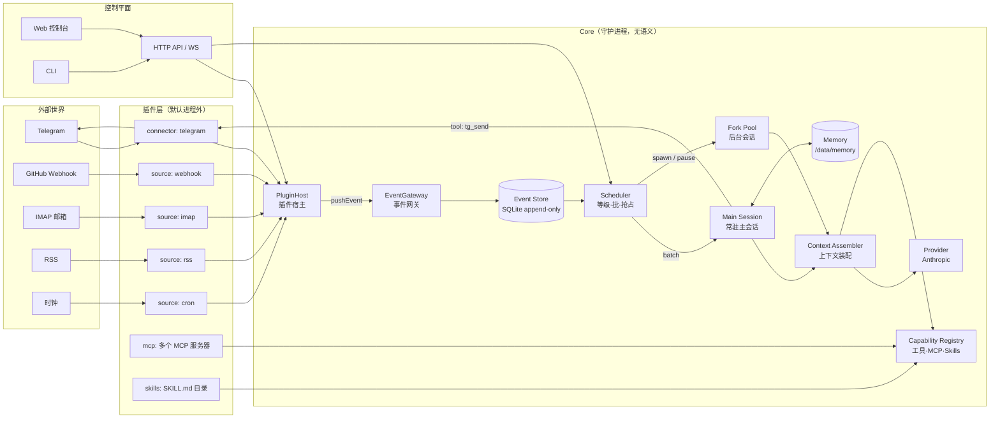
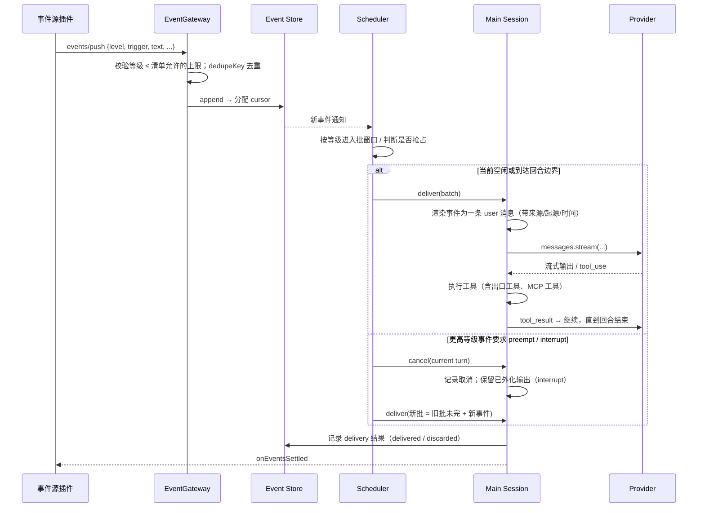

# 总体架构

> 状态：Accepted（M0–M6）· 更新：2026-11-08

## 1. 一张图



## 2. 分层与职责

| 层 | 组件 | 职责 | 不做什么 |
|---|---|---|---|
| **插件层** | 事件源、连接器、工具插件、MCP 服务器、Skills | 把世界变成事件；把助理的动作送回世界；提供能力 | 不访问记忆；不互相调用；不决定优先级以外的调度 |
| **Core** | PluginHost、EventGateway、Event Store、Scheduler、Sessions、Context Assembler、Capability Registry、Provider、Memory FS | 存事件、排调度、跑回合、调模型、管插件生命周期 | 不解释语义；不生成自然语言 |
| **人格层** | Persona 文件（`SOUL.md`、`OPERATING.md`、`USER.md`）、记忆布局、可选钩子 | 决定助理是谁、怎么做事、记什么 | 不接触传输协议与进程管理 |
| **控制平面** | HTTP API、WebSocket、Web 控制台、CLI | 观察、配置、审批、热插拔操作 | 不绕过 Core 直接写存储 |

## 3. 进程模型

单容器内的进程树：

```
tini (PID 1)
└── node apps/daemon (守护进程)
    ├── [worker] 插件 telegram   (node, JSON-RPC/stdio)
    ├── [worker] 插件 imap       (node)
    ├── [worker] 插件 my-source  (python, JSON-RPC/stdio)   ← 任意语言
    ├── [mcp]    uvx mcp-server-fetch        (MCP stdio)
    ├── [mcp]    npx @modelcontextprotocol/server-filesystem
    └── [tool]   bash 工具的子进程（受限用户、超时）
```

- **守护进程**是唯一有状态的进程：它持有 SQLite 连接、会话内存状态、插件表。
- **进程外插件**与 **MCP 服务器**都是子进程，由 PluginHost 统一监督（启动、心跳、重启退避、资源上限）。
- **进程内插件**只有内核自带的少量来源（`console`、`cron`、`internal`），它们经过审计并且没有外部 I/O 风险。
- 守护进程崩溃时，容器重启策略拉起整个树；所有子进程随之重建，状态从 `/data` 恢复。

详见 [07-plugin-system.md](07-plugin-system.md) 与 [16-deployment.md](16-deployment.md)。

## 4. 核心数据流

### 4.1 入站：事件 → 回合



### 4.2 出站：动作 → 世界

助理没有"发消息"的内建能力。每个连接器插件把出站能力声明为工具（如 `tg_send`），Core 只负责把 `tool_use` 分发给声明它的插件。副作用工具受权限策略约束（[14-security-and-permissions.md](14-security-and-permissions.md)）。

### 4.3 能力：工具表的来源

工具表 = 内核工具（`memory_*`、`fork_*`、`skill_load`、`schedule_*`、`approval_*`）∪ 插件工具 ∪ MCP 工具（命名空间 `mcp__<server>__<tool>`）∪ Skills 目录（只贡献"目录条目"，正文按需加载）。工具表变化只在回合边界生效，以保护提示缓存（[06-context-assembly.md](06-context-assembly.md)）。

## 5. 关键不变量

这些不变量是测试套件的骨架（[../40-plan/03-testing-strategy.md](../40-plan/03-testing-strategy.md)）：

1. **I-1 单一主会话**：任意时刻恰有一个接收事件的主会话；它串行处理批。
2. **I-2 事件恰好一次投递或显式终结**：每个持久化事件最终有且仅有一条 `delivered | withdrawn | discarded | expired` 记录。
3. **I-3 回合边界**：上下文只在回合边界变化（新增事件、工具表变化、系统前缀重建）。
4. **I-4 历史只追加**：会话转录从不原地修改；交接 = 重置并写入新文件。
5. **I-5 抢占只能自高向低**：等级数值更大的事件永远不能取消更小等级的回合；同级仅 `interrupt`。
6. **I-6 插件崩溃不传染**：任一插件进程异常退出，Core 与其他插件继续运行；它的未投递事件保留。
7. **I-7 秘密不入上下文**：Provider 请求体中不得出现任何 `secrets/*` 的值（有静态检查与运行时过滤）。
8. **I-8 副作用可审计**：每个策略为 `ask` 或标记 `sideEffect: true` 的工具调用都有审计记录（谁、何时、输入摘要、结果）。

## 6. 技术选型摘要

| 维度 | 选择 | ADR |
|---|---|---|
| 语言 / 运行时 | TypeScript · Node.js 22 · pnpm workspace | [ADR-0001](../20-decisions/ADR-0001-typescript-node-runtime.md) |
| 事实源 | 事件日志（append-only） | [ADR-0002](../20-decisions/ADR-0002-event-log-as-source-of-truth.md) |
| 代理循环 | 自研循环 + Anthropic Messages API；Claude Agent SDK 作为可选 Fork 执行器 | [ADR-0003](../20-decisions/ADR-0003-own-agent-loop-over-agent-sdk.md) |
| 优先级 | 等级 L0–L4 × 投递模式 | [ADR-0004](../20-decisions/ADR-0004-priority-levels-and-delivery-modes.md) |
| 插件隔离 | 进程外 JSON-RPC/stdio 为默认 | [ADR-0005](../20-decisions/ADR-0005-plugin-isolation-out-of-process.md) |
| 存储 | SQLite（WAL）+ 文件目录 | [ADR-0006](../20-decisions/ADR-0006-sqlite-single-store.md) |
| 镜像 | 单镜像含 Node 22 + Python 3.13/uv（full），另有只含 Node 的 slim | [ADR-0007](../20-decisions/ADR-0007-single-image-with-node-and-python.md) |
| 上下文容量 | 只追加历史 + 交接重置 | [ADR-0008](../20-decisions/ADR-0008-append-only-history-and-handoff.md) |

## 7. 子系统索引

| 文档 | 内容 |
|---|---|
| [02-event-model.md](02-event-model.md) | 事件信封、起源、等级、投递模式、生命周期 |
| [03-event-store-and-bus.md](03-event-store-and-bus.md) | 存储、游标、去重、回放、投影 |
| [04-scheduling-and-preemption.md](04-scheduling-and-preemption.md) | 批窗口、抢占矩阵、老化、预算、Fork 调度 |
| [05-sessions-and-agent-loop.md](05-sessions-and-agent-loop.md) | 主会话、Fork、回合状态机、工具循环、交接 |
| [06-context-assembly.md](06-context-assembly.md) | 前缀分段、缓存断点、事件渲染、动态状态块 |
| [07-plugin-system.md](07-plugin-system.md) | 插件种类、清单、生命周期、隔离、热插拔 |
| [08-event-source-plugins.md](08-event-source-plugins.md) | 事件源契约、等级声明、内置来源 |
| [09-mcp-integration.md](09-mcp-integration.md) | MCP 客户端管理、命名空间、工具搜索、热插拔 |
| [10-skills.md](10-skills.md) | SKILL.md、渐进披露、注册表、热加载 |
| [11-memory-and-persona.md](11-memory-and-persona.md) | 人格文件、记忆布局、记忆工具、交接笔记 |
| [12-model-providers.md](12-model-providers.md) | Provider 抽象、Anthropic 细节、模型分配、成本 |
| [13-control-plane.md](13-control-plane.md) | API、WS、控制台、CLI |
| [14-security-and-permissions.md](14-security-and-permissions.md) | 身份、策略、审批、秘密、沙箱、注入防护 |
| [15-observability.md](15-observability.md) | 日志、指标、追踪、运行目录 |
| [16-deployment.md](16-deployment.md) | 镜像、卷、启动顺序、升级、备份 |
