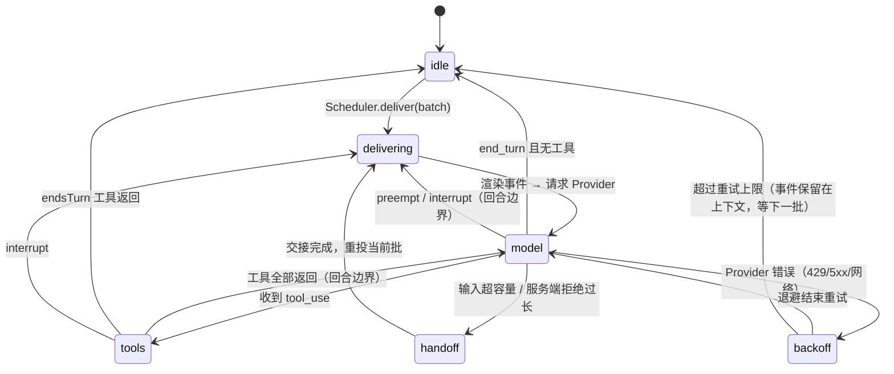

# 会话与代理循环

> 状态：Draft · 更新：2026-11-03 · 决策：[ADR-0003](../20-decisions/ADR-0003-own-agent-loop-over-agent-sdk.md) · [ADR-0008](../20-decisions/ADR-0008-append-only-history-and-handoff.md)

## 1. 会话种类

| 种类 | 数量 | 接收事件 | 持久 | 用途 |
|---|---|---|---|---|
| **主会话** `main` | 恰好 1 | 是 | 是（跨重启） | 助理的"意识流"：感知事件、决定行动、与主人对话 |
| **Fork** `fork` | 0..N（受并发上限） | 否 | 是（可检查点/恢复） | 后台长任务：抓取、整理、写报告、运行 Skill 脚本 |
| **例程** `routine` | 0..N | 否 | 是 | 由定时事件源按计划派生的 Fork（模板化的 Fork） |
| **离线** `replay` | 调试用 | 回放 | 否 | 回放事件、评测 |

主会话 ≈ Cortico 的 resident main session；Fork ≈ Cortico 的 fork。

## 2. 主会话的运行阶段（RunPhase）



阶段变化通过总线广播，插件可订阅 `onRunPhase`（控制台据此画"呼吸灯"）。

## 3. 回合（turn）与批（batch）

- **批**：调度器交付的一组事件。一个批从 `delivering` 开始，到主会话回到 `idle` 或被取消结束。
- **回合**：一次模型调用 + 其引发的全部工具调用。一个批通常包含多个回合。
- **回合上限**：人格声明 `rounds()` → `{ soft, hard }`。达到 soft 时注入 `internal` 事件提示"请收尾"；达到 hard 时结束批（不再调用模型），并记 `internal` 事件。
- **结束回合的方式**：
  1. 模型返回 `end_turn` 且无 `tool_use`；
  2. 调用了标记 `endsTurn` 的工具（如 `idle`、`sleep_until`）；
  3. 被 `interrupt`；
  4. hard 回合上限。

"默认不作为"（P5）在这里体现为：模型可以在看到事件后直接 `end_turn` 而不调用任何出口工具。

## 4. 工具循环

```
runTurn(session):
  req = ContextAssembler.build(session)            // 见 06
  response = Provider.generate(req, { signal })     // 内部总是流式
  for block in stream:
    if text/thinking: session.outputTap?.(block)    // 可选的流式分接（如打字指示）
    if tool_use: collect
    if stop_reason == 'refusal': handleRefusal()    // 见 12 §6
  session.append(assistantMessage)                  // 整条 content 原样追加（含 thinking 块）
  if no tool_use: return 'end_turn'
  results = ToolDispatcher.runAll(toolUses, {       // 并行执行可并行的工具
      policy: PermissionPolicy, signal: session.turnSignal })
  session.append(userMessage(results))              // 所有 tool_result 放在同一条 user 消息
  if any(result.endsTurn): return 'ends_turn'
  return 'continue'                                  // 调用方在回合边界检查 pending 事件
```

要点：

- **并行工具**：同一条 assistant 消息中的多个 `tool_use` 并行执行，所有 `tool_result` 回到**一条** user 消息（否则模型会学会不再并行）。
- **`barrierAfter`**：声明了该标志的工具返回前，不开始后续工具（用于有顺序依赖的出口，如先 `tg_send` 再 `tg_pin`）。
- **`interruptible`**：工具处理器收到 `AbortSignal`；取消后必须返回部分回执 `{ text, partial: true }`。未声明的工具运行到完成（interrupt 会等待它们）。
- **状态检查**：只执行 `status: completed` 的工具调用；流式中途被取消的 `tool_use` 不执行。
- **失败回执**：处理器抛错或返回非法形状 → `{ failed: true, text: <错误摘要> }`，`is_error: true` 回传模型；绝不丢弃。
- **副作用门禁**：`ToolDispatcher` 在执行前查询权限策略；`ask` 则创建审批并把该工具调用挂起（见 §7）。

## 5. Fork

### 5.1 派生

两种来源：

1. 模型在主会话调用内核工具 `fork_spawn({ goal, context?, tools?, model?, level?, stopWhen? })`；
2. 例程事件源按计划派生（`routine.*`）。

Fork 选项：

```ts
interface ForkOptions {
  id: string;
  goal: string;                     // 任务目标（进入 Fork 的首条 user 消息）
  seed?: MessageParam[];            // 从主会话挑选的上下文片段（人格决定）
  tools?: string[];                 // 允许的工具子集（默认：主会话工具表 − 出口工具）
  model?: ModelRole;                // 'fork' | 'cheap' | 'main'，映射到具体模型（见 12）
  level?: Level;                    // 默认继承派生批的等级；只能更低
  stopWhen?: { maxTurns?: number; maxTokens?: number; deadline?: string };
  wrapUpHint?: string;              // 接近上限时注入的收尾提示
  reportTo?: 'main' | 'none';       // 完成后是否向主会话发 internal 事件
}
```

### 5.2 生命周期

`queued → running → paused → running → completed | cancelled | failed`

- Fork 固定其派生时的 Provider 端点与模型（主会话每次请求都读当前配置）。
- 完成/失败时向主会话推送 `internal` 事件 `fork.completed {id, summary}`，summary 由 Fork 自己在最后一回合写出（人格的收尾提示要求它这样做）。
- 保留最近 20 个已结束 Fork 的转录供控制台查看。

### 5.3 检查点与恢复

暂停或取消时写入 `/data/sessions/forks/<id>.checkpoint.json`：`{ messages 游标, 已完成工具集合, 剩余预算, 下一步提示 }`。恢复时从转录文件重建上下文并继续；若转录中有未完成的 `tool_use`，补占位回执 `[result missing (fork paused/restarted)]`。

### 5.4 可选：Claude Agent SDK 作为 Fork 执行器

对"编码/文件系统重活"型任务，可配置 `fork.runner = 'claude-agent-sdk'`：Fork 在子进程中以 Claude Agent SDK 的 `query()` 运行（获得其内建工具、子代理与压缩），Protea 只接收其最终结果与进度事件。这是执行器插件，不是内核依赖（[ADR-0003](../20-decisions/ADR-0003-own-agent-loop-over-agent-sdk.md)）。

## 6. 持久化与启动修复

### 6.1 转录文件

每个会话一个 append-only JSONL：`/data/sessions/main.jsonl`、`/data/sessions/forks/<id>.jsonl`。每行一条记录：

```jsonc
{"t":"msg","role":"user","content":[...],"batch":"b_0192","cursors":[18233,18234],"at":"..."}
{"t":"msg","role":"assistant","content":[{"type":"thinking",...},{"type":"text",...},{"type":"tool_use",...}],"usage":{...},"at":"..."}
{"t":"msg","role":"user","content":[{"type":"tool_result",...}],"at":"..."}
{"t":"mark","kind":"turn_cancelled","reason":"interrupt","by":18240,"at":"..."}
{"t":"mark","kind":"handoff","to":"main.0007.jsonl","at":"..."}
```

### 6.2 启动修复规则（继承 Cortico，并补充）

以换行结尾的行才算**已提交**；已提交的行永不改写（I-4）。所有修复都以追加形式记录，加载时按记录确定性地重放：

1. 最后一行无换行（写到一半被杀）：能解析则补换行；不能解析则截掉这段未提交的尾巴，原文写入本次运行的 `runs/<runId>/transcript.jsonl`（`truncated-tail`）。中间任何一行无法解析 → 加载失败，进程以明确错误退出（不猜）。
2. `tool_result` 找不到对应 `tool_use`（或重复）：追加 `repair` 标记 `{action: 'drop-result', msgIndex, toolUseId}`，加载时剔除；原块写入运行目录（`orphan-result-drop`）。
3. 中间某条 assistant 消息的 `tool_use` 缺结果：追加 `repair` 标记 `{action: 'insert-results', afterMsgIndex, toolUseIds}`，加载时把占位回执 `[result missing (process restart)]`（`is_error: true`）插到下一条 user 消息最前面（没有则合成一条）。
4. 最后一条是含 `tool_use` 的 assistant 消息：直接追加一条带占位回执的 user 消息（`repair: true`）。
5. **思考块原样保留**：Claude 5 系列要求回传 thinking 块且历史只追加；上述修复都不改动既有块。
6. 每个批结束时追加 `batch_ended` 标记 `{reason, rounds, resumable}`。转录以 user 消息结尾且其后没有 `resumable: false` 的标记 → 启动后自动发起 `resume` 批（崩溃或停机中断的批会继续；模型报错、拒答、回合上限结束的批不会被反复重试）。
7. 用转录里记录的事件游标对账 `events` / `deliveries`（[03-event-store-and-bus.md](03-event-store-and-bus.md) §8）。

### 6.3 用量统计

每次模型调用的 usage 写 `usage` 表（持久），内存中的聚合用于预算与控制台。

## 7. 审批挂起

策略为 `ask` 的工具调用：

1. `ToolDispatcher` 创建 `approvals` 记录，向主人渠道发送审批请求（通过人格配置的"审批出口"工具，默认是主人最近使用的连接器）。
2. 该回合**不阻塞**等待：工具立即返回回执 `{ text: "pending approval #a_17", pendingApproval: "a_17" }`，模型可以继续做别的或结束回合。
3. 主人的决定由连接器识别（回复、按钮、命令 `/approve a_17`）并作为 L1 `internal`（经 Core 验证身份后由 Core 发出）事件 `approval.decided` 投递。
4. 模型看到结果后，若同意，**重新调用**该工具；Core 用 `approvals.decision` 放行（一次性、带过期）。

不阻塞的原因：主人可能数小时不回复；主会话不能被一个工具调用挂死。

## 8. 容量与交接（handoff）

- 输入上限 `hardTokens = contextWindow − maxOutputTokens − 安全余量`。
- 触发：请求前估算（`count_tokens`）超过 `hardTokens`，或服务端返回"输入过长"。
- 流程（[11-memory-and-persona.md](11-memory-and-persona.md) §5 描述人格侧）：
  1. Core 切到 `handoff` 阶段，调用人格钩子 `onHandoff(snapshot, { hardTokens })`；默认实现（无自定义钩子时）：用 `cheap` 模型从转录生成交接笔记写入 `memory/handoff/<ts>.md`，保留最近 N 条消息作为尾部。
  2. 重建系统前缀。
  3. 新建转录文件 `main.<seq>.jsonl`，写入 `{ t: 'handoff_from', ... }`，尾部消息原样复制（含 thinking 块）。
  4. 旧文件只追加一条 `handoff` 标记，不删除。
  5. 重投当前批。
- 循环保护：若交接后立刻又超限（前缀过大），不再交接，记 error，并发 L0 `internal` 事件请求主人处理（例如缩减 Skills 目录或 MCP 工具数）。
- 可选优化：开启 Provider 的服务端压缩（Anthropic `compact` beta）作为交接之前的第一道；但交接仍是最终保障，且保证 Provider 无关（[ADR-0008](../20-decisions/ADR-0008-append-only-history-and-handoff.md)）。

## 9. 内核工具（所有会话可用）

M0 已实现的工具标注"✓"；`sleep_until` 与 `schedule_*` 由内置 `cron` 插件提供（它们需要日程后端），其余在 Core 中。

| 工具 | 作用 | 标志 |
|---|---|---|
| ✓ `idle` | 明确结束回合，不做任何事 | endsTurn |
| ✓ `sleep_until {until, note?}` | 结束回合并创建一次性 L3 唤醒事件 | endsTurn |
| ✓ `events_query {source?, type?, states?, since_cursor?, limit?}` | 查询事件存储（含 `store` 模式归档的事件） | 只读、可并行 |
| `events_promote {cursor, trigger}` | 把一个未投递事件升级 | |
| `fork_spawn / fork_status / fork_cancel` | Fork 管理 | |
| `memory_*` | 记忆读写（[11](11-memory-and-persona.md)） | |
| `skill_load {name}` | 加载 Skill 正文与文件清单（[10](10-skills.md)） | 只读、可并行 |
| ✓ `schedule_create / schedule_list / schedule_delete` | 操作 `cron` 事件源 | |
| `approval_request {tool, input, reason}` | 主动发起审批（用于模型预判需要许可的场景） | |
| ✓ `self_status` | 预算、pending 事件、插件状态快照 | 只读 |
