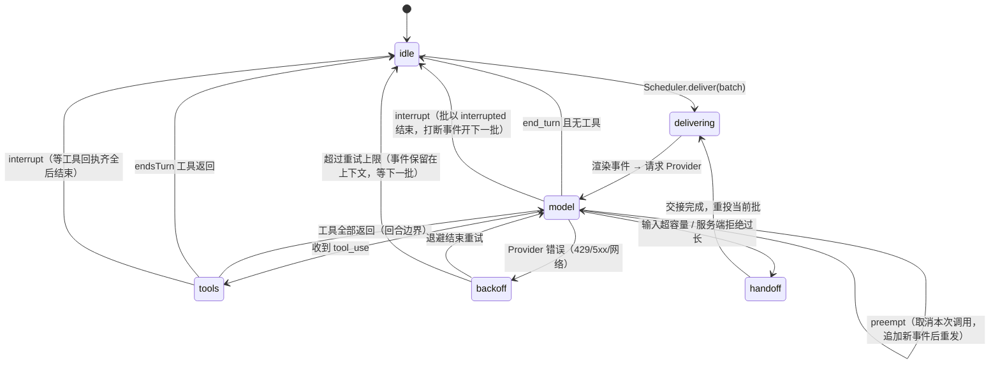

# 会话与代理循环

> 状态：Accepted（M0–M4；未实现的子项在文中标注）· 更新：2026-11-10 · 决策：[ADR-0003](../20-decisions/ADR-0003-own-agent-loop-over-agent-sdk.md) · [ADR-0008](../20-decisions/ADR-0008-append-only-history-and-handoff.md)

## 1. 会话种类

| 种类 | 数量 | 接收事件 | 持久 | 用途 |
|---|---|---|---|---|
| **主会话** `main` | 恰好 1 | 是 | 是（跨重启） | 助理的"意识流"：感知事件、决定行动、与主人对话 |
| **Fork** `fork` | 0..N（受并发上限） | 否 | 是（可检查点/恢复） | 后台长任务：抓取、整理、写报告、运行 Skill 脚本 |
| **例程** `routine` | 0..N | 否 | 是 | 由定时事件源按计划派生的 Fork（模板化的 Fork） |
| **离线** `replay` | 调试用 | 回放 | 否 | 回放事件、评测 |

主会话 ≈ Cortico 的 resident main session；Fork ≈ Cortico 的 fork。

## 2. 主会话的运行阶段（RunPhase）



阶段变化通过总线广播，插件可订阅 `onRunPhase`（控制台据此画"呼吸灯"）。

## 3. 回合（turn）与批（batch）

- **批**：调度器交付的一组事件。一个批从 `delivering` 开始，到主会话回到 `idle` 或被取消结束。
- **回合**：一次模型调用 + 其引发的全部工具调用。一个批通常包含多个回合。
- **回合上限**：人格声明 `rounds()` → `{ soft, hard }`。达到 soft 时注入 `internal` 事件提示"请收尾"；达到 hard 时结束批（不再调用模型），并记 `internal` 事件。
- **结束回合的方式**：
  1. 模型返回 `end_turn` 且无 `tool_use`；
  2. 调用了标记 `endsTurn` 的工具（如 `idle`、`sleep_until`）。这时已经到期的事件**不**并入工具结果，而是留在 pending 里，批结束后立即成为下一批（M6 修正：之前它们会被写进转录却没有模型调用来回答，要等下一个事件才被看到）；
  3. 被 `interrupt`（批以 `interrupted` 结束；打断事件和 `session.turn_cancelled` 通知组成下一批，见 [04-scheduling-and-preemption.md](04-scheduling-and-preemption.md) §4）；
  4. hard 回合上限。

"默认不作为"（P5）在这里体现为：模型可以在看到事件后直接 `end_turn` 而不调用任何出口工具。

## 4. 工具循环

```
runTurn(session):
  req = ContextAssembler.build(session)            // 见 06
  response = Provider.generate(req, { signal })     // 内部总是流式
  for block in stream:
    if text/thinking: session.outputTap?.(block)    // 可选的流式分接（如打字指示）
    if tool_use: collect
    if stop_reason == 'refusal': handleRefusal()    // 见 12 §6
  session.append(assistantMessage)                  // 整条 content 原样追加（含 thinking 块）
  if no tool_use: return 'end_turn'
  results = ToolDispatcher.runAll(toolUses, {       // 并行执行可并行的工具
      policy: PermissionPolicy, signal: session.turnSignal })
  session.append(userMessage(results))              // 所有 tool_result 放在同一条 user 消息
  if any(result.endsTurn): return 'ends_turn'
  return 'continue'                                  // 调用方在回合边界检查 pending 事件
```

要点：

- **并行工具**：同一条 assistant 消息中的多个 `tool_use` 并行执行，所有 `tool_result` 回到**一条** user 消息（否则模型会学会不再并行）。
- **`barrierAfter`**：声明了该标志的工具返回前，不开始后续工具（用于有顺序依赖的出口，如先 `chat_send` 再 `tg_pin`）。
- **`interruptible`**：工具处理器收到 `AbortSignal`；取消后必须返回部分回执 `{ text, partial: true }`（宽限 5 s，超时记为失败回执）。未声明的工具运行到完成（interrupt 会等待它们）；interrupt 之后尚未开始的调用（例如在 `barrierAfter` 之后）回执 `not run: the turn was interrupted`。实现上 `ToolDispatcher.runAll` 区分硬取消 `signal`（停机，全部立即取消）与软取消 `interrupt`。
- **状态检查**：只执行 `status: completed` 的工具调用；流式中途被取消的 `tool_use` 不执行。
- **失败回执**：处理器抛错或返回非法形状 → `{ failed: true, text: <错误摘要> }`，`is_error: true` 回传模型；绝不丢弃。
- **副作用门禁**：`ToolDispatcher` 在执行前查询权限策略；`ask` 则创建审批并把该工具调用挂起（见 §7）。

## 5. Fork

### 5.1 派生

两种来源：

1. 模型在主会话调用内核工具 `fork_spawn({ goal, context?, tools?, model?, level?, max_turns? })`（M1 已实现）；
2. 例程事件源按计划派生（`routine.*`，未实现）。

Fork 选项：

```ts
interface ForkOptions {
  id: string;
  goal: string;                     // 任务目标（进入 Fork 的首条 user 消息）
  seed?: MessageParam[];            // 从主会话挑选的上下文片段（人格决定）
  tools?: string[];                 // 允许的工具子集（默认：主会话工具表 − 出口工具）
  model?: ModelRole;                // 'fork' | 'cheap' | 'main'，映射到具体模型（见 12）
  level?: Level;                    // 默认继承派生批的等级；只能更低
  stopWhen?: { maxTurns?: number; maxTokens?: number; deadline?: string };
  wrapUpHint?: string;              // 接近上限时注入的收尾提示
  reportTo?: 'main' | 'none';       // 完成后是否向主会话发 internal 事件
}
```

M1 实现的子集：`goal`、`context`、`tools`、`model`、`level`、`maxTurns`（工具参数 `max_turns`，上限 `scheduler.forks.maxTurns`，默认 20）、`reportTo`（默认 `main`）。`seed`、`stopWhen.maxTokens|deadline`、`wrapUpHint` 尚未实现；收尾提示是固定文本，在倒数第二回合的工具回执后追加。

- **工具**：默认是工具表中没有 `sideEffect`、没有 `endsTurn`、不是 `fork_*` 的全部工具；显式列出时可以包含有副作用的工具，但 `endsTurn` 工具（`idle`、`sleep_until`）和 `fork_*` 永远不给 Fork。
- **等级**：默认取派生批的等级；只能更低（数值更大），且至少为 L1。
- **上下文**：Fork 的系统前缀是 identity → Fork 运行时说明 → owner（所有 Fork 共用，可缓存）；首条 user 消息是 `<fork id level max_rounds now>` 包裹的目标与上下文；`now` 是派生时刻（守护进程时区），因为 Fork 没有 `<status>` 快照，这是它唯一的时间来源，运行中不更新。Fork 看不到主会话的对话，也不接收事件（I-1）。
- **结果**：最后一条不含工具调用的 assistant 消息是结果，作为 `fork.completed` 事件回到主会话；失败为 `fork.failed`；取消不报告。

### 5.2 生命周期

`queued → running → paused → running → completed | cancelled | failed`

- Fork 固定其派生时的 Provider 端点与模型（主会话每次请求都读当前配置）。
- 完成/失败时向主会话推送 `internal` 事件 `fork.completed {id, summary}`，summary 由 Fork 自己在最后一回合写出（人格的收尾提示要求它这样做）。
- 保留最近 20 个已结束 Fork 的转录供控制台查看（M1：转录文件全部保留，`/api/sessions/forks` 与 `fork_status` 列出最近 10 个已结束的；清理策略随 `scheduler.retention`（M7a）实现）。

### 5.3 检查点与恢复

暂停或取消时写入 `/data/sessions/forks/<id>.checkpoint.json`：`{ messages 游标, 已完成工具集合, 剩余预算, 下一步提示 }`。恢复时从转录文件重建上下文并继续；若转录中有未完成的 `tool_use`，补占位回执 `[result missing (fork paused/restarted)]`。

M1 实现：检查点在每回合和每次状态变化后原子写入（临时文件 + rename），内容是派生参数与进度——`{ id, goal, context?, tools, model, level, maxTurns, parentBatch?, reportTo, state, rounds, createdAt, updatedAt, endedAt?, pauseReason?, summary?, error? }`；消息本身只在转录里（转录即游标）。`sessions` 表登记每个 Fork（`kind='fork'`、状态、等级、父批、文件路径、结束摘要）。启动时所有 `queued` / `running` / `paused` 的 Fork 重新排队；转录若以最终 assistant 消息结尾，直接记为完成。

### 5.4 可选：Claude Agent SDK 作为 Fork 执行器

对"编码/文件系统重活"型任务，可配置 `fork.runner = 'claude-agent-sdk'`：Fork 在子进程中以 Claude Agent SDK 的 `query()` 运行（获得其内建工具、子代理与压缩），Protea 只接收其最终结果与进度事件。这是执行器插件，不是内核依赖（[ADR-0003](../20-decisions/ADR-0003-own-agent-loop-over-agent-sdk.md)）。

## 6. 持久化与启动修复

### 6.1 转录文件

每个会话一个 append-only JSONL：`/data/sessions/main.jsonl`、`/data/sessions/forks/<id>.jsonl`。每行一条记录：

```jsonc
{"t":"msg","role":"user","content":[...],"batch":"b_0192","cursors":[18233,18234],"at":"..."}
{"t":"msg","role":"assistant","content":[{"type":"thinking",...},{"type":"text",...},{"type":"tool_use",...}],"usage":{...},"at":"..."}
{"t":"msg","role":"user","content":[{"type":"tool_result",...}],"at":"..."}
{"t":"mark","kind":"turn_cancelled","batch":"b_0192","reason":"interrupt","by":18240,"during":"tools","at":"..."}
{"t":"mark","kind":"model_call_cancelled","batch":"b_0193","reason":"preempt","by":18251,"at":"..."}
{"t":"mark","kind":"handoff","to":"main.0007.jsonl","at":"..."}
```

### 6.2 启动修复规则（继承 Cortico，并补充）

以换行结尾的行才算**已提交**；已提交的行永不改写（I-4）。所有修复都以追加形式记录，加载时按记录确定性地重放：

1. 最后一行无换行（写到一半被杀）：能解析则补换行；不能解析则截掉这段未提交的尾巴，原文写入本次运行的 `runs/<runId>/transcript.jsonl`（`truncated-tail`）。中间任何一行无法解析 → 加载失败，进程以明确错误退出（不猜）。
2. `tool_result` 找不到对应 `tool_use`（或重复）：追加 `repair` 标记 `{action: 'drop-result', msgIndex, toolUseId}`，加载时剔除；原块写入运行目录（`orphan-result-drop`）。
3. 中间某条 assistant 消息的 `tool_use` 缺结果：追加 `repair` 标记 `{action: 'insert-results', afterMsgIndex, toolUseIds}`，加载时把占位回执 `[result missing (process restart)]`（`is_error: true`）插到下一条 user 消息最前面（没有则合成一条）。
4. 最后一条是含 `tool_use` 的 assistant 消息：直接追加一条带占位回执的 user 消息（`repair: true`）。
5. **思考块原样保留**：Claude 5 系列要求回传 thinking 块且历史只追加；上述修复都不改动既有块。
6. 每个批结束时追加 `batch_ended` 标记 `{reason, rounds, resumable}`。转录以 user 消息结尾且其后没有 `resumable: false` 的标记 → 启动后自动发起 `resume` 批（崩溃或停机中断的批会继续；模型报错、拒答、回合上限结束的批不会被反复重试）。
7. 用转录里记录的事件游标对账 `events` / `deliveries`（[03-event-store-and-bus.md](03-event-store-and-bus.md) §8）。

### 6.3 用量统计

每次模型调用的 usage 写 `usage` 表（持久），内存中的聚合用于预算与控制台。

## 7. 审批挂起

策略为 `ask` 的工具调用：

1. `ToolDispatcher` 创建 `approvals` 记录，向主人渠道发送审批请求（通过人格配置的"审批出口"工具，默认是主人最近使用的连接器）。
2. 该回合**不阻塞**等待：工具立即返回回执 `{ text: "pending approval #a_17", pendingApproval: "a_17" }`，模型可以继续做别的或结束回合。
3. 主人的决定由连接器识别（回复、按钮、命令 `/approve a_17`）并作为 L1 `internal`（经 Core 验证身份后由 Core 发出）事件 `approval.decided` 投递。
4. 模型看到结果后，若同意，**重新调用**该工具；Core 用 `approvals.decision` 放行（一次性、带过期）。

不阻塞的原因：主人可能数小时不回复；主会话不能被一个工具调用挂死。

权限模式（[ADR-0015](../20-decisions/ADR-0015-permission-modes-and-auto-review.md)）决定第 1 步是否发生：`auto` 下判断模型放行的调用直接执行，没放行的走上面的流程并在审批里附上理由；`bypass` 直接执行；`locked` 不执行也不询问。

M2 实现：步骤 1 的"审批出口"是所有声明了 `approvals` 能力的运行中渠道；第 2 步的回执是 `pending approval a12: …`（不是错误回执）；第 3 步的事件类型为 `approval.decided`，由 Core 在核实主人身份后发出；细节见 [14-security-and-permissions.md](14-security-and-permissions.md) §3。

## 8. 容量与交接（handoff）

- **闲时压缩（常态，2026-11-10）**：主会话空闲时，维护模块每 60 秒检查一次。全部满足才压缩：没有 L0–L2 待投递、未暂停、没有待续跑的批、L4 预算未耗尽、距上次尝试至少 10 分钟（失败也计入）、可丢弃的内容至少 16k token（防止只是轮换转录）。然后满足其一：对话（不含前缀）≥ 32k 且空闲时间达到 Provider 的缓存寿命（Anthropic 取 `cacheTtl`，其他默认 30 分钟），此时下一次请求本来就会未命中缓存，压缩只多花一次笔记请求；或对话 ≥ 48k 且空闲 ≥ 15 分钟。压缩期间到达 L0/L1 事件会立即放弃；笔记返回之前不写任何文件，所以放弃后对话原样不变。笔记模型失败、拒答、返回空文本或被 `max_tokens` 截断时也放弃本次。默认值见 `context.idleCompaction`。
- 阈值（`context.handoff`，M4）：`hardTokens` 默认 `contextWindow − maxOutputTokens − max(8000, 5 % 窗口)`（Opus 5.5 为 886 000）；`softTokens` 默认 80 000（不超过 hardTokens）。
- 估算：上一次模型响应的 usage（输入 + 缓存读写 + 输出）加上之后追加的消息的本地估算（按文字类别估 token，图片与文档按固定值）；估算到达阈值的 90 % 时改用 Provider 的 `count_tokens` 求精确值。新转录还没有 usage 时整份请求本地估算。
- 触发：批开始时（第一次模型请求前）超过 `softTokens`；任何模型请求前超过 `hardTokens`；Provider 返回"输入过长"（Anthropic：400 `prompt is too long` 或 413），此时交接一次后重试。`POST /api/sessions/main/handoff` 请求交接：空闲时立即执行，否则等下一批开始时执行。
- 流程（[11-memory-and-persona.md](11-memory-and-persona.md) §5 描述笔记与尾部）：
  1. Core 切到 `handoff` 阶段；有 `onHandoff` 钩子时由它决定尾部与笔记，否则用默认策略（`cheap` 模型写 `memory/handoff/<ts>.md`）；被丢弃的对话另存到 `memory/raw/<ts>.md`。
  2. 新建转录文件 `main.<seq>.jsonl`：`session_start`、`handoff_from {file, notes, reason, dropped, kept}` 标记，第一条 user 消息是 `session.handoff` 事件加白板与笔记（[11-memory-and-persona.md](11-memory-and-persona.md) §5），然后是尾部消息（**去掉 thinking 块**和旧的白板块，保留原 `batch` 与 `cursors`）。没有批在运行时（闲时或空闲时手动触发），在切换指针之前写入不可续跑的 `batch_ended` 标记，否则崩溃后会被当成中断的批。同名文件已存在（上次交接在切换指针前崩溃）时先改名为 `.abandoned-<ms>`。
  3. 旧文件只追加一条 `handoff {to, notes, reason}` 标记，不删除。
  4. 原子替换 `main.current`，更新 `sessions` 表，发 `session.handoff` 总线事件（SSE 主题 `handoff`）。
  5. 系统前缀在下一次请求时按最新的 `INDEX.md` 重建，当前批在新转录里继续（不是从头重投：正在运行的批完整保留在尾部）。
- 循环保护：交接后估算仍超过 `hardTokens`（前缀本身或正在运行的批太大）时，记 error，发一条 L0 `flush` 事件 `context.overflow` 请主人处理（缩减 Skills 目录、MCP 工具或 `INDEX.md`），批以 `context_overflow` 结束；此后在下一次成功的模型调用之前不再尝试交接、也不再发事件，批次直接以 `context_overflow` 结束。

### 8.1 前缀变化与 thinking 块（保留思考）

Claude 5 系列的 thinking 块绑定产生它的对话前缀（system、工具集合、它之前的全部消息），并且逐块成链：前缀被改过之后再回传旧块，新账户（2026-08-31 起创建）会收到 400，老账户也只是暂不执行。Protea 的转录只追加，所以消息部分天然不变；会变的是 system 与工具集合：人格、插件、MCP、Skills、记忆索引、需要脱敏的秘密集合。处理方式：

- 每次模型请求前计算前缀指纹（system 文本 + 已加载工具的定义，按名排序；延迟加载的工具不计，追加它们不算编辑；再加上秘密集合的指纹）。指纹变了而转录里还有未截止的 thinking 块时，追加 `{"t":"mark","kind":"prefix","hash":…,"floor":<记录数>}`：此后序号小于 `floor` 的消息发送时去掉 thinking 块（去掉对话"开头一段"的块不影响之后的块；只剩 thinking 的消息整条不发）。加载转录时按最大的 `floor` 重放，所以重启后请求字节不变。
- 交接复制尾部时同样去掉 thinking 块。
- Anthropic 请求带 `thinking.block_binding.prefix_mismatch_behavior`（Claude 档案的 `anthropic.thinkingMismatch`，默认 `drop_block`，beta `thinking-binding-controls-2026-08-01`）作为兜底：万一仍有不匹配，API 丢弃这些块而不是拒绝请求；响应里的 `input_transformations` 记在 `ProviderResponse` 上。
- Fork 使用同样的截止标记（Fork 不做交接）。
- 可选优化：开启 Provider 的服务端压缩（Anthropic `compact` beta）作为交接之前的第一道；但交接仍是最终保障，且保证 Provider 无关（[ADR-0008](../20-decisions/ADR-0008-append-only-history-and-handoff.md)）。

## 9. 内核工具（所有会话可用）

已实现的工具标注"✓"（M0–M1）；`sleep_until` 与 `schedule_*` 由内置 `cron` 插件提供（它们需要日程后端），其余在 Core 中。

| 工具 | 作用 | 标志 |
|---|---|---|
| ✓ `idle` | 明确结束回合，不做任何事 | endsTurn |
| ✓ `sleep_until {until, note?}` | 结束回合并创建一次性 L3 唤醒事件 | endsTurn |
| ✓ `events_query {source?, type?, states?, since_cursor?, limit?}` | 查询事件存储（含 `store` 模式归档的事件） | 只读、可并行 |
| ✓ `events_promote {cursor, trigger}` | 把未投递事件（pending 或 `store` 归档的）改为 `flush` 或 `piggyback`；等级不变 | |
| ✓ `fork_spawn / fork_status / fork_cancel` | Fork 管理（§5） | `fork_status` 只读 |
| `memory_*` | 记忆读写（[11](11-memory-and-persona.md)） | |
| `skill_load {name}` | 加载 Skill 正文与文件清单（[10](10-skills.md)） | 只读、可并行 |
| ✓ `schedule_create / schedule_list / schedule_delete` | 操作 `cron` 事件源 | |
| ✓ `approval_request {tool, input, reason}` | 主动发起审批（用于模型预判需要许可的场景） | |
| ✓ `self_status` | 预算、pending 事件、插件状态快照 | 只读 |
| ✓ `view_image` | 看工作区里的图片文件或一个已存的图片句柄 | 只读 |
