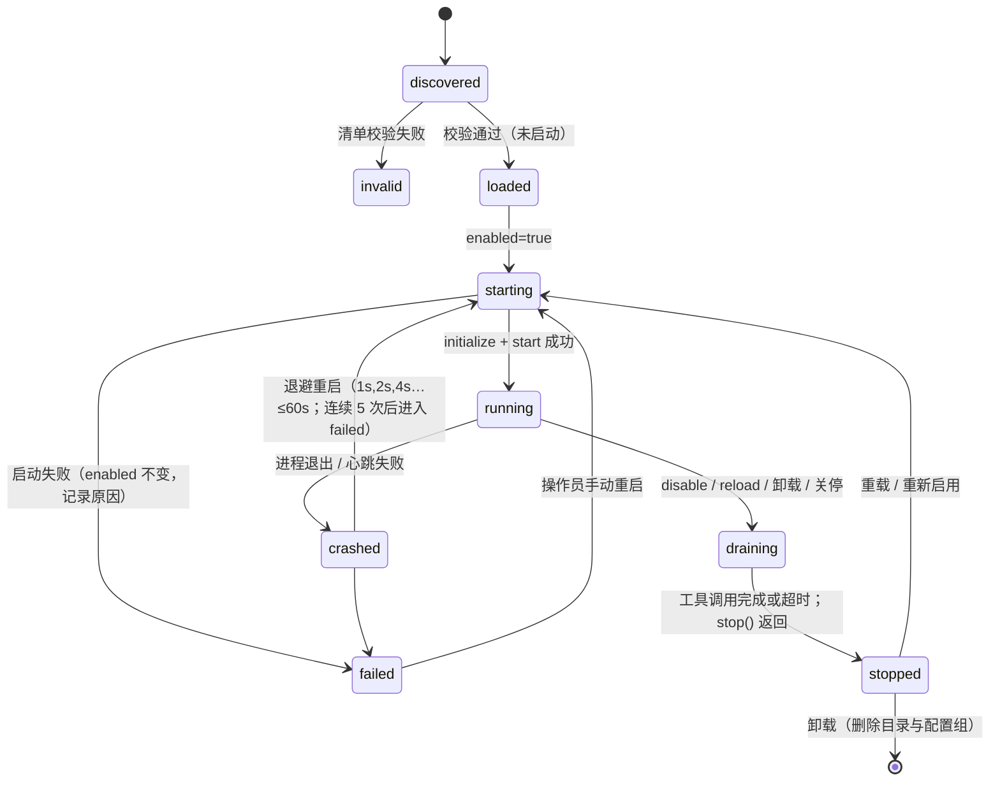

# 插件系统

> 状态：Accepted（M2）· 更新：2026-11-03 · 决策：[ADR-0005](../20-decisions/ADR-0005-plugin-isolation-out-of-process.md) · 规范：[../30-specs/02-plugin-manifest.md](../30-specs/02-plugin-manifest.md) · [../30-specs/03-plugin-protocol.md](../30-specs/03-plugin-protocol.md)

> **实现状态（M2）**：`source` / `connector` / `tool` 三类进程外插件已实现（`packages/core/src/plugins/`：`manifest.ts` 清单与发现，`process.ts` 子进程与协议，`host.ts` 生命周期与监督，事件网关在 `events/gateway.ts`，`conformance.ts` 一致性检查）；MCP 服务器由 MCP 管理器运行（M3，[09-mcp-integration.md](09-mcp-integration.md)；服务器在 `mcp.servers` 里声明，`kind: mcp` 清单在 M5），Skills 由 Skills 注册表管理（M3，[10-skills.md](10-skills.md)），`provider` 插件在 M7。进程内插件只有 `console` 与 `cron`，由守护进程在代码里注册。

## 1. 插件种类

| kind | 提供什么 | 示例 | 运行方式 |
|---|---|---|---|
| `source` | 事件（入站） | `cron`、`webhook`、`imap`、`rss`、`filewatch` | 进程外（默认）/ 进程内（内核自带） |
| `connector` | 事件 + 出口工具（入站 + 出站） | `telegram`、`slack`、`discord`、`console` | 进程外 |
| `tool` | 工具（可推少量事件，如后台任务结束） | `shell`（内置，M6）、`http`、`calendar` | 进程外 |
| `mcp` | 一个 MCP 服务器的声明（Core 作为 MCP 客户端） | `mcp-server-fetch`、`filesystem` | MCP stdio / HTTP |
| `skill` | 一个 Skill 目录 | `pdf`、`weekly-report` | 不运行；按需读取 |
| `provider` | 模型提供方 | `anthropic`（内核自带）、`openai-compat` | 进程内（需审计） |

`mcp` 与 `skill` 在生命周期上是插件（可热插拔、有清单、有状态），但没有自己的进程协议：前者走 MCP，后者只是文件。详见 [09-mcp-integration.md](09-mcp-integration.md)、[10-skills.md](10-skills.md)。

## 2. 目录与发现

```
/data/plugins/
├── telegram/               ← 一个插件一个目录
│   ├── protea.plugin.json  ← 清单（必需）
│   ├── ENV_PROMPT.md       ← 环境提示模板（可选）
│   ├── package.json / pyproject.toml
│   └── dist/ 或 src/
├── my-python-source/
│   ├── protea.plugin.json
│   └── main.py
└── skills/                 ← Skills 另有目录，见 10
```

发现方式：

1. **内置**：镜像内 `/app/plugins/*`（随版本发布；开发时是仓库的 `plugins/`，可用 `PROTEA_ASSETS_DIR` 指定）。只扫描含 `protea.plugin.json` 的目录，因此进程内的 `console`、`cron` 目录不在其中。
2. **数据卷**：`/data/plugins/*`，用 `fs.watch`（递归）监视，500 ms 去抖后重新扫描：新增目录 → `loaded`（配置里启用了就启动）；清单内容变化 → 重载；目录删除 → 停止并移除。以 `.` 开头的目录被跳过。
3. **安装**：`POST /api/plugins {path}` / `protea plugins install <dir>`（M2 只支持本地目录；Git URL 与 tarball 在 M5）。先复制到 `/data/plugins/.install-…` 再原子改名，监视器不会看到半个插件。默认安装后即启用。

同 ID 冲突：数据卷优先于内置（允许覆盖内置实现）；卸载数据卷版本后内置版本重新出现。数据卷插件必须**自包含**：打包成单文件，或自带 `node_modules`。内置插件用 `scripts/bundle-plugin.mjs`（esbuild）打包为 `dist/main.js`。

**开发模式**（`PROTEA_DEV=1`，或守护进程本身从 TypeScript 源码运行）：内置插件改用清单的 `runtime.dev`（如 `src/main.ts`），`node` 插件经 tsx 加载器并以 `--conditions=source` 解析工作区包的源码，无需先构建。数据卷插件始终按原样运行。

## 3. 清单（protea.plugin.json）

```jsonc
{
  "id": "telegram",
  "kind": "connector",
  "api": 1,                          // 契约版本；不匹配拒绝加载
  "version": "0.3.1",
  "displayName": "Telegram",
  "runtime": { "exec": "node", "args": ["dist/main.js"] },   // 进程外；"inproc": true 仅内置允许
  "level": 1,                        // 可声明的最高等级（source/connector 必填）
  "triggers": ["debounce", "flush", "preempt", "interrupt"],  // 允许申请的投递模式
  "tools": ["tg_send", "tg_react", "tg_edit"],               // 声明的工具名（用于冲突检查与审计）
  "sideEffectTools": ["tg_send", "tg_edit"],                 // 默认策略 ask/allow 的参考
  "secrets": ["TELEGRAM_BOT_TOKEN"], // 需要的秘密名；由宿主注入，不进上下文
  "configSchema": "./config.schema.json",                    // JSON Schema，含 x-hot 标记
  "envPrompt": "./ENV_PROMPT.md",
  "healthcheck": { "intervalMs": 30000, "timeoutMs": 5000 },
  "resources": { "maxMemoryMb": 256, "maxCpu": 0.5 }
}
```

校验规则：`id` 为 `[a-z0-9-]+`；`tools` 内名称必须以 `<id短前缀>_` 开头且全局唯一；`level` 不得为 0；`inproc` 只对内置插件生效。

## 4. 生命周期



- **enabled 语义**：`plugins.<id>.enabled` 是操作员意图；启动失败不改它（Cortico 规则），控制台显示原因。没有出现在配置里的插件（内置的 `telegram`、`webhook`、`filewatch` 也一样）默认关闭。通过 API/CLI 启用、禁用、卸载时，宿主同时更新内存中的配置并写回 `config.yaml`。
- **启动失败**：清单无效 → `invalid`；配置不符合 `configSchema`、声明的秘密不存在、`initialize` 超时（20 s）、工具名冲突 → `failed`（附原因）。
- **崩溃**：进程意外退出，或连续 3 次心跳超时（宿主随即 SIGKILL）→ `crashed`，工具立即下线，按 `pluginHost.restartBackoffMs` 退避重启；监督中的重启再次启动失败也算一次崩溃。运行满 `stableAfterMs`（默认 60 s）后崩溃计数清零；连续 `maxCrashes`（默认 5）次 → `failed`。崩溃记 L4 store 的 `plugin.crashed`，进入 `failed` 记 L2 flush 的 `plugin.failed`（主会话会知道）。操作员 `restart` 清零计数后重新启动。
- **draining**：工具立即从工具表移除（之后的调用回执 `tool <name> is not available (plugin <id> is disabled)`）；已在执行的工具最多等 `drainTimeoutMs`（默认 30 s）；然后发 `stop`，`stopTimeoutMs`（默认 5 s）内不退出则 SIGTERM，再 5 s 后 SIGKILL。事件源应停止拉取；Core 保留其未投递事件。
- **crashed 时的事件**：已持久化的事件不受影响；插件不在运行期间结算的事件，重启后通过 `events/settled` 补发（内存队列，最多 1000 条）。
- 同一插件的生命周期操作串行执行（启用、重载、配置变更、崩溃处理不会交错）。
- 生命周期变化广播 `plugin.*` 事件；人格可订阅（例如在主会话注入"Telegram 已离线"的 `internal` 事件——由 Core 发出，内容只陈述状态）。

## 5. 隔离

| 维度 | 进程外插件 | MCP 服务器 | 进程内插件（内置） |
|---|---|---|---|
| 进程 | 独立子进程 | 独立子进程 / 远程 | 守护进程内 |
| 通信 | JSON-RPC 2.0 over stdio（NDJSON） | MCP | 直接调用 |
| 文件系统 | `/data/plugins/<id>/`（只读）+ `/data/plugin-data/<id>/`（读写） | 按其配置 | 全部 |
| 秘密 | 启动时通过环境变量注入声明的秘密 | 同 | 直接读取 |
| 记忆 | **不可访问** | 不可访问 | 不可访问（Core 代为读写） |
| 资源 | cgroup 不可用时用 `ulimit` + 进程监控；超限重启 | 同 | — |
| 用户 | 容器内非 root 用户 `protea`；可选更低权限用户 `plugin` | 同 | — |

插件之间**不能**直接通信；需要协作时通过事件（A 推事件 → 模型 → 调 B 的工具）。这是刻意的：避免插件间隐式耦合（Cortico 的 World 隔离原则）。

## 6. 宿主 API（PluginHost）

插件通过协议得到的能力（完整方法表见规范）：

| 方向 | 方法 | 说明 |
|---|---|---|
| 宿主→插件 | `initialize(ctx)` | 配置、数据目录、时区、宿主能力版本、`modelFacts` |
| | `start()` / `stop()` | 生命周期 |
| | `config/changed(patch)` | 热配置；插件应当在使用时读取 |
| | `tools/list` / `tools/call(name, input, {signal, callId})` | 工具 |
| | `env/prompt` | 返回环境提示变量（`null` 表示省略本插件的分段） |
| | `events/settled(events, outcome)` | 投递结果回调 |
| | `run/phase(phase)` | 主循环阶段（可选订阅） |
| | `health` | 心跳 |
| | `shutdown/verify(language)` | 关停前只读快照 |
| 插件→宿主 | `events/push(envelope, {trigger})` → cursor | 推事件 |
| | `events/pushDeferred` / `events/pushCandidate` | 延迟/候选 |
| | `events/withdraw(cursor)` / `events/promote(cursor, trigger)` | 撤回/升级 |
| | `blob/put(bytes)` → handle · `blob/get(handle)` | 图片（工具回执的 `images`、事件的 `blobs` 用句柄引用） |
| | `log(level, msg, fields)` | 结构化日志（带插件 ID 与关联 ID） |
| | `usage/report(...)` | 外部 API 用量 |
| | `kv/get` / `kv/set`（命名空间 = 插件 ID） | 小状态 |
| | `owner/resolve(senderKey)` → `'owner' \| 'unknown'` | 身份查询（不暴露映射表） |

## 7. 热插拔操作

控制台/CLI/API 的操作及其语义：

| 操作 | 语义 | 需要重启进程？ |
|---|---|---|
| 安装 | 复制到 `/data/plugins/<id>`，校验清单，`loaded`；默认随即启用 | 否 |
| 启用 | `enabled=true` → `starting` | 否 |
| 禁用 | `draining → stopped`；未投递事件保留 | 否 |
| 重载 | `draining → stopped → starting`（重新读取代码与清单） | 否 |
| 重启 | 从 `failed` / `crashed` 清零崩溃计数后启动 | 否 |
| 配置变更 | 先按 `configSchema` 校验（失败则拒绝、保持原配置）；热项：`config/changed {patch, full}` 并刷新环境提示变量；非热项（`x-hot:false`）：自动重载该插件；进程内插件一律重载 | 否 |
| 卸载 | 必须先禁用；删除目录、配置组、`plugin-data`（`keepData` 可保留） | 否 |
| 升级内核 | 换镜像 | 是（整个容器） |

对应接口：`POST /api/plugins`、`POST /api/plugins/:id/enable|disable|reload|restart`、`PATCH /api/plugins/:id/config`、`DELETE /api/plugins/:id`；CLI `protea plugins install|enable|disable|reload|restart|config|uninstall`。

**秘密与环境**：子进程只拿到最小环境（`PATH`、`HOME`、`LANG`、`TZ`、`PROTEA_PLUGIN_ID`、`PROTEA_PLUGIN_DATA_DIR`、清单 `runtime.env`）加上清单声明的秘密；守护进程自己的环境（例如供应商密钥 `PROVIDER_<ID>_API_KEY`）不会传给插件。插件配置里的 `${secret:NAME}` 只在发给插件的那一刻解析。

**工具表与环境提示的变化**在下一个回合边界生效（[06-context-assembly.md](06-context-assembly.md) §4）。禁用一个插件时，它的工具从表中移除；若模型随后仍调用了旧工具名，回执为 `failed: tool not available (plugin disabled)`。

## 8. 插件 SDK

`@protea/plugin-sdk`（TypeScript，`packages/plugin-sdk`）提供：类型定义、JSON-RPC stdio 传输（与 Core 共用 `@protea/protocol` 的 `RpcPeer`）、`definePlugin()` / `runPlugin()`，以及测试用的 `@protea/plugin-sdk/testing` 中的 `FakeHost`（内存中的宿主，记录事件并像门禁一样标出越权）。Python 版 `protea_plugin`（`sdks/python`，Python 3.9+，无第三方依赖）提供同样的协议实现：`Plugin` 基类、`Tool`、`run()`；处理器在线程池里运行，可以同步调用宿主。宿主把这个 SDK 放进 Python 插件的 `PYTHONPATH`。

开发工具：
- `protea dev-plugin <dir>`：起一个最小宿主，打印插件推送的事件与日志，交互式执行 `tools`、`call <tool> <json>`、`config <json>`、`settle`、`env`、`health`。
- `protea dev-plugin <dir> --check`：运行 14 项协议一致性检查（握手、工具声明、健康检查、错误码、事件合法性、取消、stdout 只含协议、自行退出等）；插件目录里可选的 `protea.conformance.json` 提供要试调的工具与期望输出。
- 示例：`examples/plugins/py-notes`（Python）与 `examples/plugins/ts-notes`（TypeScript），行为相同。

任何语言只要实现协议即可（[../30-specs/03-plugin-protocol.md](../30-specs/03-plugin-protocol.md)）。

## 9. 与 Cortico World 的兼容

字段与钩子命名尽量对齐（`envPromptVars`、`tools`、`start/stop`、`onEventsSettled`、`onRunPhase`、`shutdownVerification`、`pushEvent/pushDeferred/pushCandidate/withdrawPending/promotePending`）。一个"Cortico World 适配器"插件理论上可以把 World 定义包装为 Protea 进程外插件；不在 v1 范围。
