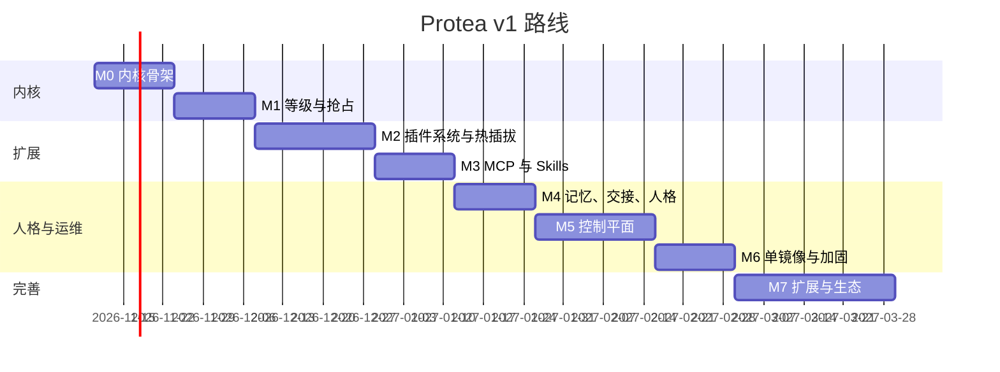

# 路线图

> 状态：Draft · 更新：2026-11-03

每个里程碑有**可演示的验收标准**；没有通过验收不进入下一个。估时按一人全职、不含控制台美化。

## 总览



## M0 · 内核骨架（2 周）· 状态：已实现（2026-11-03）

**目标**：事件进、模型出，重启不丢。

- [x] Event Store（SQLite、游标、去重、状态、投递记录）与门禁（schema 校验、等级上限、L1 仅限主人、模式降级）。
- [x] 进程内来源：`console`（连接器，`con_send`）、`cron`（配置日程 + 助理自建日程）、Core 的 `internal` 事件。
- [x] 主会话：回合状态机、流式、并行工具与 `barrierAfter`、回合边界投递、软/硬回合上限、退避重试、拒答与 `max_tokens` 处理。
- [x] 内核工具 `idle` / `events_query` / `self_status`；cron 提供 `sleep_until` / `schedule_create|list|delete`。
- [x] Anthropic Provider：流式、自适应思考、effort 按批等级、system 末尾显式断点 + 顶层自动缓存（TTL 1h）、服务端拒答回退、错误分类、用量与成本记录。
- [x] 转录 append-only + 以标记追加的确定性启动修复；与事件库的投递对账；中断批次自动恢复。
- [x] 控制 API 最小集（health/ready、status、events、transcript、SSE 流）与 CLI：`serve`、`status`、`events push|tail|ls`。

**验收**：
- [x] `protea events push "你好"` 后终端收到回复；`kill -9` 守护进程并重启，未完成的批次被恢复、事件只投递一次，转录无需修复（`apps/daemon/test/crash.e2e.test.ts`，真实子进程 + SIGKILL，使用离线 echo Provider）。
- [ ] 连续 100 次推送，`usage.cache_read_input_tokens` 命中率 ≥ 80%。**尚未在真实 API 上验证**（开发环境没有 API key）。离线代理指标已通过：100 次推送中每个请求的 system/tools 字节不变、消息序列是上一请求的严格前缀，按字节计的前缀复用率 > 80%（`packages/core/test/invariants.test.ts`）。拿到 key 后用下文脚本复核。
- [x] 不变量 I-1、I-2、I-4 的测试通过（I-1/I-2 为属性测试：随机事件序列、随机时刻中止、重启后检查；I-4 覆盖追加、修复与截断尾行）。

**M0 与原设计的差异**（已同步进各文档）：
- `preempt` / `interrupt` 暂按 `flush` 处理，抢占矩阵属于 M1。
- 实时流先用 SSE（`/api/stream`），WebSocket 留到 M5。
- `delivered` 定义为"已写入转录"，并以转录为准做启动对账，不再维护高水位游标。
- `daemon.started` 是 L4 piggyback、`daemon.stopping` 是 L4 store：启动和停机都不单独唤醒模型。
- 管理员令牌只写入秘密文件，不打印到日志。

**真实 API 验收步骤**（需要 `ANTHROPIC_API_KEY`，约 200 次 Opus 5.5 调用，预计花费数美元）：

先在一个终端启动守护进程：

```bash
ANTHROPIC_API_KEY=sk-ant-... pnpm dev
```

再在另一个终端连续推送 100 条并查看状态（`usage 24h` 一行给出缓存命中率）：

```bash
for i in $(seq 1 100); do PROTEA_DATA_DIR=.dev-data pnpm -s protea events push "第 $i 条：请只回复收到"; done
```

```bash
PROTEA_DATA_DIR=.dev-data pnpm -s protea status
```

## M1 · 等级与抢占（2 周）

**目标**：主人的声音永远优先。

- 调度器：批窗口、抢占矩阵、老化、抢占风暴防护、预算池（先只统计不限制）。
- `preempt` / `interrupt` 实现：取消流式请求、`interruptible` 工具信号、部分回执、`turn_cancelled` 标记与 `internal` 事件。
- Fork：派生、独立循环、暂停/恢复/检查点、容量让渡。
- 身份映射与 L1 门禁。

**验收**：
- [ ] 场景"晨报被主人打断"（[04-scheduling-and-preemption.md](../10-architecture/04-scheduling-and-preemption.md) §10）端到端测试：L1 事件在 ≤ 1 s 内（不含模型延迟）进入上下文。
- [ ] L4 来源申请 `interrupt` 被降级并记录；L3 事件等待超过 maxWait 后被提升。
- [ ] Fork 在主会话 L1 回合期间被暂停、之后恢复并完成，转录可读。
- [ ] 不变量 I-3、I-5 测试通过。

## M2 · 插件系统与热插拔（3 周）

**目标**：不重启换零件。

- 清单校验、发现（内置 + 数据卷 + 文件监视）、生命周期状态机、子进程监督、协议实现（TS SDK + Python SDK）。
- 热操作：安装/启用/禁用/重载/卸载；配置热更新与 `x-hot`。
- 内置插件：`telegram`（连接器）、`webhook`、`filewatch`。
- 权限策略引擎 + 审批流（经 Telegram）。
- `protea dev-plugin`。

**验收**：
- [ ] 运行中安装 Telegram 插件 → 主人发消息得到回复；禁用插件 → 其工具消失；重载代码 → 新版本生效；全程主会话不重启。
- [ ] 插件进程被 `kill -9` 后自动重启，期间入库事件不丢；连续崩溃 5 次进入 `failed` 并在控制台/日志可见。
- [ ] `ask` 策略的工具调用 → Telegram 收到审批请求 → `/approve` 后执行；24 h 过期。
- [ ] Python 示例插件通过协议一致性测试。
- [ ] 不变量 I-6、I-8 测试通过。

## M3 · MCP 与 Skills（2 周）

**目标**：接入现成能力。

- MCP 客户端管理器：stdio + Streamable HTTP、健康、重启、工具命名空间、资源/提示词映射、`list_changed` 在回合边界应用、OAuth（基础）。
- 工具搜索与 `defer_loading` 策略。
- Skills 注册表：扫描、校验、目录段、`skill_load`、热加载、内置 3 个 Skills。
- 内置来源：`rss`、`imap`。

**验收**：
- [ ] 通过 CLI 添加 `uvx mcp-server-fetch` 与 `npx @modelcontextprotocol/server-filesystem`，≤ 10 s 内模型可调用；移除后工具在下一回合消失。
- [ ] 60 个以上 MCP 工具时启用工具搜索，缓存命中率不低于无 MCP 时的 90%。
- [ ] 拷贝一个 Skill 目录进数据卷，下一回合目录中出现；`skill_load` 回执正确；损坏的 SKILL.md 被拒绝并显示原因。

## M4 · 记忆、交接、人格（2 周）

**目标**：换上下文不换人。

- 记忆工具（memory tool 命令面 + FTS 搜索）、INDEX.md 段。
- 交接：容量估算、默认交接策略（cheap 模型生成笔记）、新转录、循环保护。
- 人格文件与可选钩子热加载；默认人格与 `OPERATING.md` 模板。
- 服务端压缩（可选）与拒答回退接入。

**验收**：
- [ ] 回放 2000 条事件触发 ≥ 3 次交接，交接后助理仍能正确回答"我们昨天说好的三件事是什么"（评测集）。
- [ ] 修改 `SOUL.md` 后下一回合生效，缓存只失效一次。
- [ ] 不变量 I-7 测试通过（秘密扫描）。

## M5 · 控制平面（3 周）

**目标**：看得见、管得住。

- HTTP API 全量（[05-control-api.md](../30-specs/05-control-api.md)）、WebSocket、鉴权。
- 控制台页面最小集（总览、事件流、会话、插件、MCP、Skills、审批、配置、日志）。
- 指标端点、运行目录、`logq`。
- CLI 全量。

**验收**：
- [ ] 所有 M0–M4 的操作都可在控制台完成，且不需要 SSH。
- [ ] 事件流页面实时显示抢占/老化/预算动作。
- [ ] Prometheus 抓取成功；Grafana 示例面板随仓库提供。

## M6 · 单镜像与加固（2 周）

**目标**：`docker run` 即用，连续运行 30 天。

- Dockerfile（full/slim）、entrypoint、迁移、健康检查、非 root、`stop-timeout` 文档。
- 预算限制生效、外发速率限制、沙箱化 `shell`、秘密扫描覆盖日志。
- 备份/恢复命令。
- 安全检查清单；依赖与镜像扫描进 CI。
- 长稳测试：模拟来源持续 72 h。

**验收**：
- [ ] 成功标准（[01-vision-and-scope.md](../00-overview/01-vision-and-scope.md)）中的部署与延迟指标达成。
- [ ] 72 h 压测内存无持续增长（< 5%/天），SQLite 大小符合预期。
- [ ] 渗透用例全部按预期被拒。

**v1.0 发布点**。

## M7 · 扩展与生态（4 周，v1.x）

- Claude Agent SDK Fork 执行器插件。
- Protea 作为 MCP 服务器。
- `openai-compat` Provider 插件。
- 向量记忆（sqlite-vec）。
- 更多连接器（Slack、Discord、CalDAV）。
- Cortico World 适配器（探索）。
- 控制台打磨与多语言。

## 跨里程碑的持续工作

- 每个里程碑结束：更新对应架构文档状态为 Accepted，补充 ADR。
- 回放评测集随里程碑增长；每次 PR 跑离线回放回归。
- 每周"真网"冒烟测试（模型 ID、beta 头有效性）。
