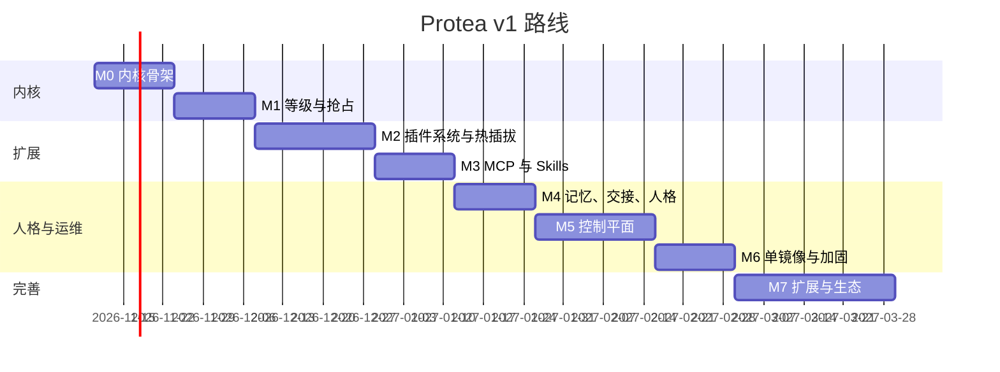

# 路线图

> 状态：Draft · 更新：2026-11-09

每个里程碑有**可演示的验收标准**；没有通过验收不进入下一个。估时按一人全职、不含控制台美化。

下图是 2026-11-03 定稿时的排期（2026-11-10 起、按周估），只保留作范围划分的参考：M0–M6 实际在 2026-11-03 至 11-06 间实现并逐个通过了离线验收，需要真实条件的验收项改在实际使用中复核（[06-real-world-testing.md](06-real-world-testing.md)）。

## 总览



## M0 · 内核骨架（2 周）· 状态：已实现（2026-11-03）

**目标**：事件进、模型出，重启不丢。

- [x] Event Store（SQLite、游标、去重、状态、投递记录）与门禁（schema 校验、等级上限、L1 仅限主人、模式降级）。
- [x] 进程内来源：`console`（连接器，`con_send`）、`cron`（配置日程 + 助理自建日程）、Core 的 `internal` 事件。
- [x] 主会话：回合状态机、流式、并行工具与 `barrierAfter`、回合边界投递、软/硬回合上限、退避重试、拒答与 `max_tokens` 处理。
- [x] 内核工具 `idle` / `events_query` / `self_status`；cron 提供 `sleep_until` / `schedule_create|list|delete`。
- [x] Anthropic Provider：流式、自适应思考、effort 按批等级、system 末尾显式断点 + 顶层自动缓存（TTL 1h）、服务端拒答回退、错误分类、用量与成本记录。
- [x] 转录 append-only + 以标记追加的确定性启动修复；与事件库的投递对账；中断批次自动恢复。
- [x] 控制 API 最小集（health/ready、status、events、transcript、SSE 流）与 CLI：`serve`、`status`、`events push|tail|ls`。

**验收**：
- [x] `protea events push "你好"` 后终端收到回复；`kill -9` 守护进程并重启，未完成的批次被恢复、事件只投递一次，转录无需修复（`apps/daemon/test/crash.e2e.test.ts`，真实子进程 + SIGKILL，使用离线 echo Provider）。
- [ ] 连续 100 次推送，`usage.cache_read_input_tokens` 命中率 ≥ 80%。**尚未在真实 API 上验证**（开发环境没有 API key）。离线代理指标已通过：100 次推送中每个请求的 system/tools 字节不变、消息序列是上一请求的严格前缀，按字节计的前缀复用率 > 80%（`packages/core/test/invariants.test.ts`）。拿到 key 后用下文脚本复核。
- [x] 不变量 I-1、I-2、I-4 的测试通过（I-1/I-2 为属性测试：随机事件序列、随机时刻中止、重启后检查；I-4 覆盖追加、修复与截断尾行）。

**M0 与原设计的差异**（已同步进各文档）：
- `preempt` / `interrupt` 暂按 `flush` 处理，抢占矩阵属于 M1。
- 实时流先用 SSE（`/api/stream`），WebSocket 留到 M5。
- `delivered` 定义为"已写入转录"，并以转录为准做启动对账，不再维护高水位游标。
- `daemon.started` 是 L4 piggyback、`daemon.stopping` 是 L4 store：启动和停机都不单独唤醒模型。
- 管理员令牌只写入秘密文件，不打印到日志。

**真实 API 验收步骤**（需要 Anthropic 的 API key，约 200 次 Opus 5.5 调用，预计花费数美元；2026-11-05 起 key 在控制台的「模型」页或 `protea providers set anthropic --key-stdin` 里设置）：

先在一个终端启动守护进程：

```bash
PROTEA_PROVIDERS__DEFAULT=anthropic PROTEA_PROVIDERS__PROFILES__ANTHROPIC__PROTOCOL=anthropic PROVIDER_ANTHROPIC_API_KEY=sk-ant-... pnpm dev
```

再在另一个终端连续推送 100 条并查看状态（`usage 24h` 一行给出缓存命中率）：

```bash
for i in $(seq 1 100); do PROTEA_DATA_DIR=.dev-data pnpm -s protea events push "第 $i 条：请只回复收到"; done
```

```bash
PROTEA_DATA_DIR=.dev-data pnpm -s protea status
```

## M1 · 等级与抢占（2 周）· 状态：已实现（2026-11-03）

**目标**：主人的声音永远优先。

- [x] 调度器：抢占矩阵（纯函数 `decidePreemption`）、老化（提升为 flush，等级不变，重启后按 `receivedAt` 续算）、抢占风暴防护（按来源冷却）、预算池（只统计不限制，越过阈值记 `budget.threshold`）。
- [x] `preempt` / `interrupt`：取消流式请求；`interruptible` 工具收到信号并返回部分回执，其余工具跑完，未开始的跳过；`model_call_cancelled` / `turn_cancelled` 标记；`session.preempted`、`session.turn_cancelled` 内部事件。
- [x] Fork：`fork_spawn` / `fork_status` / `fork_cancel`，独立循环（`fork` 模型角色、受限工具表、独立转录），排队与并发上限，主会话处理 ≤ L1 批时合作式暂停、超时取消 L3/L4 Fork 的模型调用，之后恢复；检查点；停机暂停、重启后续跑；结果以 `fork.completed` 事件回到主会话。
- [x] 内核工具 `events_promote`；控制 API `GET /api/sessions`、`/api/sessions/forks[/:id]`、`POST /api/sessions/forks/:id/cancel`、Fork 转录；SSE 增加 `scheduler`、`fork` 主题；CLI `protea forks [ls|show|cancel]`，`status` 显示预算与 Fork。
- [x] 身份映射与 L1 门禁（M0 已实现；M1 补充"冒用 owner senderKey"的用例：身份绑定到插件，其他来源无法冒用）。

**验收**：
- [x] 场景"晨报被主人打断"（[04-scheduling-and-preemption.md](../10-architecture/04-scheduling-and-preemption.md) §10）端到端测试：L1 事件在 ≤ 1 s 内（不含模型延迟）进入上下文——`preempt` 在工具阶段等回合边界、与工具回执同一条消息；`interrupt` 取消可中断工具并开下一批；模型调用阶段的 `preempt` 取消调用后合并重发（`packages/core/test/preemption.test.ts`）。
- [x] L4 来源申请 `interrupt` 被降级为 piggyback 并记录 `core.event_downgraded`，不取消任何回合；L3 事件等待超过 maxWait 后被提升为 flush，且不抢占正在运行的更高等级批（`preemption.test.ts`、`aging.test.ts`）。
- [x] Fork 在主会话 L1 回合期间被暂停、之后恢复并完成，转录可经 API 读取（`forks.test.ts`、`apps/daemon/test/daemon.test.ts`）。
- [x] 不变量 I-3、I-5 的属性测试通过（`invariants.test.ts`：随机事件序列 + 随机等级/模式/来源；I-3 检查任何转录写入都不发生在模型调用或工具运行期间、且每个请求都是上一个请求的追加扩展；I-5 检查每次取消都满足"新事件更紧急，或同级 interrupt"）。两项测试都做过变异检验：注入违规代码后测试失败。

**M1 与原设计的差异**（已同步进各文档）：
- Fork 让渡条件简化为"主会话正在运行等级 ≤ `scheduler.forks.yieldLevel`（默认 L1）的批"，不依赖 Provider 并发/速率池（尚不存在）；按池满让渡留待并发池实现。
- 抢占风暴只计**实际执行**的取消；冷却同时作用于 `preempt` 与 `interrupt`；Core 自身事件不受限制。
- `phase=backoff` 视同"模型调用、无外部输出"，可被 `preempt`。
- 预算只统计：不改变调度，`budget.enforce` 留到 M6（已在 M6 实现）。
- Fork 的 `seed`、`stopWhen.maxTokens|deadline`、`wrapUpHint` 尚未实现（经 API 派生与暂停/恢复在 M5 实现）；已结束 Fork 的转录暂不清理（`scheduler.retention` 推迟到 M7a）。
- Fork 端点放在 `/api/sessions/forks` 下（与控制 API 规范一致）。

## M2 · 插件系统与热插拔（3 周）· 状态：已实现（2026-11-03）

**目标**：不重启换零件。

- [x] 清单校验（`protea.plugin.json`）、发现（内置 `plugins/` + 数据卷 `/data/plugins` + 目录监视）、生命周期状态机、子进程监督（心跳、退避重启、排空、`stop` → SIGTERM → SIGKILL）、协议实现（`@protea/plugin-sdk` + Python `protea_plugin`）。
- [x] 热操作：安装（本地目录）/启用/禁用/重载/重启/卸载；`config.yaml` 热更新（owner、permissions、plugins 立即生效），`x-hot: false` 的键变更自动重载插件；通过 API 做的修改写回 `config.yaml` 并保留注释。
- [x] 内置插件：`telegram`（连接器，长轮询）、`webhook`（`/hooks/<name>`，GitHub/HMAC/token 校验）、`filewatch`（默认 `/data/inbox`）。三者都打包为单文件 `dist/main.js`。
- [x] 权限策略引擎（`allow` / `ask` / `deny`，精确名 → glob → 清单 `sideEffectTools` → 默认；没有 owner 时副作用一律拒绝）+ 审批流（经 Telegram 或控制台，`/approve aN`，绑定输入哈希、一次性、24 h 过期）+ `audit` 审计表 + `approval_request` 内核工具。
- [x] `protea dev-plugin <dir>`（交互式最小宿主）与 `protea dev-plugin <dir> --check`（协议一致性检查）；CLI `plugins`、`approvals` 命令；控制 API 插件、审批与 `/hooks` 端点。

**验收**：
- [x] 运行中安装 Telegram 插件 → 主人发消息得到回复；禁用插件 → 其工具消失；重载代码 → 新版本生效；全程主会话不重启（`apps/daemon/test/plugins.e2e.test.ts`：真实守护进程 + 模拟 Telegram Bot API；安装的是打包后的插件，覆盖同名内置插件；运行号、转录文件与批次全程不变）。
- [x] 插件进程被 `kill -9` 后自动重启，期间发来的消息不丢（偏移量在事件入库后才前移）；连续崩溃 5 次进入 `failed`，`/api/plugins` 与日志可见，并以 L2 `plugin.failed` 事件告知主会话（`packages/core/test/plugin-host.test.ts`）。
- [x] `ask` 策略的工具调用 → Telegram 收到审批请求 → `/approve a1` 后同一输入执行一次；24 h 过期（e2e 与 `permissions.test.ts`）。
- [x] Python 示例插件（`examples/plugins/py-notes`，Python 3.9+）与 TypeScript 示例（`examples/plugins/ts-notes`）通过 14 项协议一致性检查（`packages/core/test/conformance.test.ts`）；故意违规的插件被检出。
- [x] 不变量 I-6（插件在工具调用中途崩溃 → 失败回执，其他插件与主会话不受影响）、I-8（属性测试：每个有副作用或受限的调用恰有一条审计记录；只有 `allow` 或匹配的审批才会执行，审批只用一次）测试通过；I-8 做过变异检验。

**M2 与原设计的差异**（已同步进各文档）：
- 安装来源只支持本地目录；Git URL 与 tarball 留到 M5（控制台）。
- 数据卷插件必须自包含（打包或自带 `node_modules`）；内置插件用 `scripts/bundle-plugin.mjs`（esbuild）打包。开发模式下内置插件按清单 `runtime.dev` 直接跑源码。
- 目录监视用 Node 自带的 `fs.watch`，不用 chokidar。
- 资源上限在 M6 实现（进程树内存采样 + 文件描述符上限，见 M6）；`events/pushDeferred`、`events/pushCandidate`、`blob/*`、`usage/report`、`plugin_state` 表尚未实现（按需）。
- 审批请求发给所有声明了 `approvals` 能力的运行中渠道（控制台 + Telegram），而不是只发"主人最近使用的渠道"。
- 权限的附加条件（按批等级、按参数、按时间窗）与外发白名单尚未实现。
- Python SDK 尚未发布到 PyPI；宿主把仓库（或镜像）里的 `sdks/python` 放进 Python 插件的 `PYTHONPATH`。
- 进程内插件（console、cron）的配置变更一律重载该插件。

## M3 · MCP 与 Skills（2 周）· 状态：已实现（2026-11-03），一项验收待复核

**目标**：接入现成能力。

- [x] MCP 客户端管理器（`packages/core/src/mcp/`，官方 `@modelcontextprotocol/sdk`）：stdio、Streamable HTTP、SSE；与进程外插件相同的监督语义（20 s 握手超时、退避重启、连续崩溃 5 次 → `failed`、30 s ping 连续 3 次失败 → 重启）；工具命名 `mcp__<server>__<tool>`；`tools.allow/deny`；`list_changed` 合并 500 ms 后重读；资源（`mcp_resource_list` / `mcp_resource_read`、订阅更新 → L4 事件）；prompts 映射为只读 Skill；roots 声明 `<data>/workspace`；服务器日志进结构化日志；bearer（秘密）与 OAuth（授权码 + PKCE + 动态注册，回调 `/api/mcp/oauth/callback`）。
- [x] 工具搜索：工具总数超过 `context.toolSearch.threshold`（默认 40）时，MCP 工具标 `defer_loading`，每个服务器调用次数最多的 3 个保持加载；Anthropic Provider 声明 `tool_search_tool_regex_20251119`。
- [x] Skills 注册表（`packages/core/src/skills/`）：扫描内置 → 数据卷 → 插件 → MCP prompts，校验，`skills-catalog` 段，`skill_load` / `skill_read`，目录监视热加载；内置 `protea-self-ops`、`daily-brief`、`memory-hygiene`（后者等 M4 的记忆工具出现后才进目录）。
- [x] 内置来源：`rss`（RSS 2.0 / Atom / RDF，条件请求，按条目去重）、`imap`（imapflow，IDLE 或轮询，`mail_fetch` / `mail_search`）。
- [x] CLI `protea mcp ls|add|rm|tools|enable|disable|restart|auth`、`protea skills ls|show|install|enable|disable|rm`；控制 API `/api/mcp/*`、`/api/skills*`；`mcp`、`skills`、`context` 三节配置可热更新。

**验收**：
- [~] 通过 CLI 添加 `uvx mcp-server-fetch` 与 `npx @modelcontextprotocol/server-filesystem`，≤ 10 s 内模型可调用；移除后工具在下一回合消失。
  - 用测试服务器（`packages/core/test/fixtures/mcp-server.mjs`）在真实守护进程里验证：经控制 API 添加后 0.1 s 就绪，模型调用成功，移除后下一回合工具消失（`apps/daemon/test/mcp-skills.e2e.test.ts`）。
  - 真实服务器（`PROTEA_REAL_MCP=1` 才运行的同名测试）：两个服务器都启动成功，首次运行含下载分别用了 13.3 s（fetch，1 个工具）和 5.9 s（filesystem，14 个工具）；模型调用 filesystem 读文件成功；**fetch 的调用在 60 s 内没有拿到期望的结果，原因未查明**，复跑与"有缓存时是否 ≤ 10 s"待复核。
- [x] 60 个以上 MCP 工具时启用工具搜索，缓存命中率不低于无 MCP 时的 90%（`packages/core/test/tool-search.test.ts`）：100 次推送、两个服务器共 78 个 MCP 工具、其间一个服务器中途接入又离开、一次 `list_changed`。按"工具 → system → messages 的最长公共前缀、延迟加载的工具不进前缀"模拟缓存，无 MCP 时 98.5%，有 MCP 时 96.5%（为前者的 98%）。真实 API 下的命中率需要 API key 复核。
- [x] 拷贝一个 Skill 目录进数据卷，下一回合目录中出现；`skill_load` 回执正确；损坏的 SKILL.md 被拒绝并显示原因（e2e 与 `packages/core/test/skills.test.ts`）。

**M3 与原设计的差异**（已同步进各文档）：
- MCP 服务器只能在 `config.yaml` 的 `mcp.servers` 里声明（CLI 与 API 写的也是这里）；插件目录里的 `kind: mcp` 清单留到 M5（随 Git 安装一起做）。
- 服务器的"信任等级"命名为 `trust: low | normal | high`（待决问题 Q1 的结论）：`low` 时没有 `readOnlyHint` 的工具一律 `ask`，`normal` 时只有显式 `destructiveHint` 的工具 `ask`，`high` 不加限制；`readOnlyHint` 工具默认 `allow`。所有没有 `readOnlyHint` 的 MCP 工具都按"有副作用"审计，没有 owner 时被拒绝。
- 不声明 sampling 与 elicitation 能力（服务器不应发起这两类请求）；elicitation 转审批留到以后。Anthropic 服务端 MCP 连接器（`remote-passthrough`）未实现。
- 工具表变化没有单独的"待应用队列"：每次模型请求都在回合边界组装，变化自然在下一回合生效；`list_changed` 合并 500 ms。
- 只有 MCP 工具会被延迟加载（插件工具总是加载）；"常用前 k 个"按新表 `tool_stats` 的调用次数计算，只在该服务器的工具列表变化时重算，避免前缀抖动。历史里出现过工具搜索结果后，工具搜索保持开启，已消失的被引用工具以"不可用"的延迟占位定义保留，避免请求被拒。
- 工具描述覆盖为 `descriptionOverrides`（按服务器的原工具名）；描述过长的提示留到控制台（M5）。
- Skills 增加 `skill_read`（读取 Skill 目录内的文件，限制在目录内）；`shell` 工具（`sh_run`）在 M6 实现，默认不启用；启用前 Skill 的脚本无法执行。重复加载的回执改为"已在本会话加载（工具调用 id）"。Protea 扩展 `metadata.requires-tools`：所需工具不存在时不进目录。
- Skills 只能从本地目录安装；Git URL 留到 M5。例程把 Skill 作为 Fork 目标、描述相似度诊断未实现。
- `rss` 默认 L4 `piggyback`（可配 L3 `debounce`），首次读取只报最新 3 条；`imap` 默认 L2 `flush`，邮件列表与自动邮件（`List-*`、`Precedence: bulk`、`Auto-Submitted`）降为 L4，首次连接只记录邮箱当前位置。

## M4 · 记忆、交接、人格（2 周）· 状态：已实现（2026-11-03），回答质量待真实模型评测

**目标**：换上下文不换人。

- [x] 记忆（`packages/core/src/memory/`）：`memory` 工具（memory tool 的 `view / create / str_replace / insert / delete / rename` 命令面，路径 `/memories/…` 映射到 `/data/memory`，原子写入，拒绝越界与符号链接逃逸，单文件 ≤ 1 MB）、`memory_search`（SQLite FTS5 trigram 索引，中文不分词也能搜；短于 3 字的词按子串过滤）、`memory_recent`；`memory-index` 段（`INDEX.md`，系统前缀最后一段）；目录监视增量更新索引；控制 API `/api/memory/*`（写入记审计）。
- [x] 交接（`packages/core/src/session/handoff.ts`）：容量估算（上一次响应的 usage + 之后消息的本地估算，接近阈值时用 Provider 的 `count_tokens`）；批开始时超过 `softTokens`、任何请求前超过 `hardTokens`、或 Provider 报"输入过长"时交接；默认策略用 `cheap` 模型写 `memory/handoff/<ts>.md`（上一份笔记一并交给它，保证笔记链不断），失败时写机械笔记；新转录 `main.<seq>.jsonl` 以 `session.handoff` 事件开头，尾部消息**去掉 thinking 块**后原样复制；`INDEX.md` 维护"Recent handoffs"列表；循环保护；`POST /api/sessions/main/handoff` 手动交接。
- [x] 人格热加载：`SOUL.md` / `OPERATING.md` / `USER.md` / 环境提示覆盖变化后从下一次模型请求生效；可选钩子 `persona/hooks.{ts,mts,mjs,js}`（`systemSegments`、`onHandoff`、`onBatchEnd`、`rounds`），文件变化时重载，出错回退默认实现；默认人格的 `OPERATING.md` 增加记忆约定，首次启动创建带模板 `INDEX.md` 的记忆目录。
- [x] Provider：thinking 块绑定控制（beta `thinking-binding-controls-2026-08-01`，默认 `drop_block`）；拒答回退后按规则回传内容（丢弃最后一个 `fallback` 块之前的 thinking 与工具调用）；费用按 `usage.iterations` 逐次计价；可选服务端压缩（`compact-2026-01-12`，默认关）；`count_tokens`、上下文窗口与"输入过长"错误分类；可声明官方 memory 工具类型（`memory.nativeTool`，默认关）。
- [x] 不变量 I-7：所有 Provider 请求在发出前做秘密值扫描（`RedactingProvider`），命中替换为 `[REDACTED:<NAME>]` 并记一次 `secret.redacted` 事件。

**验收**：
- [~] 回放 2000 条事件触发 ≥ 3 次交接，交接后助理仍能正确回答"我们昨天说好的三件事是什么"（评测集）。
  - 机制已验证（`apps/daemon/test/m4.e2e.test.ts`）：真实守护进程，2000 条事件分 101 批推送，`softTokens` 12000 时交接 24 次（5 s）；"三件事"早已离开对话，模型从 `session.handoff` 事件找到最新笔记、用 `memory` 工具读出并答对三项。笔记模型在测试里是确定性的替身（保留上一份笔记的承诺并加入新的约定），**真实 `cheap` 模型的笔记质量与回答正确率需要 API key 跑评测**。
- [x] 修改 `SOUL.md` 后下一回合生效，缓存只失效一次（同一测试文件）：按"上一请求的工具 → system → messages 是否是本请求的前缀"模拟缓存，6 个请求里只有修改后的第一个未命中；修改之前的 thinking 块不再发送，之后产生的照常回传。
- [x] 不变量 I-7 测试通过（同一测试文件）：秘密出现在 `USER.md`（系统前缀）、主人消息、记忆文件（经工具结果）与交接笔记请求里，所有发给模型的请求都不含其值，`secret.redacted` 只记一次。

**M4 与原设计的差异**（已同步进各文档）：
- **保留思考（preserved thinking）**：Claude 5 系列的 thinking 块绑定产生它的对话前缀（system、工具集合、之前的消息），前缀一变，之后回传旧块会被新账户以 400 拒绝。因此：交接复制尾部时去掉 thinking 块（文本、工具调用与结果保留）；系统前缀或已加载工具集合变化（人格、插件、MCP、Skills、记忆索引、秘密集合）时，在转录里追加 `prefix` 标记，之前的 thinking 块从此不再发送（去掉"开头一段"不会使之后的块失效）。这也修正了 M2/M3 热更新在新账户上的同类问题。Anthropic 请求另带 `block_binding.prefix_mismatch_behavior: drop_block` 作为兜底。
- memory 工具默认以**普通自定义工具**提供（同一命令面与回执文本），不声明官方类型 `memory_20250818`：官方工具会自动在系统提示里加入"做任何事之前先查看记忆目录"的指令，对事件驱动、每批都很短的助理意味着每批多一次读取；需要时用 `memory.nativeTool: true` 开启。
- 交接事件名为 `session.handoff`（与其他 `session.*` 一致；原设计称 `handoff.completed`），以 `store` 模式记入事件库后直接写进新转录的第一条消息。手动交接与"输入过长"后的交接只保留正在运行的批（或最近一批）。
- 钩子只实现了 `systemSegments`、`onHandoff`、`onBatchEnd`、`rounds`；`onDelivery`、`onPluginLifecycle`、`eventDelivery` 未实现。钩子模块可以是 `.ts`（需要 Node.js 22.18+ 的类型剥离）或 `.mjs/.js`。
- 人格变化走"重建系统前缀"（缓存失效一次），而不是 API 推荐的"会话中系统消息"追加形式；后者能做到缓存不失效，记为后续优化（[04-risks-and-open-questions.md](04-risks-and-open-questions.md) Q11）。
- Fork 不做交接（受 `maxTurns` 约束），但同样使用 thinking 截止标记。记忆向量检索（sqlite-vec）未实现。

## M5 · 控制平面（3 周）· 状态：已实现（2026-11-04），真实 Prometheus 抓取待复核

**目标**：看得见、管得住。

- [x] HTTP API 全量（[05-control-api.md](../30-specs/05-control-api.md)）：事件分页、提升、撤回；批与其模型调用；Fork 派生、暂停、恢复；插件详情、带 schema 的配置、日志，从 Git / tarball 安装插件与 Skills；生效配置（附每个键的来源层）与 JSON Merge Patch 写回；秘密（只写与列名）；权限、预算；调度暂停/恢复/清空；日志检索、运行目录；人格文件；审计。
- [x] 鉴权（`packages/control/src/auth.ts`）：管理员令牌与可选的只读令牌（秘密 `PROTEA_READONLY_TOKEN`，只能 GET 与订阅，读不到记忆、人格与秘密）；控制台登录换 HttpOnly + SameSite=Strict 的会话 cookie（值是令牌的 HMAC，换令牌即全部失效），cookie 发起的写请求要带 `x-protea-csrf: 1`；失败登录按地址限流；所有写请求记审计 `control_write`。
- [x] WebSocket `/ws`（`packages/control/src/ws.ts`）：订阅分组 `events / phase / scheduler / output / changes / usage / logs`，可带 `since` 先补发再转实时（不漏不重），日志可按级别、组件、插件、文字过滤；30 s 心跳；跟不上的客户端被断开；浏览器 cookie 连接校验 Origin。SSE 与 WS 都经总线的 tap 投影，按因果顺序发出（事件先于为它开的批与它的结算）。
- [x] Web 控制台（`apps/web`，Vite + React，守护进程在同一端口托管 `apps/web/dist`）：
  - 总览：阶段呼吸灯、待处理、上下文环、用量、按等级的预算、Fork、内部事件、暂停/恢复投递、手动交接。
  - 事件流：实时 + 历史分页；抢占、老化、清空、暂停等调度动作与内部事件高亮；详情抽屉里提升或撤回；输入框即 console 来源。
  - 会话：转录（含思考摘要开关）、批与每轮用量、Fork 派生/暂停/恢复/取消。
  - 插件：卡片、启停重载卸载、Git / tarball / 目录安装、按 JSON Schema 生成的配置表单（标出 `x-hot: false`）、日志。
  - MCP：增删、启停、工具、OAuth 授权。Skills：正文、启停、安装、删除。审批：待处理、历史、审计。
  - 记忆与人格：目录树、全文检索、编辑器。配置：生效值与来源、按路径或补丁修改、秘密、权限、预算、调度。日志：实时、检索、运行目录的关停记录与崩溃报告。
  - 只读令牌登录时修改按钮全部隐藏；明文 HTTP 且非本机访问时持续显示风险提示。
- [x] 指标端点 `/metrics`（prom-client，`packages/core/src/observability/metrics.ts`）：[15-observability.md](../10-architecture/15-observability.md) §3 的全部指标，另有 `protea_info` 与 Node.js 进程指标；默认需要令牌（`control.publicMetrics`）。`docker/observability/` 提供 Prometheus 抓取配置与 Grafana 面板（27 个面板）。
- [x] 运行目录：`log.jsonl`、`transcript.jsonl`、`shutdown.json`（关停原因、各步骤耗时、批是否跑完、插件与 Fork 状态）、`crash/`（未捕获异常的堆栈与最近 200 条总线记录）；只保留最近 `observability.keepRuns`（默认 20）个；内存里保留本次运行最近 5000 行日志供 API 与 WS 使用。`/readyz` 增加 SQLite 写锁、必需插件（`observability.requiredPlugins`）与"投递已暂停"。
- [x] CLI 全量：`events show|promote|withdraw`、`batches`、`sessions [ls]|handoff`、`forks spawn|pause|resume`、`plugins show|logs|install --git|--tarball`、`skills install --git`、`config get|set|unset`、`secrets ls|set|rm`、`scheduler pause|resume|discard`、`budget`、`memory`、`persona`、`logs [--follow]`、`logq`（直接读运行目录，不需要守护进程）、`runs`、`audit`。

**验收**：
- [x] 所有 M0–M4 的操作都可在控制台完成，且不需要 SSH。
  - API 层由 `apps/daemon/test/m5.e2e.test.ts` 覆盖：鉴权与角色、cookie 与 CSRF、事件、批、调度、配置、秘密、人格、日志、Fork、从 Git/tarball 安装、WebSocket、指标、控制台托管。
  - 页面在内置浏览器里对构建产物逐页走过：登录、推送事件看回复、抢占实时显示、插件配置表单、配置来源、日志、人格编辑、审计。
  - 例外：人格钩子 `hooks.*` 是在守护进程内执行的代码，不开放 API 编辑；"从守护进程所在机器的目录安装"仍要求目录已在那台机器上（远程用 Git / tarball）。
- [x] 事件流页面实时显示抢占/老化/预算动作：调度动作走 `scheduler` 主题（抢占、打断、老化、风暴冷却、Fork 让渡、暂停、清空），预算阈值与 `session.preempted` 等走内部事件，两者在页面上高亮。抢占在浏览器里实测，WS 侧由测试覆盖。
- [~] Prometheus 抓取成功；Grafana 示例面板随仓库提供。
  - 已验证：`/metrics` 的输出逐行符合文本格式，关键序列随事件流变化（同一测试文件）；面板里用到的每个指标名都在守护进程的实际输出里。
  - 待复核：本机没有 Prometheus/Grafana，**真实抓取与面板导入还没跑过**。

**M5 与原设计的差异**（已同步进各文档）：
- 控制台界面为中文，hash 路由，不用 UI 组件库；构建产物在 `apps/web/dist`（`PROTEA_WEB_DIR` 可改），开发时 `pnpm web` 起 Vite 并把 API 转给守护进程。多语言仍在 M7。
- WebSocket 主题从设计的 4 个（events、phase、logs、usage）扩成 7 个分组，覆盖 SSE 的全部主题；控制台只用一条 WS 连接，SSE 留给 CLI。
- 会话 cookie 是令牌的 HMAC（没有服务端会话表，重启不掉登录）；只读令牌另外读不到记忆、人格与秘密名称；`/metrics` 默认也要令牌。
- 指标里的 `turns` 对主会话按"批"计（一批含多轮模型调用），对 Fork 按整个 Fork 计；`protea_plugin_restarts_total` 由插件状态变化推导。
- 推迟：`protea replay`（离线回放需要录制的工具定义与回执，和 M6 的 Provider 录制模式一起做）；`POST /api/budget/release`（随 M6 的预算强制执行）；日志的秘密过滤（M6）。`protea backup` 按原计划在 M6。
- 新增（原设计没有）：Fork 的运营暂停/恢复（`pauseReason: operator`，重启后保留）；调度暂停持久化（重启后仍暂停）；清空 pending 只允许 L2–L4；审计 `control_write`；`/api/audit`、`/api/runs`、`/api/persona/*`、`/api/auth/*`；预算设置改为热更新。
- 从 Git / tarball 安装时不做构建：来源里必须有可直接运行的入口（与 M2 的目录安装一致）；`.git` 不复制；指向来源之外的符号链接直接拒绝。

## M6 · 单镜像与加固（2 周）· 状态：已实现（2026-11-04），长时间运行留给实际使用；CI 已通过（T5：30b8e17 首次全绿，219b0b1 复核全绿）

**目标**：`docker run` 即用，连续运行 30 天。

- [x] 镜像（`Dockerfile`，[16-deployment.md](../10-architecture/16-deployment.md)）：
  - 多阶段构建；`full`（默认）带 Node 22、Python 3.13、uv、git、ripgrep、jq、curl，`slim` 只有 Node。
  - 入口脚本 `docker/entrypoint.sh`：tini 是 PID 1；以 root 准备 `/data` 后降为 uid 1000；启动前 `protea migrate`（有待执行的迁移时先快照，数据库比镜像新时拒绝启动）。
  - `HEALTHCHECK` 跑 `protea healthcheck`；`--stop-timeout 40` 写进文档与 compose 示例。
  - `docker/docker-compose.yml` 示例带 Caddy（TLS）、容器限制、`cap_drop`。
- [x] 加固：
  - 预算强制执行（`budget.enforce`）：L2 用尽改为 piggyback 且不老化，L3/L4 用尽改为入库；用尽与全局硬上限 `budget.hardDailyUsd` 各记一条 L0 事件；Fork 按等级拒绝。
  - `POST /api/budget/release`、`protea budget release`、控制台"预算"页的放行按钮；池恢复时扣住的 L2 事件自动恢复。
  - 外发限速 `pluginHost.outboundPerMinute`：每个 connector 每分钟，主会话与 Fork 共用。
  - 内置工具插件 `shell`（`sh_run`）：工作区、进程组超时、输出截断、环境白名单；默认不启用，启用后默认 `ask`。
  - 插件与 stdio MCP 服务器的资源上限 `pluginHost.limits`：进程树内存采样，超限按崩溃重启；启动前设文件描述符上限。
  - 子进程继承缓存与代理变量（npx/uvx 缓存留在 `/data/cache`）。
  - 日志、崩溃报告与 `shutdown.json` 的秘密过滤。
  - 控制平面地址白名单 `control.allowCidrs`（HTTP 与 WS）。
- [x] 备份与恢复（`packages/core/src/backup.ts`）：
  - `protea backup`：SQLite 在线备份 + 数据目录，`--archive`；`--to <git-url>` 推送 config、人格、记忆与 Skills。
  - `protea restore`：校验 manifest 与校验和，旧文件移开不删。
  - `/api/backups` 与控制台"备份"页。
- [x] 从 M5 推迟的两项：
  - Provider 录制模式（`observability.recordProvider`，录在脱敏之后）。
  - `protea replay`：按原批次边界投给离线主会话；工具结果来自录下的转录，Core 只读工具在副本上运行，其余是桩。
- [x] 安全检查清单（`apps/daemon/test/m6-security.test.ts`）：渗透用例、默认策略审查、秘密读取点的静态检查；`SECURITY.md`。
- [x] CI（`.github/workflows/ci.yml`）：typecheck、构建、测试、`pnpm audit`；full/slim 镜像构建、容器冒烟测试（`scripts/container-smoke.sh`）、Trivy。
- [x] 指标：`protea_event_to_request_seconds`（入库 → 带着它的模型请求发出）、`protea_db_size_bytes`。
- [~] 长稳测试：`scripts/soak.mjs`。本机 Docker 里跑了两次加速短程（1 h 与 1.5 h）；长时间运行不再单独压测，留给实际使用观察。

**验收**：
- [x] 成功标准里的部署与延迟指标（在本机 Docker 里验证）：
  - `docker run` 即用：两种镜像都能启动、健康检查通过、控制台消息有回复、以 uid 1000 运行。
  - 任意时刻 stop/start 不丢事件：容器冒烟测试先暂停投递、放入 3 个事件、`docker stop` 再 `docker start`，3 个事件仍在，恢复投递后全部送达，且写了 `shutdown.json`。此外 M0 起已有 kill -9 恢复与"不重复副作用"的测试。
  - 延迟：在 1 CPU / 1 GB 的容器里、每分钟 30 和 60 个事件下，L1 事件入库 → 模型请求发出的 P95 ≤ 0.05 s（直方图最低一档，L2 相同；echo Provider，不含模型自身时间；目标 ≤ 2 s）。
  - "1 vCPU / 1 GB 上 30 天无人工干预"只能由长期运行证明，见下一条。
- [~] 内存无持续增长、SQLite 大小符合预期。已做的是本机 Docker 里的两次加速短程，都在 1 CPU / 1 GB 的容器里，用 echo Provider（每次回复延迟 300 ms），事件是 L1–L4 混合：
  - **第一次**：每分钟 30 个事件，1 小时。V8 堆的低点从 26 MB 稳步升到 33 MB。原因是 echo Provider 报告固定的 10 个输入 token，交接从不触发，整段对话（6792 条记录）一直留在内存里；内存日志缓冲也还没填满。这是测试设置的问题，真实模型会报告真实用量。修正：echo 改为按请求长度估算用量。
  - **第二次**：每分钟 60 个事件（约为一个忙碌主人的 30 倍），90 分钟，`softTokens` 调到 30k，让交接频繁发生；增长只拟合后半段（缓冲已满之后）。共投 5394 个事件，0 失败，结束时 pending ≤ 2（在途）；发生 74 次交接（约 73 s 一次）。V8 堆不再增长：每 15 分钟的中位数 31.9 → 33.4 MB，后半段拟合 −10%/天。RSS 仍在缓慢上升：中位数 126 → 142 MB，后半段拟合约 +9 MB/h，中途有一次回落 13 MB。结束时 143 MB 里 60 MB 是文件映射（Node 与动态库），83 MB 是匿名内存，其中 V8 堆 40 MB、external 4 MB，其余是 SQLite 与 malloc 等原生内存。1.5 h 不足以判断它会不会封顶，留给实际使用观察；若仍上升，先试 `MALLOC_ARENA_MAX` 与 SQLite 的 `cache_size`。转录 1.5 h 写了 13 MB（75 段），清理随 `scheduler.retention` 留到 M7。
  - 数据库每个事件约 1 KB：第二次 1.5 h 后 6.8 MB（约 6700 个事件，含内部事件），按这个事件量约 107 MB/天；每天 3000 个事件约 3 MB/天。WAL 在 4 MB 封顶。
  - **留给实际使用**：长时间运行（数天到 30 天）在实际部署里观察 `process_resident_memory_bytes`、`nodejs_heap_size_used_bytes` 与 `protea_db_size_bytes`；需要时仍可单独跑 `node scripts/soak.mjs --url … --token-file … --hours 72 --rate 2`。
- [x] 渗透用例全部按预期被拒：伪造主人、低等级来源申请打断、伪造 internal 来源、事件正文伪造标签、秘密出现在工具输出，见 [14-security-and-permissions.md](../10-architecture/14-security-and-permissions.md) §9。

**M6 与原设计的差异**（已同步进各文档）：
- 插件不再用独立的 uid 1001：守护进程不是 root，无法切换用户。改为同一用户，加环境白名单、资源上限与默认 `ask`（[ADR-0009](../20-decisions/ADR-0009-single-uid-with-process-limits.md)）。
- 基础镜像是 Debian 13（trixie），Python 是 3.13（原写 3.12）。
- 体积：full 约 550 MB、slim 约 345 MB（压缩后约 170 / 95 MB），超过原目标 450 / 200 MB。原因是 Node 的 Debian 基础镜像本身约 270 MB。
- 基础镜像自带的 npm 依赖里有高危漏洞：镜像里升级到 npm 12.2.1，并把它捆绑的 undici 换成 6.29.1；corepack 与 yarn 删除。
- 资源上限：内存是每 15 s 采样一次进程树，不是 cgroup 硬限制；CPU 与进程数交给容器。文件描述符同时降低软、硬上限，因为 Node 启动时会把软上限提到硬上限。
- "所有副作用工具默认不是 allow"收窄为：对第三方或系统的副作用默认 `ask`；发给主人本人的 `con_send`、`tg_send`、`tg_react` 默认 `allow`，测试固定了这份名单。
- 预算细节（原设计没有）：
  - L2 被改成 piggyback 的事件不参与老化；
  - 池恢复时扣住的 L2 事件自动恢复，L3/L4 保持入库并列出游标；
  - 放行按小时计，默认 24 h，存在 kv 里，重启后仍有效。
- 回放的工具结果按 tool_use id 或"工具名 + 输入"从生产转录里取，Core 的只读工具在离线副本上运行。这需要生产转录还在；评测集尚未建立。
- 备份不含 `secrets/`、`cache/`、`workspace/`、`runs/`（后两者可选）。Git 备份不含数据库。恢复不提供 API，必须先停守护进程。
- 修正了 M1 起就有的一个问题：模型调用 `idle` 等结束回合的工具时，回合边界上到期的事件被并进工具结果，但已没有模型调用来回答它们，要等下一个事件到来才会被看到。现在这些事件留在 pending，批结束后立即成为下一批。
- echo Provider 改为按请求与回复长度估算用量（原来固定 10 个 token，长稳测试里交接从不触发）。
- 镜像没有发布到镜像仓库；CI 只构建与测试。发布与签名留到 M7。
- 推迟到 M7：`scheduler.retention`、`permissions.conditions` / `egress`、CPU 上限、OpenTelemetry、软告警。

### 实际测试准备（2026-11-04，M6 之后）

所有需要真实条件的复核项（M0 缓存命中率、M3 真实 MCP、M4 交接质量、M5 Prometheus/Grafana、M6 的 CI 与长时间运行、Telegram 与 IMAP 真实账号、真实模型下的重启恢复）改在实际使用场景里做，步骤与通过标准见 [06-real-world-testing.md](06-real-world-testing.md)，结果写回各里程碑的验收项。为此补了：
- 追踪日志：每次模型调用（所有角色）一行 `model call`，带 token、缓存命中率、耗时与停止原因；事件入库、批开始/扩展、审批变化、工具完成/未执行/被策略扣住各一行。只含元数据，`observability.logEventText` 才带事件正文。
- 日志轮转：`observability.logRotateMb`（默认 50）与 `logRotateKeep`（默认 4）。
- 诊断包：`protea diag`、`/api/diagnostics`、控制台"日志 → 导出诊断包"。守护进程不在时离线生成；默认不含对话内容，所有文件经过秘密过滤。
- 镜像构建脚本 `scripts/docker-build.sh`（`pnpm docker:build`），按版本与提交打标签。
- `scripts/soak.mjs --rate 0`：只采样不推事件，用来观察实际部署。
- 修正：几条日志用 `level` 字段表示事件或预算等级，覆盖了 pino 的日志级别（"event held by the budget"、"budget threshold crossed"、"fork spawned"），改为 `eventLevel` / `budgetLevel` / `forkLevel`。

### 账号、初始化与可选的模型供应商（2026-11-05，M6 之后）

主人的要求：供应商可以选，模型、接口地址与协议都能指定；不依赖环境变量，首次通过网页建账号（用启动时打印的设置码鉴权），登录后在网页里配置供应商。设计见 [ADR-0010](../20-decisions/ADR-0010-accounts-and-provider-profiles.md)。
- 供应商档案 `providers.profiles.<id>`：协议 `anthropic`（含给其他厂商兼容接口用的 `features: basic`）、`openai-chat`、`openai-responses`、`echo`；地址、密钥秘密（默认 `PROVIDER_<ID>_API_KEY`）、每个角色的模型、effort、输出上限、上下文窗口、价格表。`providers.default` 与按角色的 `providers.roles`；热更新，存密钥后立即生效。默认没有任何档案（不再默认 Claude + `ANTHROPIC_API_KEY`）；旧写法与旧密钥文件在启动时自动迁移。
- 原计划 M7 的 `openai-compat` Provider 插件改为内置的两种 OpenAI 协议（[12-model-providers.md](../10-architecture/12-model-providers.md) §3、§8）。
- 账号：scrypt 密码、服务端会话（可单独注销）、管理员与只读两种角色、最后一个管理员保护；设置码 `PROTEA_SETUP_CODE` 打印到标准输出（不进日志文件与诊断包），建好第一个管理员即作废。API 令牌留给 CLI、脚本与监控，也可在登录页恢复时使用。
- 控制台：初始化向导（设置码与账号 → 供应商 → 完成）、账号密码登录、「模型」页（预设、测试连接、模型列表、默认与按角色选择）、配置页的"账号"标签。CLI：`protea setup`、`protea accounts …`、`protea providers …`。
- API：`/api/setup`、`/api/auth/password`、`/api/accounts*`、`/api/providers*`；迁移 5 `accounts`。测试 +30（协议的假服务器测试、档案与迁移、账号与会话、端到端的初始化与供应商流程），共 289 个通过。
- 实际测试新增 T10（首次设置与多供应商）；T5（CI 首次运行）已通过。

### 控制台「对话」页（2026-11-05）

原先回复只在实时流里出现，事件流页一刷新就看不到了。
- 迁移 6 `outputs`：插件发给主人的输出入库（`con_send` 带上所在的批）；`GET /api/chat` 把 `console.message` 事件与 console 输出按时间合并、倒序分页，并给出每批的结局（报错原因、是否回复、由什么事件引起）。`model.error` 事件的 `meta` 带 `batchId`。升级前的回复在首次启动时从主会话转录里补回（只做一次）。
- 控制台「对话」页：气泡式对话、状态与失败原因、"思考中 / 执行工具"、打断并发送、更早的消息、审批提示、Markdown 子集；断线重连后补齐。窄屏时导航改为横向滚动条（以前窄屏下导航整个隐藏）。
- 测试 +4（`packages/core/test/outputs.test.ts`、`apps/daemon/test/chat.e2e.test.ts`），共 294 个通过。

### 对话窗口与控制台分离（2026-11-06）

主人的要求：打开网页就是独立、简洁的对话窗口；点"控制台"再进入现有的运维页面；控制台风格统一、更专业。
- 路由：`#/` 是对话窗口，`#/console/<页面>` 是控制台（旧链接仍可用）。登录、初始化完成后默认进入对话。
- 对话窗口按常见的对话产品做法重做：居中的单栏、回复按正文排版并可复制、用户消息为气泡、分组与按天分隔、输入状态提示、失败重发、审批卡片直接批准、向上自动加载、回到最新按钮、空对话的示例、手机上 Enter 换行。
- 控制台：分组侧栏与图标、面包屑顶栏、统一页头（标题、说明、操作按钮）、账号菜单；一套新的设计变量（颜色、圆角、阴影、焦点环），卡片、按钮、输入框、表格、标签页统一调整；窄屏时侧栏收进抽屉。
- 修正：回复极快时，发送请求的响应晚于实时推送，消息会被临时副本覆盖（顺序颠倒、停在"等待处理"）。

### CI 修复与文档同步（2026-11-08）

84abdce 推送后 CI 在两个分支上都失败（run 42484226250 / 42484226396），上一次全绿是 30b8e17（T5）。两处原因都不是功能回归：
- `apps/daemon/test/crash.e2e.test.ts` 还在用旧写法 `PROTEA_PROVIDERS__ECHO__DELAY_MS` 设置 echo 的回复延迟。2026-11-05 改为供应商档案后，环境变量里的旧写法只记一条警告、不再生效，echo 立即回复，"回合中途 kill -9"变成与回复赛跑：本机能赢，CI 上输。改为 `PROTEA_PROVIDERS__PROFILES__ECHO__ECHO__DELAY_MS`，并在 kill 之后断言回复确实还没写进转录，这类静默失效以后会在该处直接失败。
- Trivy 报 zlib1g 两个 HIGH（CVE-2026-76844、CVE-2026-85091），Debian 已发布修复，但 `Dockerfile` 只 `apt-get install`、从不 `apt-get upgrade`，基础镜像发布后的安全更新不会进镜像。slim 与 full 两个阶段现在都先 `apt-get upgrade`。
- 文档：M6 标题、M1/M3 差异段里过期的"留到 M5"与"shell 尚未实现"、排期图的说明、`docs/README.md` 状态行、M0–M4 对应架构文档的状态（Draft → Accepted）；M7 按收尾（M7a）与生态（M7b）拆开并补验收标准草案。
- 结果：以上改动提交为 219b0b1 并推送后（2026-11-09），`feat/kernel` 与 `main` 的 ci 都全绿（run 42576417368、42576420953：check、image full、image slim），T5 重新通过。
- 实际测试的观察（本机试用容器，镜像 `0.1.0-e8a60fe-dirty`）：T10 的步骤 1–4 部分成立——账号建好、DeepSeek（`openai-responses`）档案就绪并服务三个角色、对话窗口有回复、24 h 内 2 次调用缓存命中 95%；设置码被拒/作废、登录限流、按角色分配与换回 Claude 未复核。另有一个 Streamable HTTP 的 MCP 服务器因 `auth: none` 而 401 进入 `failed`：服务器端要 bearer 令牌，属配置问题，监督与状态显示符合设计。

### 记忆系统重构（2026-11-10）

按 [07-memory-system-redesign.md](07-memory-system-redesign.md) 一次完成，决策见 [ADR-0011](../20-decisions/ADR-0011-layered-memory-and-idle-compaction.md)：白板（`board` 工具与控制台页）；闲时压缩（低水位 32k，上限 80k，尾部 8k，尽量对齐缓存寿命）；压缩笔记与白板直接进新对话；被压缩的对话另存为可读原文；中文二元组检索与按层检索；`INDEX.md` 发布点；每日梦境。真实模型下的摘要与整理质量待 T3、T11 实测。

**v1.0 发布点**：功能到此为止；打 `v1.0.0` 标签、把 `package.json` 从 0.1.0 升上去、发布镜像，与 M6 推迟的加固项一起放在 M7a。

### 对话与控制台分离（2026-11-10）

决策见 [ADR-0012](../20-decisions/ADR-0012-chat-platforms-and-operator-console.md)，设计见 [17-chat-and-console.md](../10-architecture/17-chat-and-console.md)。
- 对话：Core 的对话中枢提供唯一的 `chat_send`（`platform` 必填），内置平台 `webchat`，进程外插件用清单的 `chat` 块加 `chat/send` 接入（TS 与 Python SDK、一致性检查、FakeHost）。Telegram 已迁移：`tg_send` 去掉，主人私聊是 `chat.message`。
- `console` 收窄为运维注入，没有回复工具。
- 控制台：事件流页升级为运行流（上下文摘要、思考、流式正文、工具调用、发出的消息，按类别筛选），`GET /api/batches/:id/trace` 回看一批的过程，会话页加上下文标签（`GET /api/sessions/:id/context`）。Anthropic 与 OpenAI 协议都接上了思考增量；观察不影响抢占。
- CLI：`protea chat`；`events tail` 和 `events push` 显示模型输出。
- 旧数据：分界游标兼容旧对话，不需要迁移；转录里有 `con_send` 时启动后交接一次。

未验证：真实模型的思考增量、真实 Telegram（T 系列由主人在自己环境里跑）。

### 沙箱 shell、浏览器与视觉支持（2026-11-10）

方案见 [08-sandbox-browser-vision.md](08-sandbox-browser-vision.md)，决策见 [ADR-0013](../20-decisions/ADR-0013-sandboxed-shell-and-in-container-browser.md)、[ADR-0014](../20-decisions/ADR-0014-images-as-blob-references.md)。
- 持久 shell：独立的沙箱容器（`protea sandbox serve`，`@protea/sandbox`），`shell` 插件经 unix socket 调用；`sh_run` 状态延续，`sh_job_*` 后台任务与结束事件，`sh_reset`。
- 浏览器：主容器里的 stdio MCP 服务器（Playwright MCP + Chromium），镜像目标 `browser`，`protea mcp preset browser`。
- 视觉：blob 存储，图片以引用进入转录，入口是工具回执（内核、插件、MCP）、事件（Telegram、webchat）与 `view_image`，三种协议的适配，控制台显示。
- 配套：时限授权（`/approve a12 1h`）、`fork_spawn` 的工具通配、`tool` 插件推事件、部署与 CI。

未验证：真实模型下的使用与 DeepSeek 的图片格式（T12）。

### 对话的富内容与平台能力（2026-11-11）

方案见 [09-chat-rich-display.md](09-chat-rich-display.md)，决策见 [ADR-0018](../20-decisions/ADR-0018-rich-chat-content-and-widget-sandbox.md)。
- 渲染：网页的回复换成 `react-markdown` 管线，支持表格、嵌套与任务列表、提示框、代码高亮、` ```mermaid ` 图、`$$` 公式；流式时写完的块不重排；重的部分按需加载。
- `chat_send` 增加 `images`、`choices`、`widget`，都是平台声明的能力，工具描述里有按声明生成的平台能力说明；不匹配时回执失败并说明。
- 小组件：模型写的 HTML 只在不透明源的沙箱外壳里运行（`/widget-frame.html`），主页面的 CSP 只写明 `frame-src 'self'`；`chat.widgets` 是总开关。
- 进程外平台：`chat/draft` 通知（能力位 `chatDrafts`）、`chat/send` 的新字段、`meta.answer`；TS 与 Python SDK、一致性检查、`FakeHost`；示例连接器 `examples/plugins/ts-chat`。
- 存储：迁移 9（`outputs.meta`、表 `widgets`）。只读账号可以读对话里出现过的图片。
- QQ 连接器接入图片、选项（按钮，退回编号列表）与草稿（QQ 私聊流式消息）；不声明小组件。
- 测试共 590 个通过；`scripts/widget-escape-probe.mjs` 在 Chrome 157 里 25 项全部通过。

未验证：真实模型是否会恰当地使用表格、图、选项和小组件；Firefox 与 Safari 里的沙箱行为；Telegram 与微信没有接入新能力；QQ 的按钮权限、流式消息与额度没有用真实账号验证（T15、T16）。已知缺口：WebRTC 不受 CSP 约束（[14-security-and-permissions.md](../10-architecture/14-security-and-permissions.md) §8.1）。

### 权限模式与 auto 判断模型（2026-11-10）

决策见 [ADR-0015](../20-decisions/ADR-0015-permission-modes-and-auto-review.md)。

- 四个模式：`ask`（默认）、`auto`、`bypass`（必须带时限）、`locked`；`/mode`、`protea mode`、控制台审批页、`POST /api/permissions/mode`。
- 模型角色 `judge`（默认跟随主模型）；判断模型只看主人的话和工具调用，任何失败都转给主人，连续 3 次或一小时 20 次没放行后自动暂停。
- 钉住：`permissions.tools` 里显式写的 `ask` 在 auto 和 bypass 下也问主人。

未验证：真实模型下的判断质量（T13）。

## M7 · 扩展与生态（v1.x）· 状态：未开始

拆成两段：M7a 收掉 M6 推迟的加固项并发布 v1.0；M7b 是生态扩展，每项独立，可无限期推迟（风险 R9）。验收标准是草案，开工前由主人确认。

### M7a · 收尾与 v1.0 发布（估 2 周）

- [ ] `scheduler.retention`：事件（按状态与等级）、已结束 Fork 的转录、运行目录的保留期；到期清理在空闲时分批做，`protea_db_size_bytes` 随之回落。
- [ ] 软告警（[15-observability.md](../10-architecture/15-observability.md) §6）：缓存命中率连续低、插件反复重启、预算 90%、拒答连续发生、pending 老化超过两倍 `maxWait`、SQLite 超阈值；控制台横幅 + 可选的 L2 `internal` 事件。
- [ ] `permissions.conditions`（按批等级、参数、时间窗）与外发白名单 `permissions.egress`。
- [ ] 镜像发布到镜像仓库（GHCR）并签名（cosign 或来源证明）；CI 在 tag 上发布；README 的"镜像还没有发布"改掉。
- [ ] 打 `v1.0.0`：`package.json` 版本、镜像标签、变更记录。

**验收**（草案）：
- [ ] 保留期设为 1 天、灌入 2 天事件后，到期事件与转录被清理、数据库体积回落，`events_query` 仍能查到保留期内的事件。
- [ ] 人为制造上述六种告警条件各一次：横幅与（开启时）L2 事件出现，恢复后消失。
- [ ] 带条件的策略：同一工具在 L1 批 `allow`、在 L3 批 `ask`；超出 `egress` 白名单的外发被拒并记审计。
- [ ] 发布的镜像能 `docker pull`、签名校验通过；容器冒烟测试对发布的镜像跑一遍。
- [ ] 实际测试 T1–T4、T6–T9 至少各有一次记录（通过或说明），结论写回对应里程碑。

### M7b · 生态（v1.1+，每项独立）

- Protea 作为 MCP 服务器（对外暴露事件推送、记忆检索与状态查询）。
- Claude Agent SDK Fork 执行器插件（[ADR-0003](../20-decisions/ADR-0003-own-agent-loop-over-agent-sdk.md) 的可选路径）。
- 控制台多语言（先英文）与打磨。
- 一个新连接器（Slack、Discord 或 CalDAV 之一），沿用 `telegram` 的审批与主人映射。微信（`wechat`）已于 2026-11-10 实现（[ADR-0016](../20-decisions/ADR-0016-wechat-and-plugin-sign-in.md)），真实账号测试见 T14；QQ（`qq`）已于 2026-11-11 实现（[ADR-0017](../20-decisions/ADR-0017-qq-connector-and-qr-bot-creation.md)），真实账号测试见 T15。
- 向量记忆（sqlite-vec）；插件 CPU 上限；OpenTelemetry；Cortico World 适配器（探索）。
- ~~`openai-compat` Provider 插件~~：已内置为 `openai-chat` 与 `openai-responses` 协议（2026-11-05）。

**验收**（草案）：每项有自己的端到端测试与文档；新连接器要过与 T6 同等的真实账号测试。长时间运行（30 天成功标准）不再单独压测，在实际使用中观察（T8）。

## 跨里程碑的持续工作

- 每个里程碑结束：更新对应架构文档状态为 Accepted，补充 ADR。
- 回放评测集随里程碑增长；每次 PR 跑离线回放回归。
- 每周"真网"冒烟测试（模型 ID、beta 头有效性）。
