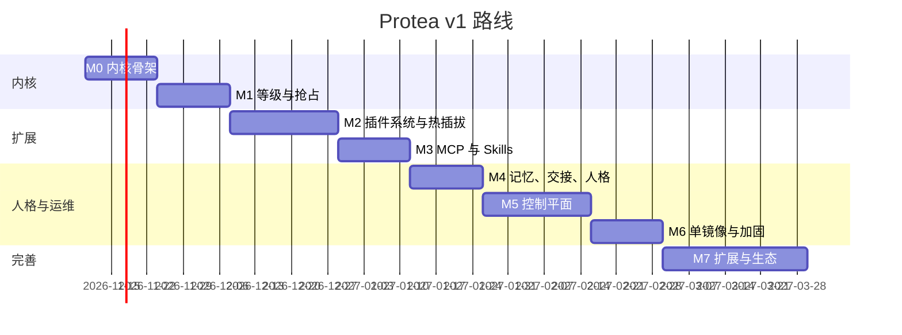

# 路线图

> 状态：Draft · 更新：2026-11-03

每个里程碑有**可演示的验收标准**；没有通过验收不进入下一个。估时按一人全职、不含控制台美化。

## 总览



## M0 · 内核骨架（2 周）· 状态：已实现（2026-11-03）

**目标**：事件进、模型出，重启不丢。

- [x] Event Store（SQLite、游标、去重、状态、投递记录）与门禁（schema 校验、等级上限、L1 仅限主人、模式降级）。
- [x] 进程内来源：`console`（连接器，`con_send`）、`cron`（配置日程 + 助理自建日程）、Core 的 `internal` 事件。
- [x] 主会话：回合状态机、流式、并行工具与 `barrierAfter`、回合边界投递、软/硬回合上限、退避重试、拒答与 `max_tokens` 处理。
- [x] 内核工具 `idle` / `events_query` / `self_status`；cron 提供 `sleep_until` / `schedule_create|list|delete`。
- [x] Anthropic Provider：流式、自适应思考、effort 按批等级、system 末尾显式断点 + 顶层自动缓存（TTL 1h）、服务端拒答回退、错误分类、用量与成本记录。
- [x] 转录 append-only + 以标记追加的确定性启动修复；与事件库的投递对账；中断批次自动恢复。
- [x] 控制 API 最小集（health/ready、status、events、transcript、SSE 流）与 CLI：`serve`、`status`、`events push|tail|ls`。

**验收**：
- [x] `protea events push "你好"` 后终端收到回复；`kill -9` 守护进程并重启，未完成的批次被恢复、事件只投递一次，转录无需修复（`apps/daemon/test/crash.e2e.test.ts`，真实子进程 + SIGKILL，使用离线 echo Provider）。
- [ ] 连续 100 次推送，`usage.cache_read_input_tokens` 命中率 ≥ 80%。**尚未在真实 API 上验证**（开发环境没有 API key）。离线代理指标已通过：100 次推送中每个请求的 system/tools 字节不变、消息序列是上一请求的严格前缀，按字节计的前缀复用率 > 80%（`packages/core/test/invariants.test.ts`）。拿到 key 后用下文脚本复核。
- [x] 不变量 I-1、I-2、I-4 的测试通过（I-1/I-2 为属性测试：随机事件序列、随机时刻中止、重启后检查；I-4 覆盖追加、修复与截断尾行）。

**M0 与原设计的差异**（已同步进各文档）：
- `preempt` / `interrupt` 暂按 `flush` 处理，抢占矩阵属于 M1。
- 实时流先用 SSE（`/api/stream`），WebSocket 留到 M5。
- `delivered` 定义为"已写入转录"，并以转录为准做启动对账，不再维护高水位游标。
- `daemon.started` 是 L4 piggyback、`daemon.stopping` 是 L4 store：启动和停机都不单独唤醒模型。
- 管理员令牌只写入秘密文件，不打印到日志。

**真实 API 验收步骤**（需要 `ANTHROPIC_API_KEY`，约 200 次 Opus 5.5 调用，预计花费数美元）：

先在一个终端启动守护进程：

```bash
ANTHROPIC_API_KEY=sk-ant-... pnpm dev
```

再在另一个终端连续推送 100 条并查看状态（`usage 24h` 一行给出缓存命中率）：

```bash
for i in $(seq 1 100); do PROTEA_DATA_DIR=.dev-data pnpm -s protea events push "第 $i 条：请只回复收到"; done
```

```bash
PROTEA_DATA_DIR=.dev-data pnpm -s protea status
```

## M1 · 等级与抢占（2 周）· 状态：已实现（2026-11-03）

**目标**：主人的声音永远优先。

- [x] 调度器：抢占矩阵（纯函数 `decidePreemption`）、老化（提升为 flush，等级不变，重启后按 `receivedAt` 续算）、抢占风暴防护（按来源冷却）、预算池（只统计不限制，越过阈值记 `budget.threshold`）。
- [x] `preempt` / `interrupt`：取消流式请求；`interruptible` 工具收到信号并返回部分回执，其余工具跑完，未开始的跳过；`model_call_cancelled` / `turn_cancelled` 标记；`session.preempted`、`session.turn_cancelled` 内部事件。
- [x] Fork：`fork_spawn` / `fork_status` / `fork_cancel`，独立循环（`fork` 模型角色、受限工具表、独立转录），排队与并发上限，主会话处理 ≤ L1 批时合作式暂停、超时取消 L3/L4 Fork 的模型调用，之后恢复；检查点；停机暂停、重启后续跑；结果以 `fork.completed` 事件回到主会话。
- [x] 内核工具 `events_promote`；控制 API `GET /api/sessions`、`/api/sessions/forks[/:id]`、`POST /api/sessions/forks/:id/cancel`、Fork 转录；SSE 增加 `scheduler`、`fork` 主题；CLI `protea forks [ls|show|cancel]`，`status` 显示预算与 Fork。
- [x] 身份映射与 L1 门禁（M0 已实现；M1 补充"冒用 owner senderKey"的用例：身份绑定到插件，其他来源无法冒用）。

**验收**：
- [x] 场景"晨报被主人打断"（[04-scheduling-and-preemption.md](../10-architecture/04-scheduling-and-preemption.md) §10）端到端测试：L1 事件在 ≤ 1 s 内（不含模型延迟）进入上下文——`preempt` 在工具阶段等回合边界、与工具回执同一条消息；`interrupt` 取消可中断工具并开下一批；模型调用阶段的 `preempt` 取消调用后合并重发（`packages/core/test/preemption.test.ts`）。
- [x] L4 来源申请 `interrupt` 被降级为 piggyback 并记录 `core.event_downgraded`，不取消任何回合；L3 事件等待超过 maxWait 后被提升为 flush，且不抢占正在运行的更高等级批（`preemption.test.ts`、`aging.test.ts`）。
- [x] Fork 在主会话 L1 回合期间被暂停、之后恢复并完成，转录可经 API 读取（`forks.test.ts`、`apps/daemon/test/daemon.test.ts`）。
- [x] 不变量 I-3、I-5 的属性测试通过（`invariants.test.ts`：随机事件序列 + 随机等级/模式/来源；I-3 检查任何转录写入都不发生在模型调用或工具运行期间、且每个请求都是上一个请求的追加扩展；I-5 检查每次取消都满足"新事件更紧急，或同级 interrupt"）。两项测试都做过变异检验：注入违规代码后测试失败。

**M1 与原设计的差异**（已同步进各文档）：
- Fork 让渡条件简化为"主会话正在运行等级 ≤ `scheduler.forks.yieldLevel`（默认 L1）的批"，不依赖 Provider 并发/速率池（尚不存在）；按池满让渡留待并发池实现。
- 抢占风暴只计**实际执行**的取消；冷却同时作用于 `preempt` 与 `interrupt`；Core 自身事件不受限制。
- `phase=backoff` 视同"模型调用、无外部输出"，可被 `preempt`。
- 预算只统计：不改变调度，`budget.enforce` 留到 M6。
- Fork 的 `seed`、`stopWhen.maxTokens|deadline`、`wrapUpHint`、经 API 派生与暂停/恢复尚未实现；已结束 Fork 的转录暂不清理（`scheduler.retention` 留到 M5）。
- Fork 端点放在 `/api/sessions/forks` 下（与控制 API 规范一致）。

## M2 · 插件系统与热插拔（3 周）· 状态：已实现（2026-11-03）

**目标**：不重启换零件。

- [x] 清单校验（`protea.plugin.json`）、发现（内置 `plugins/` + 数据卷 `/data/plugins` + 目录监视）、生命周期状态机、子进程监督（心跳、退避重启、排空、`stop` → SIGTERM → SIGKILL）、协议实现（`@protea/plugin-sdk` + Python `protea_plugin`）。
- [x] 热操作：安装（本地目录）/启用/禁用/重载/重启/卸载；`config.yaml` 热更新（owner、permissions、plugins 立即生效），`x-hot: false` 的键变更自动重载插件；通过 API 做的修改写回 `config.yaml` 并保留注释。
- [x] 内置插件：`telegram`（连接器，长轮询）、`webhook`（`/hooks/<name>`，GitHub/HMAC/token 校验）、`filewatch`（默认 `/data/inbox`）。三者都打包为单文件 `dist/main.js`。
- [x] 权限策略引擎（`allow` / `ask` / `deny`，精确名 → glob → 清单 `sideEffectTools` → 默认；没有 owner 时副作用一律拒绝）+ 审批流（经 Telegram 或控制台，`/approve aN`，绑定输入哈希、一次性、24 h 过期）+ `audit` 审计表 + `approval_request` 内核工具。
- [x] `protea dev-plugin <dir>`（交互式最小宿主）与 `protea dev-plugin <dir> --check`（协议一致性检查）；CLI `plugins`、`approvals` 命令；控制 API 插件、审批与 `/hooks` 端点。

**验收**：
- [x] 运行中安装 Telegram 插件 → 主人发消息得到回复；禁用插件 → 其工具消失；重载代码 → 新版本生效；全程主会话不重启（`apps/daemon/test/plugins.e2e.test.ts`：真实守护进程 + 模拟 Telegram Bot API；安装的是打包后的插件，覆盖同名内置插件；运行号、转录文件与批次全程不变）。
- [x] 插件进程被 `kill -9` 后自动重启，期间发来的消息不丢（偏移量在事件入库后才前移）；连续崩溃 5 次进入 `failed`，`/api/plugins` 与日志可见，并以 L2 `plugin.failed` 事件告知主会话（`packages/core/test/plugin-host.test.ts`）。
- [x] `ask` 策略的工具调用 → Telegram 收到审批请求 → `/approve a1` 后同一输入执行一次；24 h 过期（e2e 与 `permissions.test.ts`）。
- [x] Python 示例插件（`examples/plugins/py-notes`，Python 3.9+）与 TypeScript 示例（`examples/plugins/ts-notes`）通过 14 项协议一致性检查（`packages/core/test/conformance.test.ts`）；故意违规的插件被检出。
- [x] 不变量 I-6（插件在工具调用中途崩溃 → 失败回执，其他插件与主会话不受影响）、I-8（属性测试：每个有副作用或受限的调用恰有一条审计记录；只有 `allow` 或匹配的审批才会执行，审批只用一次）测试通过；I-8 做过变异检验。

**M2 与原设计的差异**（已同步进各文档）：
- 安装来源只支持本地目录；Git URL 与 tarball 留到 M5（控制台）。
- 数据卷插件必须自包含（打包或自带 `node_modules`）；内置插件用 `scripts/bundle-plugin.mjs`（esbuild）打包。开发模式下内置插件按清单 `runtime.dev` 直接跑源码。
- 目录监视用 Node 自带的 `fs.watch`，不用 chokidar。
- 资源上限（`ulimit` / cgroup）、`events/pushDeferred`、`events/pushCandidate`、`blob/*`、`usage/report`、`plugin_state` 表尚未实现（M6 / 按需）。
- 审批请求发给所有声明了 `approvals` 能力的运行中渠道（控制台 + Telegram），而不是只发"主人最近使用的渠道"。
- 权限的附加条件（按批等级、按参数、按时间窗）与外发白名单尚未实现。
- Python SDK 尚未发布到 PyPI；宿主把仓库（或镜像）里的 `sdks/python` 放进 Python 插件的 `PYTHONPATH`。
- 进程内插件（console、cron）的配置变更一律重载该插件。

## M3 · MCP 与 Skills（2 周）

**目标**：接入现成能力。

- MCP 客户端管理器：stdio + Streamable HTTP、健康、重启、工具命名空间、资源/提示词映射、`list_changed` 在回合边界应用、OAuth（基础）。
- 工具搜索与 `defer_loading` 策略。
- Skills 注册表：扫描、校验、目录段、`skill_load`、热加载、内置 3 个 Skills。
- 内置来源：`rss`、`imap`。

**验收**：
- [ ] 通过 CLI 添加 `uvx mcp-server-fetch` 与 `npx @modelcontextprotocol/server-filesystem`，≤ 10 s 内模型可调用；移除后工具在下一回合消失。
- [ ] 60 个以上 MCP 工具时启用工具搜索，缓存命中率不低于无 MCP 时的 90%。
- [ ] 拷贝一个 Skill 目录进数据卷，下一回合目录中出现；`skill_load` 回执正确；损坏的 SKILL.md 被拒绝并显示原因。

## M4 · 记忆、交接、人格（2 周）

**目标**：换上下文不换人。

- 记忆工具（memory tool 命令面 + FTS 搜索）、INDEX.md 段。
- 交接：容量估算、默认交接策略（cheap 模型生成笔记）、新转录、循环保护。
- 人格文件与可选钩子热加载；默认人格与 `OPERATING.md` 模板。
- 服务端压缩（可选）与拒答回退接入。

**验收**：
- [ ] 回放 2000 条事件触发 ≥ 3 次交接，交接后助理仍能正确回答"我们昨天说好的三件事是什么"（评测集）。
- [ ] 修改 `SOUL.md` 后下一回合生效，缓存只失效一次。
- [ ] 不变量 I-7 测试通过（秘密扫描）。

## M5 · 控制平面（3 周）

**目标**：看得见、管得住。

- HTTP API 全量（[05-control-api.md](../30-specs/05-control-api.md)）、WebSocket、鉴权。
- 控制台页面最小集（总览、事件流、会话、插件、MCP、Skills、审批、配置、日志）。
- 指标端点、运行目录、`logq`。
- CLI 全量。

**验收**：
- [ ] 所有 M0–M4 的操作都可在控制台完成，且不需要 SSH。
- [ ] 事件流页面实时显示抢占/老化/预算动作。
- [ ] Prometheus 抓取成功；Grafana 示例面板随仓库提供。

## M6 · 单镜像与加固（2 周）

**目标**：`docker run` 即用，连续运行 30 天。

- Dockerfile（full/slim）、entrypoint、迁移、健康检查、非 root、`stop-timeout` 文档。
- 预算限制生效、外发速率限制、沙箱化 `shell`、秘密扫描覆盖日志。
- 备份/恢复命令。
- 安全检查清单；依赖与镜像扫描进 CI。
- 长稳测试：模拟来源持续 72 h。

**验收**：
- [ ] 成功标准（[01-vision-and-scope.md](../00-overview/01-vision-and-scope.md)）中的部署与延迟指标达成。
- [ ] 72 h 压测内存无持续增长（< 5%/天），SQLite 大小符合预期。
- [ ] 渗透用例全部按预期被拒。

**v1.0 发布点**。

## M7 · 扩展与生态（4 周，v1.x）

- Claude Agent SDK Fork 执行器插件。
- Protea 作为 MCP 服务器。
- `openai-compat` Provider 插件。
- 向量记忆（sqlite-vec）。
- 更多连接器（Slack、Discord、CalDAV）。
- Cortico World 适配器（探索）。
- 控制台打磨与多语言。

## 跨里程碑的持续工作

- 每个里程碑结束：更新对应架构文档状态为 Accepted，补充 ADR。
- 回放评测集随里程碑增长；每次 PR 跑离线回放回归。
- 每周"真网"冒烟测试（模型 ID、beta 头有效性）。
