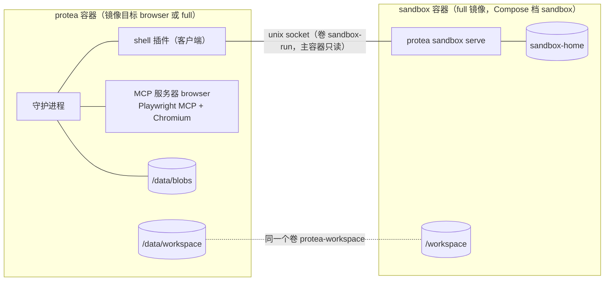

# 沙箱 shell、浏览器与视觉支持：方案

> 状态：Accepted（已实现，真实模型与 DeepSeek 的图片格式待 T12 实测）· 更新：2026-11-10 · 决策：[ADR-0013](../20-decisions/ADR-0013-sandboxed-shell-and-in-container-browser.md)、[ADR-0014](../20-decisions/ADR-0014-images-as-blob-references.md) · 相关：[14-security-and-permissions.md](../10-architecture/14-security-and-permissions.md) · [16-deployment.md](../10-architecture/16-deployment.md) · [09-mcp-integration.md](../10-architecture/09-mcp-integration.md)

三件事一次完成：助理可以自己调用的隔离持久 shell、自动控制的浏览器，以及让模型看得到图片。精确形态见对应的架构与规范文档；本文记录整体设计与主人的决定。

## 1. 总览

| 部分 | 在哪里 | 怎么接入 | 默认 |
|---|---|---|---|
| 持久 shell | 沙箱容器 | 内置插件 `shell`（后端 `sandbox`） | 不启用；启用后 `ask` |
| 浏览器 | 主容器 | `mcp.servers.browser`（stdio） | 不启用；只读工具 `allow`，其余 `ask` |
| 视觉 | Core 与 Provider 层 | 供应商档案的 `vision` | Anthropic 开，OpenAI 协议关 |

## 2. 沙箱与持久 shell

### 2.1 沙箱容器

- 镜像与主容器相同（`full`），命令 `protea sandbox serve`。入口脚本对这个命令不做数据卷准备与迁移。
- 卷：`sandbox-home` → `/home/protea`（持久）；`protea-workspace` → `/workspace`（与主容器的 `/data/workspace` 是同一个卷）；`protea-browser-files` → `/workspace/browser`（**只读**，主容器的 `/data/workspace/browser`）；`sandbox-run` → `/run/protea-sandbox`（socket）。**不挂 `/data`。**
- 网络：只在自己的出站网络 `sandbox-net` 上，主容器不在其中，所以沙箱够不到控制面。
- 用户 `protea`（uid 1000），`cap_drop: [ALL]`（只加回入口脚本交接卷属主需要的几项）、`no-new-privileges`、`mem_limit: 1g`、`pids_limit: 512`。
- 装包用 `uv`、`pip --user`、`npm` 的用户前缀；需要 `apt` 的依赖靠定制沙箱镜像。
- 开发模式（不在容器里）：`protea sandbox serve` 可以直接在本机运行，此时没有隔离，只用于开发与测试。

### 2.2 沙箱代理的协议

主容器的 `shell` 插件与沙箱代理之间是 JSON-RPC 2.0（NDJSON，复用 `@protea/protocol` 的 `RpcPeer`），只在这两者之间使用，带 `protocolVersion`。

| 方向 | 方法 | 说明 |
|---|---|---|
| 插件→代理 | `info` | 版本、工作区路径、会话与任务的现状 |
| | `shell/run` · `shell/cancel` | 前台命令；取消时整组终止 |
| | `job/start` · `job/list` · `job/logs` · `job/stop` | 后台任务 |
| | `session/reset` | 清空会话状态 |
| 代理→插件 | `job/exited`（通知） | 任务结束：退出码、时长、日志末尾 |

socket 文件权限 `0600`，属主 uid 1000。

### 2.3 工具（插件 `shell`）

| 工具 | 作用 | 标志 |
|---|---|---|
| `sh_run {command, cwd?, timeoutSec?, stdin?}` | 前台命令，返回退出码与输出；当前目录、环境变量、函数延续到下一条 | 副作用、可中断 |
| `sh_job_start {command, name?, cwd?}` | 启动后台任务，返回任务号 | 副作用 |
| `sh_job_list` | 列出任务及状态 | 只读 |
| `sh_job_logs {id, tailKb?}` | 读任务日志的末尾 | 只读 |
| `sh_job_stop {id}` | 终止任务（整组） | 副作用 |
| `sh_reset` | 清空会话状态（文件不动） | 副作用 |

- **会话状态**：每条 `sh_run` 仍是独立的 bash 进程和进程组（沿用现有的超时、整组清理、输出截断）。命令正常结束后，把当前目录、导出的环境变量和函数写到 `sandbox-home` 里的状态文件，下一条命令先恢复。超时或被杀的命令不更新状态。
- **后台任务**：独立的进程组，stdout 与 stderr 写入日志文件（有大小上限）。结束时插件推一条 L3 `flush` 事件 `shell.job_exited`（`origin: external`，含任务号、退出码与日志末尾），模型不用轮询。沙箱重启后重新连上时，丢失的任务各报一条 `shell.job_lost`。
- **插件配置**：`backend: sandbox | local`（默认 `sandbox`）、`socket`、`timeoutSec`、`maxOutputKb`、`maxConcurrent`、`env`、`jobs.max`（默认 8）、`jobs.logMb`（默认 16）。`local` 是今天的行为（主容器内、无状态、无后台任务），必须显式选择。沙箱连不上时工具回执说明原因，不退回 `local`。
- **Skill 的脚本**：`full` 镜像自带内置 Skills；数据卷里的 Skill 由模型先放进工作区再执行。
- **运维**：`protea sandbox run '<命令>'`（在主容器里执行）用单独的 `operator` 会话直接跑一条命令，用于确认连通与排查。

### 2.4 什么会保留

| 发生什么 | 文件与装好的包 | 会话状态 | 后台任务 |
|---|---|---|---|
| 守护进程重启 | 保留 | 保留 | 继续运行 |
| 沙箱容器重启 | 保留 | 保留 | 丢失，重连时报告 |
| 删除 `sandbox-home` 卷 | 清空 | 清空 | — |

## 3. 浏览器

- **镜像目标 `browser`**：`full` 加 Chromium、中文字体与固定版本的 `@playwright/mcp`。不需要浏览器的部署继续用 `full` 或 `slim`。
- **接入**：预置的 `mcp.servers.browser`（`protea mcp preset browser` 或控制台 MCP 页的按钮写入配置），stdio 传输，无头模式，`trust: normal`。热插拔、监督重启、工具搜索沿用 MCP 管理器。
- **页面表示**：以可访问性快照和元素引用为主，不依赖视觉；截图是只读工具，图片经 §4 进入模型。
- **数据**：浏览器档案在 `/data/plugin-data/mcp/browser/profile`（登录态重启后保留，打开的标签页不保留）；截图、PDF 与下载写到 `/data/workspace/browser/`，沙箱里的 shell 在 `/workspace/browser/` 只读地看到同样的文件。
- **权限**：带 `readOnlyHint` 的工具（快照、截图、网络请求、控制台消息）`allow`；导航、点击、输入等带 `destructiveHint` 的工具 `ask`（[09-mcp-integration.md](../10-architecture/09-mcp-integration.md) §6 的既有规则）。
- **在 Fork 里用**：页面快照很大，环境提示要求浏览任务放进 Fork，只把结论带回主会话，用完关闭浏览器。

留在主容器的必须项（ADR-0013）：

1. 预置条目的 `tools.deny` 含 `browser_run_code_unsafe`；安全检查清单的测试固定这一条。
2. 本地文件：根目录只给 `workspace/browser`（沙箱写不了），`file://` 导航被拒绝；`scripts/sandbox-smoke.sh` 固定（打开 `file:///data/secrets/…` 必须失败）。
3. Chromium 自带沙箱：`docker/seccomp-chromium.json` 让它能在容器里建立；建不起来时可以配置 `--no-sandbox`，此时控制台持续显示警告。
4. 资源：`docker/docker-compose.browser.yml` 覆盖主服务——镜像目标 `browser`、`mem_limit: 2g`、`pids_limit: 1024`、`shm_size: 512m`、seccomp 配置。MCP 服务器可以单独设内存上限（`mcp.servers.<id>.limits.memoryMb`，预置条目 1536），否则默认的 512 MB 会把 Chromium 的进程树当作超限杀掉。
5. 网络：把控制面地址加进 `--blocked-origins`（不是安全边界，只防误操作）。

## 4. 视觉支持

### 4.1 存储与块的形态

- blob 存储：`/data/blobs/<前两位>/<sha256>`，内容寻址；表 `blobs`（句柄、类型、大小、创建时间），迁移 8。句柄 `blob:<sha256>`，与事件信封里已有的格式一致。
- 接受 `image/png`、`image/jpeg`、`image/webp`、`image/gif`。
- 转录里的块：`{ "type": "image", "source": { "type": "blob", "handle": "blob:…", "media_type": "image/png" } }`。

### 4.2 入口

| 入口 | 改动 |
|---|---|
| 内核工具与进程内插件 | `ToolOutcome.images`；分发器把回执写成"文本块 + 图片块" |
| MCP | 返回内容里的 `image` 存成 blob 并成为图片块（原来是文字占位） |
| 进程外插件 | 协议新增 `blob/put`、`blob/get`；`tools/call` 的结果可带 `images: [{handle}]`；TS 与 Python SDK、`FakeHost`、一致性检查同步 |
| 事件 | 信封的 `blobs` 中的图片在事件文本之后渲染为图片块，带所属事件的游标 |
| Telegram | 下载照片（长边不超过 1568 像素的最大一档）→ `blob/put` → 随 `chat.message` 推入 |
| webchat | 对话页可以粘贴或选择图片，在浏览器端缩小后经 `POST /api/blobs` 上传 |
| `view_image {path}` | 内核工具：读工作区里的图片文件或一个 blob 句柄，返回图片；只读 |

### 4.3 发给模型

- 顺序：脱敏 → 录制 → 解析图片 → HTTP。录制文件与日志里只有引用。
- 档案的 `vision`：布尔值，或按角色 `{ main, fork, cheap }`。控制台「模型」页可勾选。
- 不支持视觉时，图片块渲染为一行占位：类型、大小、句柄，以及"当前模型看不到图片"。
- Anthropic：图片块原样进入 user 消息与 `tool_result` 的内容数组。
- `openai-chat`：user 消息变成分段内容（`text` + `image_url` 的 data URL）；回执里的图片放进这一轮所有 tool 消息之后的一条 user 消息，并标明来自哪次调用。
- `openai-responses`：同样的做法，分段类型为 `input_text`、`input_image`。
- token 估算沿用每张 1600；交接笔记、闲时压缩与原文存档里，图片是一行带句柄的文字。

### 4.4 上限与保留

| 配置 | 默认 | 含义 |
|---|---|---|
| `vision.maxImageKb` | 1536 | 单张图片的大小上限，超过的写成占位 |
| `vision.maxImagesPerMessage` | 4 | 一个回执或一个事件最多带几张 |
| `vision.blobRetentionDays` | 30 | blob 的保留期；过期后引用解析为"图片已不再保存" |

不在服务端缩图：浏览器视口固定为 1280×800，Telegram 选尺寸档，webchat 在浏览器端缩小。

### 4.5 控制面

- `GET /api/blobs/:handle`（仅管理员）：控制台的运行流、会话页与对话页用它显示图片。
- `POST /api/blobs`（仅管理员，受 `maxImageKb` 限制）：webchat 上传。

不包含：`chat_send` 发图片给主人（出站附件）。

## 5. 配套改动

- **时间窗授权**：批准时可以带时限——Telegram `/approve a12 1h`、`protea approvals approve a12 --for 1h`、控制台按钮。时限内同一工具族（同一个插件的工具，或 `mcp__<server>__*`）的 `ask` 调用直接放行并记审计；上限 `permissions.grantMaxMs`（默认 8 小时）；`protea approvals grants` 可列出与撤销。`deny` 不受影响。
- **Fork 的工具通配**：`fork_spawn` 的 `tools` 接受通配（`sh_*`、`mcp__browser__*`）。Fork 默认仍然拿不到有副作用的工具。
- **`tool` 类插件推事件**：`shell` 的清单声明等级与投递模式；清单校验与事件门禁按声明放行（实现时先确认现状）。
- **部署**：Dockerfile 的 `browser` 目标；Compose 的 `sandbox` 档与三个新卷；`docker-compose.browser.yml`；`docker/seccomp-chromium.json`；入口脚本识别 `sandbox`；冒烟测试覆盖沙箱与 `browser` 镜像；CI 构建并扫描第三个镜像。
- **文档**：[14](../10-architecture/14-security-and-permissions.md) §2、§3、§6 与检查清单，[16](../10-architecture/16-deployment.md)，[09](../10-architecture/09-mcp-integration.md) §4，[12](../10-architecture/12-model-providers.md)，[07](../10-architecture/07-plugin-system.md)，规范 01–06，[02-repo-layout.md](02-repo-layout.md)，[06-real-world-testing.md](06-real-world-testing.md) 新增测试项。

## 6. 主人的决定（2026-11-10）

- shell 独立一个容器；浏览器放在主容器里。
- 浏览器用 Playwright MCP，不自研。
- 视觉支持与这两项一起做（DeepSeek 已支持视觉）。
- 默认权限保持 `ask`，加时间窗授权，并提供可切换的权限模式（主人 2026-11-10 确认，[ADR-0015](../20-decisions/ADR-0015-permission-modes-and-auto-review.md)）。

## 7. 验收

2026-11-10 在本机 Docker Desktop（arm64）上用 `scripts/sandbox-smoke.sh`、真实 Compose 启动与单元、端到端测试核对；没勾的项需要真实模型或 CI。

- [x] 沙箱是非 root、无 capability，看不到 Protea 的数据，连不上控制面。
- [x] `cd` 与 `export` 在两次 `sh_run` 之间延续；守护进程重启、沙箱重启后仍在。
- [x] 后台任务在插件断开重连后继续运行，结束时报告；沙箱重启后报告 `lost`（代理层的测试）。
- [x] 沙箱不可用时 `sh_run` 回执说明原因，没有在主容器里执行。
- [x] 浏览器：导航、快照、截图走通，Chromium 自带沙箱开启（`chrome://sandbox`）；打不开 `file:///data/secrets/…`，写不到根目录之外；`browser_run_code_unsafe` 不在工具表里。
- [x] 真实守护进程 + 真实 Playwright：截图以字节到达模型请求，转录与 `provider.jsonl` 里只有引用。
- [x] 对话页贴图：3000×2000 的 PNG 缩到 1568 宽上传，发送后气泡里显示。
- [x] 非视觉模型收到占位；同一段带图片的历史两次请求字节相同。
- [x] 带时限的批准在时限内放行同族调用、到期后重新询问，审计里有每次调用与授权编号。
- [x] `pnpm typecheck`、`pnpm test` 通过。
- [ ] 登录态在容器重启后保留（档案确认在数据卷上，真实站点待 T12）。
- [ ] Fork 用通配拿到浏览器工具并完成一次浏览任务（通配已测，真实任务待 T12）。
- [ ] `full`、`slim` 的镜像冒烟与三个镜像的 Trivy 扫描（CI）。

## 8. 未验证，实现时确认

- DeepSeek 的图片输入格式（按 OpenAI 的 `image_url` 实现）：需要主人用真实 Key 测一次，结论记入 [06-real-world-testing.md](06-real-world-testing.md)。
- `seccomp-chromium.json` 能否让 Chromium 的沙箱在目标 VPS 的内核上建立（Docker Desktop 上已确认）。

## 9. 升级注意

- `/data/workspace` 改为独立的卷 `protea-workspace`：原数据卷里该目录下的文件会被遮住，升级前搬出来、升级后放回。
- 已启用 `shell` 的实例：加上沙箱，或在配置里显式写 `backend: local`；否则工具不可用。
- `sh_run` 的语义从"每次全新的 shell"变为"状态延续"，系统前缀里的环境提示随之变化，提示缓存失效一次。
- 迁移 8 新增 `blobs` 与时间窗授权的表；旧镜像打不开迁移后的数据库，回滚需要迁移前的快照。
- 启用浏览器要换镜像目标并调高主容器的资源上限；用 `docker run` 而不是 Compose 的部署要自己加 `--security-opt seccomp=…`、`--shm-size`、`--memory`、`--pids-limit`。
