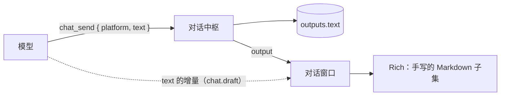
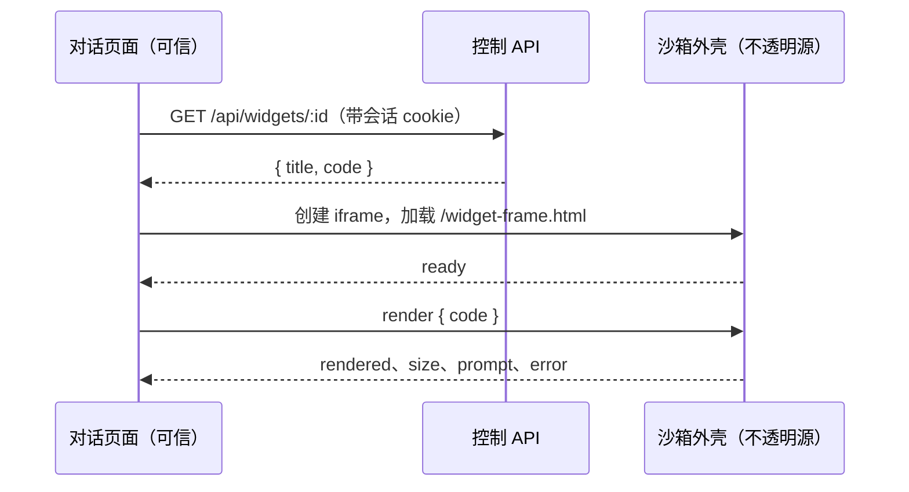

# 对话窗口的富内容展示：方案

> 状态：Accepted（2026-11-11 实现；真实模型与 Chrome 之外的浏览器待 T16 实测）· 更新：2026-11-11 · 决策：[ADR-0018](../20-decisions/ADR-0018-rich-chat-content-and-widget-sandbox.md) · 相关：[17-chat-and-console.md](../10-architecture/17-chat-and-console.md) · [13-control-plane.md](../10-architecture/13-control-plane.md) §5 · [14-security-and-permissions.md](../10-architecture/14-security-and-permissions.md) §8.1 · [03-plugin-protocol.md](../30-specs/03-plugin-protocol.md) · [ADR-0012](../20-decisions/ADR-0012-chat-platforms-and-operator-console.md) · [ADR-0014](../20-decisions/ADR-0014-images-as-blob-references.md)

对话窗口现在只能把回复显示成段落、列表和代码块。本文说明表格、流程图、问答（助理给选项，主人点选）、图片和内联小组件怎么进入对话，参考了哪些做法，安全边界怎么变，以及以后的连接器怎么接入同一套能力。

本文是实施前定下的方案，保留原样供对照；精确形态以架构与规范文档为准，实施中和方案不一样的地方记在 §15。

v2 相对 v1 的两处变化：内联小组件并入本轮（§7、§8）；图片、选项、小组件和流式草稿都做成平台声明的能力，进程外的连接器可以用同一套接口实现（§9）。

## 1. 现状

回复的路径只有一条，全程只有一个字符串：



| 内容 | 现在的表现 | 原因 |
|---|---|---|
| 表格 | 原样显示成一行行 `\| a \| b \|` | `Rich`（`apps/web/src/components/Rich.tsx`，97 行）不认表格 |
| 流程图、时序图 | 只能是代码块里的字符画或源码 | 没有图表渲染 |
| 问答 | 助理把选项写成文字，主人自己打字回答 | `chat_send` 只有 `text`；窗口里唯一的交互是审批卡片 |
| 图片（截图、画好的图） | 助理发不出来 | 只有主人的消息能带图片 |
| 代码 | 等宽文本，没有语言标记、高亮和单独的复制 | 围栏的语言名被丢掉 |
| 标题层级、斜体、删除线、嵌套列表、任务列表、分隔线、脚注 | 标题都是同一种粗体，其余原样显示符号 | 手写解析只覆盖一个子集 |
| 公式 | 原样显示 `$…$` | 同上 |

另外，`plugins/webchat/ENV_PROMPT.md` 告诉模型这里只渲染"代码块、列表、粗体和链接"，所以模型本来也不会写表格。渲染能力和这句说明必须一起改。

设计要守住的现有约束：

1. **对话只显示 `chat_send` 发出的内容**（ADR-0012）。思考、工具调用留在控制台。
2. **一个 `chat_send` 面向多个平台**。Telegram 声明 `markdown: none`，微信 `basic`，`protea chat` 是终端。
3. **主页面的 CSP 不放开**：`script-src 'self'`、`img-src 'self' data:`、不允许被嵌入（`packages/control/src/static.ts`）。
4. **回复按不可信文本渲染**。回复内容可能受外部内容影响（提示注入）；现在的 `Rich` 只生成 React 文本节点，从不插入 HTML。
5. **流式草稿**取的是 `chat_send.text` 的增量，渲染器必须能处理写到一半的文本。
6. **`outputs` 只追加**，历史要能原样重放。
7. 网页不用组件库（Q7），目前运行时依赖只有 React。

## 2. 别人怎么做

2026-11-11 查阅了三家的官方文档、changelog 与开源仓库（来源见本节末尾）。查不到依据的不写。

| | Claude Code | Codex | OpenClaw |
|---|---|---|---|
| 正文 | Markdown | Markdown | Markdown（`markdown-it` + DOMPurify） |
| 表格 | 终端里画网格，窄了改成纵向的"键：值"，超过 200 行截断 | 终端里同样在窄时改成纵向键值 | 网页里横向滚动，有"复制表格"（制表符分隔）和"展开表格" |
| 流程图 | 终端不画图。要图就发布成 Artifact 页面（官方建议用 SVG 或 HTML/CSS 画）；桌面端另有内联小组件工具 `show_widget`（SVG 或 HTML 片段） | 终端把**已闭合**的 ` ```mermaid ` 围栏画成 Unicode 文本图，画不了就显示一行原因加源码，不显示半张图；桌面端有内联可视化（预览中） | ` ```mermaid ` 围栏在隔离的 iframe 里渲染成 SVG；没闭合时保持为代码，失败显示源码加错误，可切换图与源码。另有 `show_widget`（HTML/SVG，独立源的 iframe） |
| 问答 | 工具 `AskUserQuestion`：1–4 题，每题 2–4 项（`label`、`description`），`header` ≤ 12 字符，可多选，"其他"由客户端补；阻塞等回答 | 工具 `request_user_input`：建议 1 题、最多 3 题，每题 2–3 项，推荐项放第一个，"其他"由客户端补；答完在历史里留一条记录 | 工具 `ask_user`：1–3 题，每题 2–4 项，可多选，默认 900 秒超时。网页是输入框上方的面板；Telegram 等渠道只有单题单选用原生按钮，其余降级成文字、主人回复编号；没有这类控件的渠道不提供这个工具 |
| 图片与文件 | `SendUserFile`（内联打开或下载卡片） | 图片条目；文件在对话旁预览 | 结构化的媒体字段；写在正文里的 `MEDIA:` 行只作兼容 |
| 流式 | 表格边到边重排 | 文本分"已稳定区"和"可变尾部"；表格、未闭合的公式和 Mermaid 围栏留在尾部 | 用 `remend` 补上未闭合的标记再渲染 |
| 过程 | 工具调用折叠成一行摘要，思考折叠 | 命令输出只预览 5 行，思考摘要可隐藏 | 工具活动折叠成"Worked for…"，失败的保持可见 |
| 多渠道 | — | — | Markdown 先转成中间表示再按渠道输出；表格按渠道配置成代码块、列表或关闭；富消息块按渠道声明的能力降级成文字 |

共同点：

1. **正文都是 Markdown。** 表格和任务列表靠渲染器，没有哪家为表格单独做工具。
2. **图有两条路。** 一条是客户端变换围栏代码块（Mermaid）；另一条是模型写 HTML / SVG，页面在隔离的 iframe 里运行。三家都有第二条路，都配了独立的源、严格的 CSP 和一座很窄的桥。OpenClaw 在 2026-10 去掉了声明式的 A2UI，只留 HTML 小组件。
3. **提问是三家都用专用结构的东西**，形态几乎一样：题少、选项少、标签短、"其他"由客户端补。
4. **流式**：写完的部分不重排，表格和未闭合的围栏压在尾部；Mermaid 闭合后才渲染，失败退回源码。
5. **媒体走结构化字段**，不靠正文里的标记。
6. **能力不够的渠道**，要么不给工具，要么降级成文字。

和 Protea 不同的两点：

- 三家的提问都阻塞等待（人就在面前，或者有超时）。Protea 的主人可能几小时后才看到，所以 §6 的问答不阻塞。
- Claude Code 与 Codex 把工具调用显示在对话里，因为那就是它们的工作内容。Protea 已经决定把过程放在控制台（ADR-0012），本方案不动。

来源：Claude Code 的 [tools-reference](https://code.claude.com/docs/en/tools-reference)、[user-input](https://code.claude.com/docs/en/agent-sdk/user-input)、[artifacts](https://code.claude.com/docs/en/artifacts) 与 [CHANGELOG](https://raw.githubusercontent.com/anthropics/claude-code/main/CHANGELOG.md)；Codex 的 [codex-rs](https://github.com/openai/codex/tree/main/codex-rs)（`tui` 下的 `markdown_render`、`mermaid`，`core` 下的 `request_user_input_spec.rs`）与 [app-server](https://learn.chatgpt.com/docs/app-server.md)；OpenClaw 的 [control-ui/chat](https://docs.openclaw.ai/web/control-ui/chat)、[ask-user](https://docs.openclaw.ai/tools/ask-user)、[show-widget](https://docs.openclaw.ai/tools/show-widget)、[markdown-formatting](https://docs.openclaw.ai/concepts/markdown-formatting)、[rich-output-protocol](https://docs.openclaw.ai/reference/rich-output-protocol)。`show_widget` 在 Claude Code 桌面端的公开文档里没有记载，是在本机会话的工具列表里看到的。

## 3. 取向：内容写进 Markdown，其余是平台声明的能力

| 层 | 装什么 | 模型怎么表达 | 平台声明 |
|---|---|---|---|
| 内容 | 表格、流程图、代码、公式、任务列表、提示框 | `text` 里的 Markdown；图是 ` ```mermaid ` 代码块 | `markdown` |
| 附件 | 图片 | `chat_send.images` | `images` |
| 交互 | 选项 | `chat_send.choices` | `choices` |
| 小组件 | 模型写的 HTML / SVG 片段，可以交互 | `chat_send.widget` | `widgets` |
| 流式 | 回复边写边显示 | 不用表达 | `drafts` |

**能用 Markdown 说的就用 Markdown。**

- 表格和流程图是"要读的内容"，Markdown 是模型最熟的写法，不需要为今天的模型另造一套格式（P2）。
- 流式草稿、`outputs`、`protea chat`、审计和运行流都不用改，历史仍是一段可读的文字。
- 换到别的平台时最坏的结果是看到 Markdown 源码，不会丢内容。
- 渲染面最小：不执行模型写的脚本，不加载站外资源。

附件、交互和小组件不放进 Markdown，因为它们不是文字：图片要落到 blob 存储并受数量、大小限制；选项要有"已选 / 已失效"的状态；小组件要在隔离的环境里运行。小组件只用在 Markdown、Mermaid 和图片都表达不了的地方：可以交互的图表、能拖动参数的计算、自由排版的图示。

**每一层都是平台声明的能力，不是网页专有的。** `webchat` 只是第一个全部声明的平台，走的是和别的连接器同一套声明与方法（§9）。调用带了平台没有声明的字段时，回执失败并说明（例如 `telegram does not show choices; put the options in the text`），这和"写错平台时回执列出可选值"是同一个做法（P3、P4）；中枢不替模型改写内容（P1）。

没有采用的做法：

- **把回复拆成带类型的块**（`[{ type: "table", … }, { type: "text", … }]`，Vercel AI SDK 的 `UIMessage.parts`、OpenClaw 的 `MessagePresentation` 是这个思路）：每个平台都能精确渲染，但模型要多学一套 schema，流式草稿要解析嵌套的半截 JSON，历史不再是一段可读的文字。表格和图用 Markdown 已经够了。
- **正文里的带内标记**（Codex 的 `::directive{…}`、OpenClaw 的 `MEDIA:` 行）：不用改工具 schema，但正文里引用到的外部内容可以伪造标记。图片、选项和小组件是参数，只有模型自己的调用能带上。
- **阻塞式提问**（三家都是）：见 §2 末尾。
- **声明式界面**（A2UI 一类）：OpenClaw 用过又去掉了；组件目录要长期维护。

## 4. 内容层：换掉渲染器

### 4.1 渲染管线

用 `react-markdown` + `remark-gfm` 替换手写的 `Rich`。它把 Markdown 解析成语法树后直接生成 React 元素，不经过 HTML 字符串，和现在"只生成 React 节点"的做法一致。

| 语法 | 显示 |
|---|---|
| 标题 `#`–`######` | 三档字号（一、二级；三级；四级以下），不出现页面级的大标题 |
| 粗体、斜体、删除线、行内代码、链接、自动链接 | 常规 |
| 有序、无序、嵌套列表；任务列表 `- [ ]` | 任务列表是只读的勾选框 |
| 引用；提示框 `> [!NOTE]`、`[!TIP]`、`[!WARNING]` | 提示框带颜色和标题 |
| 表格 | §4.2 |
| 围栏代码 | §4.4；语言是 `mermaid` 时见 §4.3 |
| 公式 `$$…$$` | §4.4 |
| 分隔线、脚注 | 常规 |
| 原始 HTML | **不渲染**，按文字显示 |
| 图片 `` | **不加载**站外图片，显示成一个链接；助理发图走 `images`（§5） |

规则（规范性）：

- 禁止启用任何渲染原始 HTML 的插件（`rehype-raw` 一类）。模型写的 HTML 只能经 `widget` 进沙箱（§7、§8）。
- 链接只允许 `http`、`https`、`mailto`，一律新窗口打开并带 `rel="noreferrer noopener"`；其他协议按文字显示。
- 重的部分（高亮、Mermaid、公式）必须按需加载：消息里出现时才取对应的代码块，首屏体积只增加解析器本身。

### 4.2 表格

- 表格放在可横向滚动的容器里，不撑破 780px 的对话列；表头固定在容器顶部；按 GFM 的对齐标记对齐。
- 超过 12 行时先显示前 12 行，点"展开全部 N 行"。
- 右上角有"复制"：复制成制表符分隔的文本，可以直接贴进表格软件。
- 手机上保持横向滚动，不把表格改排成卡片（改排会打乱模型安排好的列）。

### 4.3 流程图与图表：Mermaid

` ```mermaid ` 代码块渲染成图。Mermaid 覆盖流程图、时序图、状态图、甘特图、思维导图、时间线、饼图和简单的柱状 / 折线图，模型写得最稳，本仓库的文档也用它。

- 按需加载 `mermaid`；`securityLevel: 'strict'`（禁用点击回调，输出经它自带的清洗），`htmlLabels: false`（标签是 SVG 文本，不是嵌入的 HTML）。
- 渲染前先校验语法。写错时显示源码和一行"图表语法有误"，不显示 Mermaid 自己的报错图。
- 流式过程中，围栏没有闭合就只显示占位（"正在画图…"），闭合后再渲染一次，避免每 50 ms 重画。
- 工具条：放大查看、切换图与源码、复制源码、下载 SVG。颜色跟随现有的主题变量，支持深色。
- 上限：源码超过 8000 字符或渲染超过 3 秒就退回显示源码，防止一张巨大的图卡住页面。
- 这是主页面里唯一一处插入非 React 生成的标记（Mermaid 输出的 SVG），集中在一个组件里。即使清洗被绕过，`script-src 'self'` 仍然拦住内联脚本和事件属性，`img-src` 与 `connect-src` 拦住站外请求，所以主页面的 CSP 不放开是这一条的前提。OpenClaw 把 Mermaid 放进隔离的 iframe；这里有 CSP 兜底，而把 Mermaid 搬进小组件的沙箱要把整个库的源码传进去，不值得。

需要真实数据的统计图有两条路：助理在沙箱 shell 里用 Python 画成 PNG，用 `images` 发出来（§5）；要能交互就写成小组件（§7）。

### 4.4 代码与公式

- 代码块：顶部一行显示语言和"复制"；按需加载 `highlight.js` 的核心和约 20 种常用语言，配色用主题变量；超过 24 行先折叠。未知语言不高亮。
- 公式：`remark-math` + KaTeX，按需加载，字体随包自带（`font-src 'self'`）。只认 `$$…$$`，关闭单个 `$` 的行内公式，避免把"$5 到 $10"当成公式。

### 4.5 流式容错

草稿每 50 ms 更新一次，文本随时可能断在语法中间。

- 按空行把文本切成块（围栏内不切），已经写完的块用 `React.memo` 缓存，只有最后一块重新解析。20000 字符的回复不会越写越卡。
- 没闭合的围栏：CommonMark 本来就当作一直到结尾的代码块，不用处理。
- 表格：分隔行（`|---|`）到达之前，把最后这一块压着不显示，避免先闪一下竖线文字。
- 没闭合的 `**`、`` ` ``、链接：显示前用 `remend` 补上闭合符号（OpenClaw 与 Streamdown 用的同一个小库；只影响显示，不改存下来的文本）。
- 草稿和最终回复用同一个组件渲染，替换时不跳动。

## 5. 附件层：助理可以发图片

```json
{ "platform": "webchat", "text": "这是上周的支出分布。", "images": ["charts/spend.png", "blob:3f9a…"] }
```

- `images` 的每一项是工作区路径或 blob 句柄，和 `view_image` 的 `path` 同一套写法、同一段解析代码（工作区文件先存进 blob 存储）。最多 `vision.maxImagesPerMessage` 张（默认 4），单张不超过 `vision.maxImageKb`。
- `text` 仍然必填：它是图片的说明，也是历史和通知里的文字。
- 对话窗口在正文下方显示缩略图，点开在页内放大（现有的 `BlobImages` 加一个灯箱）。
- blob 有保留期（默认 30 天），过期后这里显示"图片已不再保存"，和主人发的图片一致。
- `GET /api/blobs/:handle` 现在只对管理员开放，只读账号在对话里看不到图片（主人发的图片今天就是这样）。本方案建议放宽到"只读账号可以读对话里出现过的 blob"（D8）；这改了 ADR-0014 的一条后果，写进 ADR-0018。

## 6. 交互层：问答

```json
{
  "platform": "webchat",
  "text": "周五的评审放在什么时候？",
  "choices": { "options": [{ "label": "周五下午", "detail": "15:00–16:00，大家都有空" }, { "label": "下周一上午" }], "multiple": false }
}
```

- 问题就是 `text`。`options` 2–6 项，`label` 不超过 40 字符、纯文本，`detail` 可选、不超过 120 字符；`multiple: true` 时可以多选。
- 显示：正文下方一组按钮（标签加一行说明）。多选时是勾选框加"发送"。旁边提示"也可以直接输入"，所以不需要"其他"这个选项。
- **点选等于替主人发送这段文字**：答案是一条普通的 `chat.message`，正文是所选的 `label`（多选用"、"连接），`meta.answer` 记下它回答的是哪一条（§9.4）。模型看到的是一条普通的主人消息。不新增事件类型和等待机制。
- 卡片状态由历史推出，不单独存储：有一条主人消息的 `answer.to` 指向它时，所选项标成已选；它后面出现了别的主人消息或新的一组选项时，卡片变成不可点；否则可点。同一时刻只有最新的一张可点，所以答案永远是问题之后的下一条主人消息，模型不会对错号。
- 不阻塞：`chat_send` 照常返回回执（`barrierAfter` 不变），这一批结束，答案作为新事件触发下一批。主人可能几小时后才回答，重启也不丢（P9）。
- 规则：`label` 禁止以 `/` 开头（Telegram 与微信用 `/approve <id>` 做审批，选项不能变成一键审批；OpenClaw 对小组件代发的消息有同样的限制）；审批永远不走 `choices`。只读账号看得到选项但不能点。

## 7. 小组件层

### 7.1 形态

```json
{
  "platform": "webchat",
  "text": "按月份看支出，可以拖动预算线。",
  "widget": { "title": "支出与预算", "code": "<div id=\"chart\"></div><script>…</script>" }
}
```

- `code` 是一段 HTML 或 SVG 片段（不带 `<html>`、`<head>`、`<body>`），可以有内联的 `<style>` 和 `<script>`。上限 `chat.widgetMaxKb`（默认 64）。`title` 必填，不超过 60 字符，显示在外框上，也是 `protea chat` 和不支持的入口里的文字。
- `text` 仍然必填：小组件挂在这条回复下面，正文说明它是什么。一条回复最多一个小组件。
- 小组件里**没有网络、没有外部资源、没有存储**：不能加载站外的脚本、样式、图片、字体；`fetch`、WebSocket、表单提交、弹窗、打开链接都不可用；图片只能是 `data:`。链接写在正文里。
- 外壳提供三样东西：一组跟随深浅色的 CSS 变量（文字、次要文字、边线、底色、强调色、字体）；自动高度；`sendPrompt(text)`。
- `sendPrompt(text)` 把一段文字**填进主人的输入框，不发送**。主人看到的就是将要发出的内容，自己决定发不发。选项可以点了就发，是因为按钮上的字由页面自己画、和发出的文字是同一个；小组件里的按钮写什么、发什么都由模型写的代码决定，所以多一步确认。

回执前的检查是给模型的提示，不是防线（防线在 §8）：

- 超过大小上限时回执失败。
- 出现 `<script src>`、`<link href>`、`<iframe>`、`<object>`、`<embed>`、`<base>`、`<meta http-equiv>` 时回执失败，并说明这里没有外部资源。
- 内联脚本过一遍语法解析（只编译，不执行），有语法错时回执带上位置，模型当场改。

### 7.2 存储与读取

- 迁移 9 新增表 `widgets (id, created_at, title, code, session_id, batch_id)`。`id` 是 `title` 加 `code` 的摘要（内容寻址，同样的只存一份）。`outputs.meta.widget = { id, title }`。
- `GET /api/widgets/:id` → `{ id, title, code }`，需要登录，只读账号可读。**模型写的 HTML 只作为 JSON 里的一个字符串离开服务器，没有任何地址把它当网页返回。**
- 和 `outputs` 一样不自动清理；备份带上，诊断包不导出。

### 7.3 显示

- 回复正文下面是一个带外框的区域。顶部一行是标题、"小组件"标识和操作：重新加载、在单独的页面打开（`#/widget/<id>`）、查看源码。外框和这一行由页面自己画，在 iframe 之外，小组件改不了。
- 高度由小组件上报，页面限制在 40–640px，更高的内容在框内滚动。宽度等于对话列。单独的页面里高度不设上限。
- 进入视口才加载。同时最多保留 4 个活的小组件，超出时离视口最远的退回占位（标题加"点击显示"）。
- 流式：草稿阶段在正文下显示"正在生成小组件…"（§9.3 的 `pending`），最终回复到达后才加载。
- 出错：脚本抛错，或 5 秒内没有渲染完，显示"小组件没有正常运行"和"查看源码"。
- 总开关 `chat.widgets`（默认开）。关掉后平台不再声明 `widgets`，模型发不出新的；历史里的显示成"小组件已停用"，代码不加载。

## 8. 安全边界

小组件是本方案里唯一让模型写的脚本运行起来的地方。这一节说清楚边界改了什么、靠什么守住、剩下什么风险。

### 8.1 改了什么，没改什么

| 边界 | 现在 | 改后 |
|---|---|---|
| 主页面的 CSP | `default-src 'self'; script-src 'self'; …; frame-ancestors 'none'` | 不放开任何一项，只把已经隐含的 `frame-src 'self'` 写明 |
| 可以被嵌入的页面 | 没有，全部 `X-Frame-Options: DENY` | 只多一个 `/widget-frame.html`，只允许同源页面嵌入 |
| 服务器把模型写的内容当网页返回 | 从不 | 仍然从不 |
| 模型写的脚本在哪里运行 | 哪里都不运行 | 只在沙箱外壳里 |
| 页面接收不可信代码发来的消息 | 没有 | `postMessage`，五种消息（§8.3） |
| blob 读取 | 仅管理员 | D8 |

### 8.2 沙箱外壳

`/widget-frame.html` 是随网页构建产物发布的一个静态文件：内容固定，不含任何数据，不需要登录（和 `index.html` 一样）。它带自己的响应头：

```
content-security-policy: sandbox allow-scripts; default-src 'none'; script-src 'unsafe-inline';
  style-src 'unsafe-inline'; img-src data: blob:; media-src data: blob:; font-src data:;
  connect-src 'none'; frame-src 'none'; worker-src 'none'; form-action 'none'; base-uri 'none';
  webrtc 'block'; frame-ancestors 'self'
x-content-type-options: nosniff
referrer-policy: no-referrer
x-dns-prefetch-control: off
permissions-policy: 摄像头、麦克风、定位、剪贴板等全部关闭
```

页面这样嵌入它：`<iframe sandbox="allow-scripts" allow="" referrerpolicy="no-referrer" src="/widget-frame.html">`。



- **两层沙箱**：iframe 的 `sandbox` 属性和响应头里的 `sandbox` 指令，都没有 `allow-same-origin`。外壳里的文档因此是不透明源：读不到 cookie 和存储，向本站发请求算跨站。响应头那一层保证有人直接在地址栏打开外壳时也一样。
- **代码由可信页面取、由沙箱运行**：页面用自己的登录态从 API 取到代码，经 `postMessage` 交给外壳。外壳自己不取任何东西，所以它不需要登录态，也没有地方可以把登录态交给它。
- 外壳在收到 `render` 之前不含模型写的代码。页面只在收到这个 iframe 发来的 `ready` 之后才发 `render`，只发一次。
- 页面只认 `event.source` 是自己创建的那个 iframe 的消息（不透明源的 `origin` 是 `null`，不能用来识别）。

规范性条款：

- 禁止给外壳的 `sandbox`（属性与响应头）增加 `allow-same-origin`、`allow-forms`、`allow-popups`、`allow-top-navigation`、`allow-modals`、`allow-downloads`。
- 禁止给外壳的 CSP 增加任何网络来源（包括 `'self'` 和 CDN）。
- 禁止新增任何把 `widgets.code` 以 `text/html` 返回的地址。
- 要改这三条，先写 ADR。

### 8.3 桥

| 方向 | 消息 | 页面怎么处理 |
|---|---|---|
| 页面 → 外壳 | `render { code }` | — |
| 外壳 → 页面 | `ready` | 发出 `render` |
| | `rendered` | 显示小组件，清掉加载标记 |
| | `size { height }` | 取整并限制在 40–640 |
| | `prompt { text }` | 只在主人刚刚点过（页面的 `navigator.userActivation.isActive`）时接受；截到 2000 字符、去掉控制字符；填进输入框并聚焦，**不发送**；一次点击最多一条 |
| | `error { message }` | 截到 300 字符，按文字显示 |

外壳发来的内容一律按不可信的文本或数字处理：不进 `innerHTML`，不拼进地址，不传给任何 API。其他类型的消息丢弃。

### 8.4 威胁与防线

| 威胁 | 防线 |
|---|---|
| 小组件以主人的身份调用控制 API（批准工具、读记忆和秘密） | 不透明源读不到 cookie；会话 cookie 是 `HttpOnly`、`SameSite=Strict`，沙箱里发出的请求是跨站请求，不带它；修改类接口还要 CSRF 头；WebSocket 检查 `Origin`。并且 `connect-src 'none'` 下请求本身就发不出去 |
| 把数据送到站外 | `default-src 'none'` 关掉脚本、图片、样式、字体、媒体的外部加载和 `fetch`、WebSocket；沙箱禁掉表单、弹窗和顶层跳转；iframe 自己跳到站外会被主页面的 `frame-src 'self'` 拦住，页面发现 iframe 第二次触发 `load` 就卸载它；DNS 预取和 WebRTC 由上面两个头关掉 |
| 冒充界面（假的审批卡片、假的登录框） | 外框和"小组件"标识画在 iframe 之外；小组件出不了自己的框，高度有上限；审批只出现在页面自己的卡片里；在小组件里输入的东西出不去，只能经 `sendPrompt` 进到主人看得见的输入框 |
| 替主人发消息 | `sendPrompt` 只填输入框；要主人刚点过；限长、限次 |
| 卡死页面（死循环、巨大的 DOM） | 进入视口才加载；最多 4 个活的；5 秒没渲染完就卸载；加载前在 `localStorage` 记一个标记、渲染完清掉，刷新后发现标记还在就不自动加载这一个，显示"上次没有加载完，点击重试" |
| 小组件之间互相读写 | 每个 iframe 是各自的不透明源 |
| 直接打开外壳的地址 | 响应头的 `sandbox` 仍然生效；外壳里没有数据 |
| 页面处理外壳消息时被注入 | 只认五种消息，只当文本和数字用，校验 `event.source` |
| 提示注入让模型写出恶意的小组件 | 以上每一条都假设代码是恶意的。小组件里能有的数据只有模型自己写进去的 |

剩下的风险：

- 不认 `webrtc` 指令的浏览器里，WebRTC 可能是一条出站通道。小组件里只有模型写进去的数据，而被注入的模型本来就可以用别的工具往外发，那条路由 `permissions` 管。
- 有的浏览器把沙箱 iframe 和主页面放在同一个进程里，死循环会卡住整页，靠上面的标记在刷新后恢复。
- `frame-src` 对 iframe 内部跳转的拦截、沙箱请求不带 `SameSite=Strict` 的 cookie，这两条是按规范和 Chromium 的实现写的，实现时必须在三个浏览器里实测（§12）。哪一条不成立，小组件就不能发布。

## 9. 平台接口：给以后的连接器

`webchat` 不走特殊通道。下面每一项都是清单里的声明加协议里的方法，进程内和进程外的平台是同一套；现在只有进程内平台才有的草稿，本轮补到进程外协议里。

### 9.1 能力声明

清单的 `chat` 块（`ChatPlatformDecl`）：

| 键 | 含义 | 声明了就要做到 |
|---|---|---|
| `markdown` | `none` / `basic` / `full`（已有） | — |
| `maxChars` | 单条消息的上限（已有） | 超长自己分段 |
| `images` | 能发图片 | 用 `blob/get` 取字节 |
| `choices` | 能显示可点的选项 | 把答案推回来，让旧选项失效（§9.4） |
| `widgets` | 能显示小组件，或给出打开它的入口 | — |
| `drafts` | `{ minIntervalMs? }`：能边写边显示 | **必须能撤回**预览（§9.3） |

中枢按声明做三件事：

1. **校验**：调用带了平台没有声明的字段，回执失败并说明。
2. **告诉模型**：`chat_send` 的描述里按声明生成一行平台能力，例如 `webchat: markdown full, images, choices, widget; telegram: plain text, up to 3500 characters`。平台启停时本来就要更新 `platform` 的枚举，描述跟着一起变，不多一次缓存失效。新连接器不用在提示词里再写一遍自己支持什么，也不会写错。
3. **给控制台**：`ChatPlatformInfo` 带上这些字段。

### 9.2 `chat/send`

```ts
interface ChatSendParams {
  text: string;
  replyTo?: string;
  sessionId?: string;
  batchId?: string;
  /** 这条消息的编号：草稿和答案都用它对上。 */
  callId?: string;
  /** 平台声明了 images 才会有。 */
  images?: BlobImageRef[];
  /** 平台声明了 choices 才会有。 */
  choices?: { options: Array<{ label: string; detail?: string }>; multiple?: boolean };
  /** 平台声明了 widgets 才会有。url 是网页里的单独页面，配置了 control.publicUrl 时才给。 */
  widget?: { id: string; title: string; url?: string };
}
```

只增不改，契约版本 `api` 不变。返回值不变（`{ ok, messageIds?, error? }`）。

### 9.3 `chat/draft`（宿主到插件的通知）

```ts
type ChatDraftParams =
  | { callId: string; batchId: string; state: 'writing'; text: string; pending?: Array<'images' | 'choices' | 'widget'> }
  | { callId: string; batchId: string; state: 'discarded' };
```

- `text` 是到目前为止的全文，不是增量，丢一条也不要紧。宿主按平台声明的 `minIntervalMs` 合并（默认 1000，最小 250），因为多数平台对改消息有频率限制。
- `pending` 列出还在写的结构化部分，平台可以显示"还有一张图在路上"。
- 结束只有两种：同一个 `callId` 的 `chat/send` 到达（平台把预览换成正式消息），或 `discarded`（平台撤掉预览）。
- 草稿不是外部输出：不落库，不影响抢占，模型调用被取消时草稿要消失。所以声明 `drafts` 的平台必须能删除或改写已经显示的预览；做不到就不要声明。
- 插件在 `initialize` 时声明能力位 `chatDrafts`，和清单的 `chat.drafts` 同时存在才生效（与 `chat` 的规则一致）。
- "正在处理"的提示不用新接口，已有的 `run/phase` 就是。

网页用的总线记录 `chat.draft` 仍是增量加 `offset`（50 ms），同样增加 `pending`。

### 9.4 答案怎么回来

选项的答案是一条普通的 `chat.message`：

- `text` 是主人选的内容：单选是 `label`，多选由平台连成一句。模型按普通消息读。
- `meta.answer = { to: <callId>, labels: [...] }`。核心不解释它，只原样带进对话历史，供界面标出"已选"。
- 规则：一个平台上只有最新的一组选项有效；主人发了别的消息，或助理又发了新的一组，旧的就失效。平台应当在失效时撤掉控件，撤不掉的必须丢弃过期的点击。

网页走同一条路：`POST /api/chat/messages` 增加可选的 `answer: { to, labels }`。

### 9.5 SDK、检查与示例

- TypeScript：`definePlugin({ chat: { send, draft? } })`；新字段的类型；`chatAnswer(to, labels)` 生成 `meta` 片段；`FakeHost` 增加 `chatDraft()`。
- Python：`on_chat_send` 收到新字段，新增 `on_chat_draft`。
- `protea dev-plugin --check`：清单声明的每项能力都要有对应的能力位和处理器；探针 `"chat": { "text": "…", "choices": true, "draft": true }` 各真的调用一次。
- 示例连接器 `examples/plugins/ts-chat`：一个把对话写进本地文件的最小平台，声明并实现全部能力。它是这套接口的第一个进程外使用者，端到端测试用它验证整条路径。

### 9.6 现有平台

| 平台 | `markdown` | `images` | `choices` | `widgets` | `drafts` |
|---|---|---|---|---|---|
| `webchat` | `full` | 是 | 是 | 是 | 是（50 ms） |
| `telegram` | `none` | — | — | — | — |
| `wechat` | `basic` | — | — | — | — |
| `qq`（2026-11-11 落地后加入） | `none` | 是 | 是（按钮或编号列表） | — | 是（QQ 流式消息，500 ms） |

Telegram 用这套接口可以做内联按钮、发图和边写边改消息，是否本轮接入见 D6。

## 10. 接口与存储的改动

**`chat_send`**（`packages/core/src/chat/hub.ts`）增加三个可选参数：

| 参数 | 形态 | 限制 |
|---|---|---|
| `images` | `string[]` | 1–`maxImagesPerMessage` 项，工作区路径或 blob 句柄 |
| `choices` | `{ options: [{ label, detail? }], multiple? }` | 2–6 项；`label` ≤ 40 字符且不以 `/` 开头 |
| `widget` | `{ title, code }` | `code` ≤ `chat.widgetMaxKb`；§7.1 的检查 |

**存储**：迁移 9 给 `outputs` 增加一列 `meta TEXT`（JSON：`{ callId?, images?, choices?, widget? }`，旧行为 `NULL`），并新增表 `widgets`。迁移之后旧镜像不能再打开这个数据库（和以往的迁移一样），回退要用升级前的备份。

**控制面**：

- `ChatItem`：回复增加 `callId`、`images`、`choices`、`widget: { id, title }`；主人的消息增加 `answer`。实时流的 `output` 记录同样增加这些字段。
- `GET /api/widgets/:id`（新）；`POST /api/chat/messages` 增加 `answer`；`GET /api/blobs/:handle` 的权限按 D8 调整。
- `/widget-frame.html`（新，静态）带 §8.2 的响应头；主页面的 CSP 写明 `frame-src 'self'`，其余不变。

**插件协议**：§9.2–§9.4。

**配置**：新增 `chat.widgets`（默认 `true`）与 `chat.widgetMaxKb`（默认 `64`）。

**让模型知道**：`chat_send` 的描述带平台能力（§9.1）。`plugins/webchat/ENV_PROMPT.md` 说明这里渲染 GitHub 风格的 Markdown（表格、任务列表、带语言的代码块、` ```mermaid ` 图），以及什么时候用小组件、小组件里有什么和没有什么（§7.1）。

**`protea chat`**：选项打印成编号列表，图片打印成 `[image: <句柄>]`，小组件打印成 `[widget: <标题>]`。

改动清单：

| 位置 | 改动 |
|---|---|
| `apps/web/package.json` | 新增 `react-markdown`、`remark-gfm`、`remend`（随首屏）；`mermaid`、`highlight.js`、`remark-math`、`rehype-katex`（按需加载） |
| `apps/web/src/components/Rich.tsx` → `components/rich/` | `Markdown.tsx`（管线与组件映射）、`stream.ts`（分块与容错）、`Table.tsx`、`CodeBlock.tsx`、`Diagram.tsx`、`Choices.tsx`、`Widget.tsx`（iframe、桥、加载标记） |
| `apps/web/public/widget-frame.html` | 沙箱外壳：主题变量、自动高度、`sendPrompt`、错误上报 |
| `apps/web/src/pages/Chat.tsx`、`App.tsx` | 回复行显示图片、选项、小组件；点选发送；`#/widget/<id>` 页面 |
| `apps/web/src/styles.css` | 表格、代码块头、图、提示框、选项、小组件外框、灯箱 |
| `packages/protocol/src/{plugin,control,rpc}.ts` | 上述类型与 `chat/draft` |
| `packages/core/src/chat/hub.ts` | schema、能力检查、能力说明、图片解析、记录 `meta` |
| `packages/core/src/chat/widgets.ts`（新） | 小组件的检查与存取 |
| `packages/core/src/chat/draft.ts` | `pending` |
| `packages/core/src/plugins/{host,process,manifest,conformance}.ts` | 草稿转发与节流、能力位、清单校验、一致性检查 |
| `packages/core/src/events/outputs.ts`、`db/migrations.ts` | 迁移 9，读写 `meta` |
| `packages/core/src/config/` | `chat.widgets`、`chat.widgetMaxKb` |
| `packages/control/src/static.ts` | 外壳的路由与响应头；主页面 CSP 写明 `frame-src` |
| `packages/control/src/app.ts`、`auth.ts` | `GET /api/widgets/:id`、`answer`、blob 读取权限（D8） |
| `plugins/webchat/` | 声明与 `ENV_PROMPT.md`；`answer` 写进事件的 `meta` |
| `packages/plugin-sdk/`、`sdks/python/` | §9.5 |
| `examples/plugins/ts-chat/`（新） | 示例连接器 |
| `apps/cli/src/chat-printer.ts` | 选项、图片、小组件的文字形式 |

## 11. 决定

已经定下的（主人，2026-11-11）：

- 内联小组件并入本轮，安全边界按 §8 处理。
- 流式、选项等富内容能力要有给连接器的接口（§9）。

沿用 v1 的建议，等你一并确认：

| # | 问题 | 建议 | 其他选项 |
|---|---|---|---|
| D1 | 渲染器要不要引入第三方依赖 | **引入** `react-markdown` + `remark-gfm`。Markdown 的边角情况很多，手写下去每加一种语法都是新的 bug 来源 | 继续手写，只补表格和斜体 |
| D2 | 流程图 | **Mermaid，按需加载** | 只显示源码 |
| D3 | 高亮与公式 | **都做**（按需加载，不用就不下载） | 公式先不做 |
| D4 | 问答的形态 | **`chat_send.choices`，点选即发送文字**（§6） | 独立工具 `chat_ask`；一次多题的表单（§13） |
| D5 | 助理发图片 | **本轮做** | 推迟 |
| D8 | 只读账号能不能看对话里的图片 | **能，只限对话里出现过的**。只读账号本来就能读全部对话文字 | 保持仅管理员，只读账号看到占位 |

这一版新增或改写的：

| # | 问题 | 建议 | 其他选项 |
|---|---|---|---|
| D6 | 现有的 Telegram 要不要本轮就接入新接口（内联按钮、发图、边写边改消息） | **本轮不接**。接口用示例连接器和端到端测试验证；Telegram 单独做，因为要过真实账号测试（T6） | 本轮一起做，接口有一个真实的使用者，但要等真实账号测试才能合并 |
| D9 | 小组件的 `sendPrompt` | **只填输入框，不发送**（§7.1） | 像选项一样点了就发，交互更顺，但小组件可以让按钮上的字和发出的字不一样 |
| D10 | 给小组件带一个图表库 | **本轮不带**。小组件用内联的 SVG 和 canvas 画图。以后要带，由可信页面把库的源码随 `render` 一起交给外壳，不用放开外壳的 CSP | 本轮带上 Chart.js，模型画图更稳，镜像多一个依赖 |
| D11 | 小组件的总开关 | **默认开**（`chat.widgets: true`） | 默认关，要用的人自己打开 |

确认后补 ADR-0018：对话内容走 Markdown；附件、交互、小组件是 `chat_send` 的结构化字段和平台声明的能力；网页引入渲染依赖；小组件在不透明源的沙箱外壳里运行，以及 §8.2 的三条禁令。

## 12. 验收

内容层：

- [ ] 模型在网页对话里写的表格、嵌套列表、任务列表、提示框、带语言的代码块、`mermaid` 流程图和时序图、`$$` 公式都按 §4 显示；深色模式下可读。
- [ ] 首屏不下载 Mermaid、KaTeX 和高亮；第一次出现对应内容时才下载。
- [ ] 流式：把一段含表格、代码块、Mermaid 的回复在每个字符处截断，渲染都不抛错；写完的块不重新渲染。
- [ ] 注入：原始 HTML、`javascript:` 链接、站外图片、带 `click` 指令的 Mermaid、超大的图，都不执行脚本、不发出站外请求、不卡死页面。

附件与交互：

- [ ] `chat_send` 带 `images`：工作区里的 PNG 出现在回复下方，可放大；刷新后仍在。
- [ ] `chat_send` 带 `choices`：点选后发出一条带 `meta.answer` 的主人消息并触发新的一批；所选项标成已选；主人直接打字后卡片不可点；刷新后状态一致；只读账号不能点。

小组件与安全边界：

- [ ] 一个带滑块的交互小组件能显示、能随内容调整高度、能用 `sendPrompt` 把文字填进输入框；深色模式下颜色正确；刷新后仍在。
- [ ] 主页面的响应头除了多出 `frame-src 'self'`，和今天逐字相同；除 `/widget-frame.html` 外没有任何页面可以被嵌入。
- [ ] 逃逸语料在 Chromium、Firefox、Safari 里各跑一遍，旁边起一个记录请求的服务。每一项都不能有请求到达它，也不能改变页面状态：`fetch` 本站 API、`fetch` 站外、`` / `<script src>` / `<link>` 指向站外、WebSocket、`sendBeacon`、表单提交、`window.open`、改 `top.location`、改自己的 `location`、`<meta refresh>`、读 `document.cookie`、读写 `localStorage`、访问 `parent.document`、`RTCPeerConnection`、`dns-prefetch`。
- [ ] 桥：别的窗口伪造的消息被丢弃；超大的 `size` 被限制；没有点击的 `prompt` 被丢弃；`prompt` 从不自动发送；`error` 里的 HTML 按文字显示。
- [ ] 死循环的小组件：5 秒后被卸载并显示出错；整页被卡住的浏览器里，刷新后这个小组件不再自动加载。
- [ ] `chat.widgets: false`：`chat_send` 带 `widget` 回执失败；历史里的小组件不加载。
- [ ] `widget` 里有 `<script src>` 或脚本语法错：回执失败并指出原因，没有消息发出。

平台接口：

- [ ] 示例连接器 `ts-chat` 通过 `protea dev-plugin --check`；端到端测试里它收到草稿（按 `minIntervalMs` 合并）、带 `callId` 的正式消息、图片、选项、小组件引用；模型调用被取消时收到 `discarded`；它推回的答案在网页的全平台历史里标成已选。
- [ ] 对 `telegram` 带 `choices`、`images` 或 `widget`：回执失败并说明原因，没有消息发出。
- [ ] `chat_send` 的描述随平台启停更新，内容和各平台的声明一致。
- [ ] 清单声明了 `drafts` 而没有能力位（或反过来）：不生效并有日志告警，`--check` 报失败。

其他：

- [ ] 旧历史（`meta` 为 `NULL`）显示不变。
- [ ] 测试：渲染器单元测试（语法、流式截断、注入语料）、小组件检查的单元测试、`chat.e2e` 增加图片、选项、小组件与进程外平台、迁移测试。逃逸语料做成可以重复跑的页面。实际测试新增 T16：真实模型在网页对话里主动使用表格、图、选项和小组件，在 Telegram 上不使用；逃逸语料在三个浏览器里的结果记在这一项下。

## 13. 不在本轮

| 项 | 为什么不做 | 什么时候再议 |
|---|---|---|
| 小组件加载外部库或站外资源 | 每一个网络来源都是一条出站通道 | D10 的做法不用放开 CSP，有需要时加 |
| 小组件的运行时错误自动告诉模型 | 等于让沙箱里的代码往模型的上下文里写字 | 语法检查挡不住的错误实际很多时 |
| 小组件保存状态、固定到总览页 | 要给不透明源做一套存储 | 有实际需求时 |
| 一次多题、带输入框的表单 | 状态和校验都要落库，且每个平台要各做一套 | `choices` 实际用起来不够时；届时复用控制台的 `SchemaForm` |
| 在对话里显示工具调用与思考 | ADR-0012 把它们放在控制台 | 不计划改。可以另加的只是管理员在每条回复下的"查看过程"链接（现在只有失败的批有） |
| 文件附件（PDF、CSV） | blob 存储只收图片，下载要另做权限与类型检查 | 有实际需求时 |
| Telegram / 微信接入新接口 | 要过真实账号测试 | D6 |
| 把 Markdown 自动改写成各平台的格式（OpenClaw 的中间表示与按渠道的表格策略） | 中枢不改写模型的内容（P1）；模型从 `chat_send` 的描述里知道每个平台渲染什么 | 实测模型经常在 Telegram 上写表格时，在插件 SDK 里加一个可关闭的降级函数（表格转列表或代码块，分段时不拆开围栏） |

## 14. 文档更新

实施时同一个 PR 里更新：

- 架构：[17-chat-and-console.md](../10-architecture/17-chat-and-console.md) §2–§3 与草稿一节、[13-control-plane.md](../10-architecture/13-control-plane.md) §5、[14-security-and-permissions.md](../10-architecture/14-security-and-permissions.md) §8（现在写的是"页面带严格的 CSP、`X-Frame-Options: DENY`"，要加上沙箱外壳这个例外和 §8.2 的禁令）、[08-event-source-plugins.md](../10-architecture/08-event-source-plugins.md)。
- 规范：[02-plugin-manifest.md](../30-specs/02-plugin-manifest.md)、[03-plugin-protocol.md](../30-specs/03-plugin-protocol.md)、[04-config-reference.md](../30-specs/04-config-reference.md)、[05-control-api.md](../30-specs/05-control-api.md)、[06-storage-schema.md](../30-specs/06-storage-schema.md)。
- 计划：[01-roadmap.md](01-roadmap.md)、[06-real-world-testing.md](06-real-world-testing.md)（T16）。
- ADR-0018，并在 [ADR-0014](../20-decisions/ADR-0014-images-as-blob-references.md) 里注明 blob 读取权限的变化。

## 15. 落地记录（2026-11-11）

主人确认了 §11 的全部建议：D1–D5、D8 按建议；D6 现有平台本轮不接；D9 `sendPrompt` 只填输入框；D10 不带图表库；D11 小组件默认开。

实施中和方案不一样的地方：

| 方案里写的 | 实际 | 原因 |
|---|---|---|
| 高亮用 `highlight.js` | 用 `lowlight`（同一套语法定义） | 它给出语法树，可以生成 React 元素；`highlight.js` 只给 HTML 字符串 |
| `label` 不以 `/` 开头 | 不以 `/` 或空白开头，并且互不相同 | 开头的空白会让 `/` 的检查落空；重复的标签无法标出选了哪个 |
| 小组件的 `prompt` 只要主人刚点过就接受 | 还要求焦点在这个小组件里；输入框里已有的文字保留，新文字接在后面 | 否则主人在页面别处的一次点击就能让小组件改掉正在写的消息 |
| 被换下的小组件"进入视口再加载" | 被换下的显示"点击显示"，不再自己加载 | 同屏超过 4 个时它们会互相换下，来回抖动 |
| §8.4 把 WebRTC 列为"不认 `webrtc` 指令的浏览器"的剩余风险 | Chrome 157 就不认。外壳拿掉 WebRTC 的构造函数，并在嵌套框架插入时立刻移除 | 实测：直接使用和 `srcdoc` 子框架都发不出数据；解析器生成的封闭影子树没有验证过。这是加固，不是边界（[14-security-and-permissions.md](../10-architecture/14-security-and-permissions.md) §8.1） |
| Mermaid 的输出靠 `strict` 模式 | 另外再过一遍：去掉链接、脚本、嵌入的 HTML 和事件属性 | `click` 指令在 `strict` 下仍会留下一个 `<a>` |
| — | 构建不再把小文件内联成 `data:` | KaTeX 的字体被内联后会被主页面的 `font-src 'self'` 拦住 |
| — | 内容变高时对话保持在最新一条 | 图、图片、小组件是到达之后才长高的 |

验收（§12）的结果：

- 自动测试覆盖了内容层、附件与交互、平台接口和"其他"的全部条目，共 546 个通过（新增 26 个）。
- 沙箱探测 `scripts/widget-escape-probe.mjs` 在 Chrome 157 里 25 项全部通过，其中包括方案里标为"必须实测"的两条：沙箱里发出的请求不带会话 cookie（iframe 把自己导航到 `/api/status` 得到 401），iframe 把自己导航到站外被主页面的 `frame-src` 拦住（没有请求到达另一个端口）。
- 在 Chrome 里用脚本化的模型看过：表格、任务列表、提示框、代码高亮、Mermaid 图、公式、流式、图片、单选与多选、小组件（滑块、`sendPrompt`）、深色模式。
- 没有做的：Firefox 与 Safari 里的沙箱探测；手机浏览器；真实模型（T16）。DNS 预取产生的 DNS 查询没有办法在探测里观察。
- Claude 桌面应用的浏览器面板会拦截带 `sandbox` 属性的 iframe 的请求，小组件在那里加载不出来（显示"没有正常运行"）。这是那个面板的行为，Chrome 里正常。

### QQ 接入新能力（2026-11-11）

主人确认后，把图片、选项和草稿接进了 `qq` 连接器（D6 原定本轮不接现有平台；QQ 是这一轮之后合并的新平台，主人要求一并接入）。做法见 [08-event-source-plugins.md](../10-architecture/08-event-source-plugins.md) §6.4：

- 选项：按钮优先，QQ 拒绝按钮就退回编号列表，主人回编号即可，所以不依赖按钮权限。按钮被拒只试一次，不算作被动回复被拒。
- 草稿：QQ 的私聊流式消息满足"能撤回"的要求，是因为它可以改写；撤回时改成一句说明并结束。
- 小组件：不声明，原因同上。
- 测试：插件测试加了 9 个（假服务器补上了上传、富媒体、按钮、按钮回调与流式消息），共 590 个通过。没有用真实账号验证按钮权限、流式消息和每条回复的额度（T15）。

